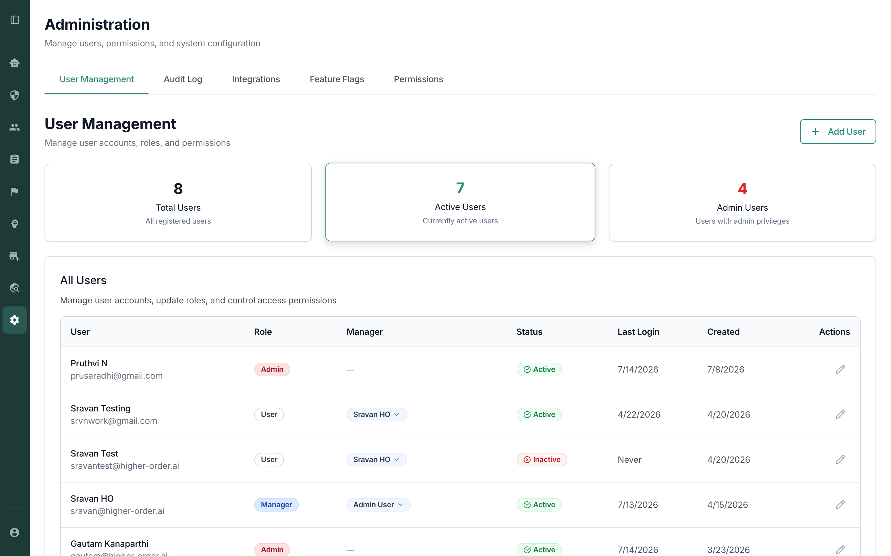
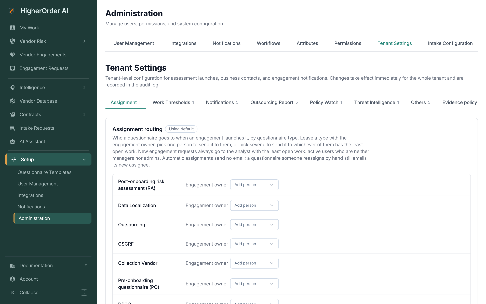
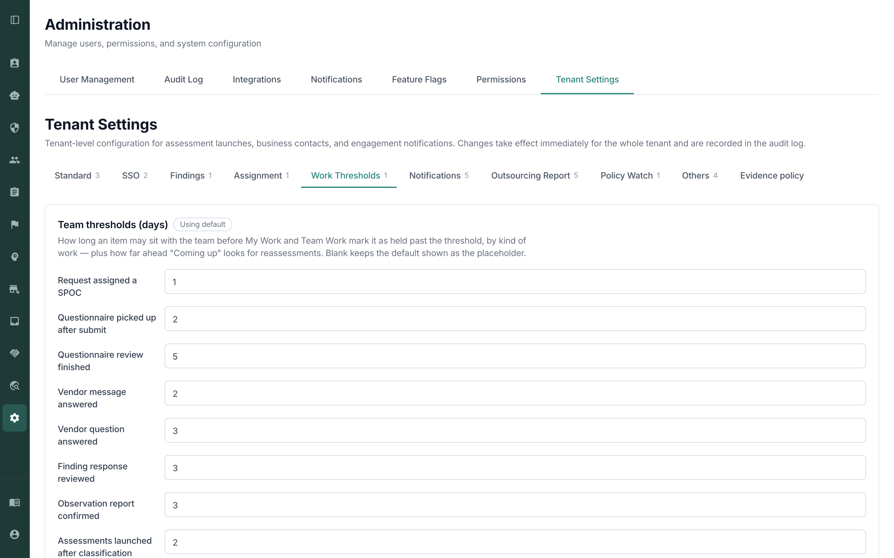
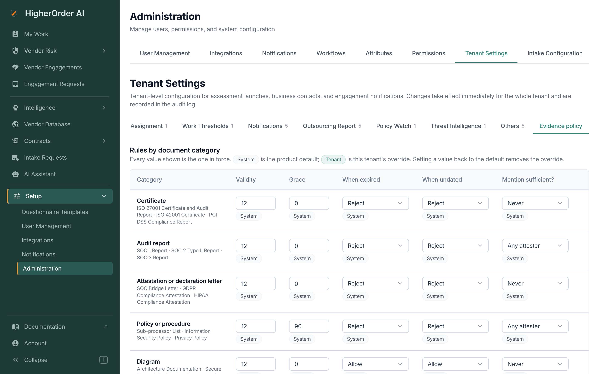

The administration surface hosts everything that configures the tenant — users and their roles, custom permissions, single sign-on, third-party integrations, notifications, engagement workflows and attributes, tenant-level settings and branding, and the audit trail. Visible to Admins only.

Each tab has its own link (`/administration?tab=…`), so a reload or the browser's Back button returns to the same tab, and the sidebar's **Setup** entries (User Management, Integrations, Notifications) open their tab directly.

## Tabs

<CardGroup cols={2}>
  <Card title="User Management" icon="users" href="#user-management">
    Add and edit users, set access level and additional roles, assign reporting manager, deactivate accounts.
  </Card>
  <Card title="Permissions" icon="shield-check" href="/administration/roles-and-permissions">
    Create custom roles, grant permissions, review role assignments.
  </Card>
  <Card title="Integrations" icon="plug" href="#integrations">
    Configure SSO, IdP / SSPM connectors (Okta, Google Workspace, Entra ID), document storage (SharePoint Online, OneDrive, Google Drive, Dropbox), and support tools (Freshdesk, Jira).
  </Card>
  <Card title="SSO" icon="key" href="/administration/sso">
    Configure OIDC-based single sign-on.
  </Card>
  <Card title="Notifications" icon="bell" href="/administration/notifications">
    Every email the platform sends — switch, recipients, cadence, preview, and the tenant-wide activity trail.
  </Card>
  <Card title="Workflows" icon="diagram-project" href="/administration/workflows">
    The tenant's engagement workflows (onboarding, offboarding) and their steps — edited as a draft, validated, then published.
  </Card>
  <Card title="Attributes" icon="tags" href="/administration/workflows">
    The attributes engagements are classified on — labels, options, and where each one is shown, filtered, and exported.
  </Card>
  <Card title="Tenant Settings" icon="sliders" href="#tenant-settings">
    Tenant-level configuration — launch mode, assignment routing, work thresholds, evidence policy, questionnaire types, outsourcing report, branding, legal entities.
  </Card>
  <Card title="Intake Configuration" icon="inbox" href="#intake-configuration">
    Who reviews and who approves vendor intake requests.
  </Card>
  <Card title="Metrics" icon="gauge" href="/sla-performance">
    The tenant's SLA and performance metric definitions — which engagements each applies to, its target, and its service window.
  </Card>
  <Card title="Audit Log" icon="list" href="#audit-log">
    Search and filter every action taken in the tenant.
  </Card>
</CardGroup>

## User Management

Add, edit, and manage users in the tenant.

<Frame>
  
</Frame>

A user carries two distinct things:

- **Access level** — User, Manager, Admin, or Auditor. Single-valued, edited in the Edit User dialog. This sets the base scope: Admin sees the full workspace, Manager sees their team's work, User sees their own work. The engagement list and engagement pages are the exception — every signed-in user can read every engagement in the tenant, whatever their access level; changing an engagement still needs the matching permission, and [My Work](/my-work) and Team Work keep their own scoping.
- **Additional roles** — any number of system or tenant custom roles (defined in [Roles & Permissions](/administration/roles-and-permissions)), granted and revoked from a **Manage roles** action directly on the user row. This is how business users get roles like Business Owner or Business Head.

### Inputs

- **User attributes.** Email, First Name, Last Name, Access level, Reporting Manager, Status (Active / Inactive / Pending). Email is read-only on edit.
- **Additional roles** — the checkbox list in Manage roles; saving replaces the user's role set.
- **Reporting Manager** — another user in the tenant. Manager assignment determines team-scoping for team-scoped roles.

### Outputs

Stats cards: **Total Users**, **Active Users**, **Admin Users**.

User table:

| Column | Meaning |
| --- | --- |
| User | Name and email |
| Role | Access level (User / Manager / Admin / Auditor) |
| Additional Roles | The user's custom/system roles |
| Manager | Reporting manager (if assigned) |
| 2FA | Whether the user has a second factor enrolled (read-only; see [Two-Factor Authentication](/administration/mfa)) |
| Status | Active / Inactive / Pending |
| Last signed in | Date of last sign-in |
| Created | Date the user was added |
| Actions | Edit · Manage roles |

## Permissions

Custom-role creation and permission grants are covered in [Roles & Permissions](/administration/roles-and-permissions). A tenant can define any number of custom roles beyond the built-ins.

Reading engagements needs no permission: the engagement list and every engagement page are open to all signed-in users in the tenant, so oversight roles such as Business Owner and Business Head need no extra grant to follow engagements across teams. Acting on an engagement still requires the relevant permission.

## Integrations

The Integrations tab is where SSO and third-party connectors live. Two categories:

### Identity and posture connectors

Connect an IdP or SSPM to receive continuous behavioral telemetry — users, apps, OAuth grants, session events. Wired into Exposure Drift Detection.

- **Okta** (OAuth)
- **Google Workspace** (OAuth)
- **Microsoft Entra ID** (OAuth)

For each, the connector uses OAuth to authorise, stores credentials in KMS, and runs on a scheduled sync. Connector health is visible in the Drift Center strip.

### Document storage and productivity connectors

- **SharePoint Online** — sync vendor documents from a SharePoint site, optionally folder-scoped, via app-only credentials
- **Dropbox** — pull evidence documents from a shared folder
- **Freshdesk** — ingest support tickets referencing vendors
- **Jira** — sync selected projects for vendor operational metrics, bring tickets in as engagement requests, and post engagement milestones back to the originating ticket as comments

See [Integrations](/administration/integrations) for setup and sync behavior.

### SSO

OIDC SSO providers (Okta, Entra ID, Google Workspace, or generic OIDC) are configured here. See [Single Sign-On](/administration/sso) for the full setup.

## Tenant Settings

A schema-driven tab for tenant-level configuration, grouped into sub-tabs. Each setting renders as its own card, saves independently, can be reset to its default, and every change lands in the audit log. Every setting the platform reads is editable here — nothing requires a change outside the UI — and a setting type this version of the app does not recognise renders read-only with a reload prompt rather than failing.

| Sub-tab | Settings |
|---|---|
| **Standard** | **Assessment launch mode** — one merged assessment per vendor (the default) or one assessment per questionnaire (see [Vendor Assessments](/vendor-risk/assessments)) · **Pre-onboarding questionnaire validity** (months) — how long a vendor's PQ covers its later engagements; blank never expires and sends no annual questionnaire · **Branding** (below) |
| **SSO** | Provider and enforcement — see [Single Sign-On](/administration/sso); **Two-factor authentication** and **Permitted second factors** — see [Two-Factor Authentication](/administration/mfa) |
| **Findings** | **Finding remediation targets** — days to remediation by criticality |
| **Assignment** | **Assignment routing** — who a questionnaire goes to at launch, by questionnaire type (below) |
| **Work Thresholds** | **Team thresholds (days)** — how long each kind of item may sit before [My Work](/my-work) marks it held, plus the *Coming up* look-ahead (screenshot below) |
| **Notifications** | **Notification teams** — named recipient groups (team key → email list) that notification rules resolve to; the **tprm** team's *first* address is the Reply-To on every mail the platform sends, so vendor replies land with the risk desk · **Portal allowed domains** — business email domains permitted for portal contacts and viewer invites; personal providers are always blocked · **Outbound email allowed domains** — when set, recipients outside the list are dropped before a mail leaves (see [Notifications](/administration/notifications)) · **Business SPOC directory** — name → email rows the [engagement request](/engagement-requests) router resolves against · **Engagement request tracker** switch |
| **Outsourcing Report** | **Outsourcing profile**, **external due-diligence provider**, **due-diligence validity / reuse window**, and **Strategic goals** with *Suggest from public sources* — see [Outsourcing Risk](/outsourcing-risk) |
| **Policy Watch** | **Policy Watch scheduled monitoring** — whether vendors' public policy documents are re-checked on a schedule (off by default). Off, documents are still captured once at vendor intake and the vendor page's Policy Watch tab keeps showing the history it has. The tab itself is not controlled here: it is shown by default and can be hidden for a tenant by HigherOrder on request. See [Policy Watch](/vendor-risk/policy-watch) |
| **Threat Intelligence** | **Our stack** — the technologies your vendors and teams run; [Threat Intelligence](/threat-intelligence) lists every threat that names one under its *Our stack* view and shows how many threats each entry matches |
| **Others** | **Questionnaire types** — the list of types a questionnaire template can be given (below), **Legal entities** — the entity list offered on the intake form, **High-risk countries**, **Standard dashboards** |
| **Evidence policy** | Document validity and attestation rules by category and type (below) |

Access is gated by a dedicated tenant-settings permission; Admins hold it by default and it can be granted to a custom role.

### Questionnaire types

Each questionnaire template carries a **Type**, chosen in the template editor. **Questionnaire types** is the tenant's list of those types: rename a type and the Assessments dashboard picker, the engagement filters, and Assignment routing follow; add a row for a type of your own. Six types the product behaves on — pre-onboarding questionnaire (PQ), post-onboarding risk assessment (RA), Data Localization, Outsourcing, Offboarding, and Other — can be relabelled but not removed, and a type still given to a questionnaire or routed to named people cannot be removed until that is changed. A questionnaire with no type counts as Other. See [Questionnaire Templates](/vendor-risk/questionnaire-templates).

### Assignment

**Assignment routing** decides who holds each questionnaire the moment an engagement launches it. One row per questionnaire type (the types come from the **Questionnaire types** setting): leave the type with the **engagement owner** (default), pick **one person**, or pick **several** — the questionnaire goes to whichever of them has the least open work (open requests owned plus questionnaires held on live runs). A stored address that is no longer an active user is shown in amber. Routing applies on every launch path — SRP auto-launch, manual launch, plan updates, post-onboarding, and additions through *Edit scope* — never blocks a launch, and sends no email; a questionnaire someone later reassigns by hand still emails its new assignee.

Engagement requests are not routed by this setting: every new request goes to the active analyst (a user with the *User* access level) with the least open work, and managers reassign from the request's triage drawer.

<Frame>
  
</Frame>

<Frame>
  
</Frame>

### Evidence policy

The **Evidence policy** sub-tab is a grid of the six document categories — certificate, audit report, attestation or declaration letter, policy or procedure, diagram, specific evidence — against five rules: **Validity** (0–24 months; 0 means valid until the document's own period end), **Grace** (0–365 days after expiry), **When expired** and **When undated** (*Allow*, *Ask vendor*, or *Reject*, plus *Only with a bridge letter* for an expired SOC 1 or SOC 2), and **Mention sufficient?** — whether a statement in a document of this category can settle a practice question on its own (*Never*, *External only*, *Any attester*). Every cell shows the value in force with a **System** or **Tenant** chip; setting a cell back to the default removes the override. Exceptions by individual document type sit beneath (built-in rows, and **Add exception** for any type), and an *Effective policy for* preview shows what a given type resolves to — tenant type over tenant category over system type over system category. One **Save** writes the whole tenant tier; a save that races another admin's is refused with a reload prompt rather than overwriting it.

The defaults, before any tenant override:

| Category | Validity | Grace | When expired / undated | Mention sufficient? |
|---|---|---|---|---|
| Certificate | 12 months | 0 days | Reject | Never |
| Audit report | 12 months | 0 days | Reject | Any attester |
| Attestation or declaration letter | 12 months | 0 days | Reject | Never |
| Policy or procedure | 12 months | 90 days | Reject | Any attester |
| Diagram | 12 months | 0 days | Allow | Never |
| Specific evidence | 12 months | 0 days | Allow | Never |

Built-in type exceptions: an expired **SOC 1** or **SOC 2** report (12 months past its audit period end) is accepted *Only with a bridge letter*; a **SOC bridge letter** has validity 0 and is rejected once its window has ended; a **BCP/DR plan** is *Any attester*.

So by default an expired or undated certificate, audit report, attestation letter, or policy is refused at upload with a message asking for a current or dated version; a tenant that prefers to be asked sets *Ask vendor* on the category or type. See [Evidence Validity](/concepts/evidence-validity) for how validity is read from a document, what the vendor and reviewer see, and how bridge letters work.

<Frame>
  
</Frame>

### Email and portal branding

The **Branding** setting carries a **wordmark** and **tagline** (rendered as live text), a **primary color** and **accent color** (hex), a **sender name** (the From display name on outbound email), and a **sender address** — the tenant's own address on the platform's signing domain, which becomes the From line on every mail the platform sends on the tenant's behalf, auth mails included. One setting drives both the notification-email header band and the Vendor Portal identity bar.

Branding is entirely optional — unset means plain email, with no fallback to HigherOrder's own colors. The branded header band appears only when both a primary color and a wordmark are set. There is deliberately no logo image: inboxes block remote images, so identity is color plus text. Severity colors on urgent mail are fixed and cannot be overridden.

## Intake Configuration

Assigns the two intake system roles. **Intake Reviewers** can move submitted vendor intake requests into review; **Intake Approvers** can approve, conditionally approve, or reject them. Add an active user to either list, or revoke one — a revoked user loses the role's permissions immediately. See [Roles & Permissions](/administration/roles-and-permissions).

## Audit Log

Every action taken in the tenant lands here.

### Inputs

- Filter selections (date range, user, action type, status)
- Free-text search

### Outputs

Stats cards: **Total Actions**, **Failed Actions**, **Unique Users**.

Audit table: **Timestamp**, **User**, **Action**, **Object type**, **Object ID**, **Details**, **Status** (success / failed).

## Limitations

- **User delete is not yet implemented.** The delete action is disabled in the User Management table; deactivate the user via the Status field instead.
- SCIM provisioning is not available — SSO users are provisioned just-in-time on first login.
- IdP group → HigherOrder role mapping is a v2 feature.
- Deleting a custom role that still has users assigned is blocked; reassign the users first.
