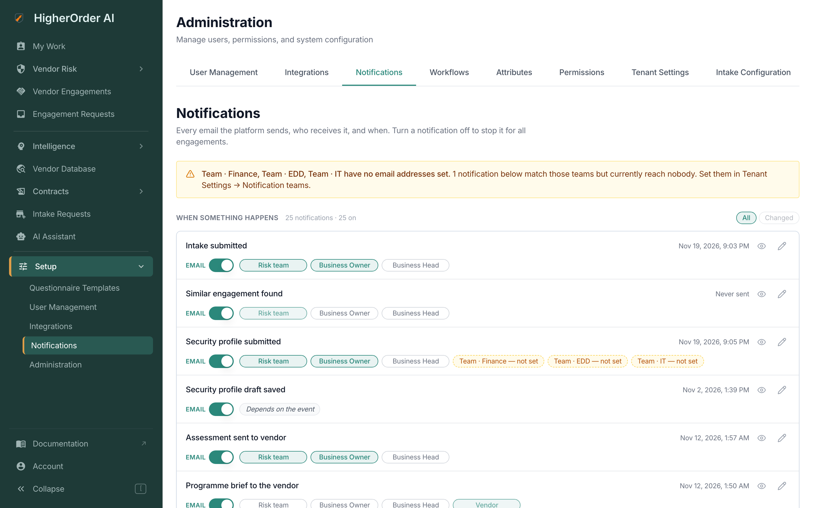
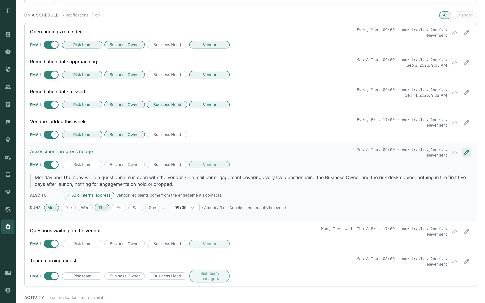
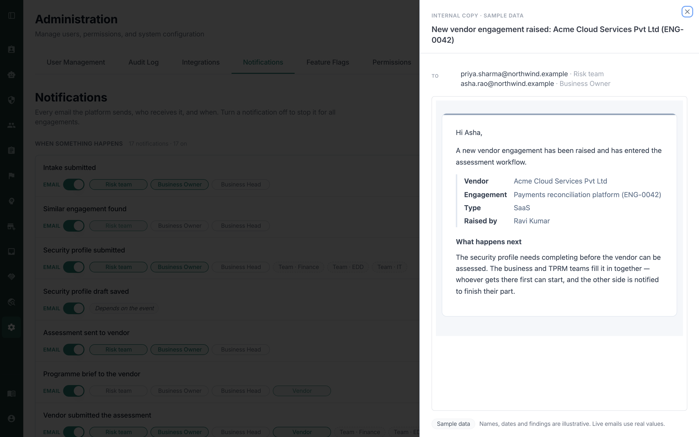

**Administration → Notifications** lists every email the platform can send on the tenant's behalf — one row per notification — and lets an admin switch each on or off, choose who receives it, change when scheduled mails go out, preview the rendered mail, and read the trail of everything actually sent. Rules that also post a comment on an engagement's Jira ticket carry a second switch for that. The shipped defaults are code; the tenant stores only its deviations, and every deviation is marked.

<Frame>
  
</Frame>

## What it does

- **One row per notification**, in two groups: *When something happens* (event-driven: intake submitted, assessment sent, vendor submitted, answer review complete, review complete, finding closed, assessment closed out, SLA report requested and submitted, …) and *On a schedule* (the progress nudge, the weekday questions email to vendors, the team morning digest, the request digests).
- **Email switch** per row. Off stops that mail for every engagement in the tenant.
- **Jira switch** beside Email, on each rule that posts a Jira comment (see [Jira comments](#jira-comments)). The two switches are independent: a rule with Email off and Jira on reads *Email off*, not *Off*.
- **Recipient pills** — one click adds or removes a role (Risk team, Business Owner, Business Head, Vendor, and the tenant's configured notification teams). A role the mail cannot address is absent rather than greyed. Roles bound to the event — the assigned reviewer, or whoever asked a question — are shown as fixed and cannot be added elsewhere.
- **Edit panel** (pencil, or click the name): the rule's note, *Also to* internal addresses, and for schedule rules a **cadence editor** — day chips and hour, shown in the tenant timezone — plus a single **Revert to default**.
- **Preview** (eye): every copy the tenant's roles would produce, as branded HTML with sample To / CC / Reply-To, with an audience switch. It is the same rendering the email trail records.
- **Changed from defaults** marking: a *Changed* tag on the row, an added recipient ringed, a removed shipped recipient struck, a switched-off ring (Email or Jira), a changed cadence highlighted, "+N address"; each group header counts how many rules differ, with an *All / Changed* filter; the panel states the difference in one sentence and names who last changed it.
- **Activity**: the engagement email trail, tenant-wide — one row per mail actually sent, with the engagement named, the same reader chips (All / Vendor / Business / Risk / Failed), twenty per page, and the rendered body in a drawer. When any rule posts Jira comments, a **Jira** chip lists each comment with its ticket key and, for a comment Jira refused, the reason; *All* includes them.

<Frame caption="A scheduled rule opened for editing: recipients, the rule's note, extra internal addresses, and the cadence in the tenant's timezone.">
  
</Frame>

<Frame caption="Preview: the internal copy of a notification rendered with sample data.">
  
</Frame>

## Rules worth knowing

- **Answer review complete — observations drafting.** Sent when the risk team presses *Close assessment* on an engagement's assessment: the vendor hears that every answer was reviewed, and the business owner and the risk team that the observations are being drafted. One mail per assessment. On by default.
- **Questions waiting on the vendor.** Every weekday at **09:00** tenant time while the risk team has asked something in the portal that the vendor has not replied to: one mail per engagement listing up to ten questions, oldest first, with the person who asked and the risk team copied. Once the oldest question has waited **3 days** the Business Owner is copied too, and from **6 days** the Business Head; an escalated mail is headed "Action needed". Approved questions are left out. The time and days are editable in the cadence editor.
- **SLA report request to the vendor.** Sent when someone requests a period's SLA figures from an engagement's SLA & Performance tab, or resends the request. It goes to the one vendor contact chosen, with a link to the report page that stays valid for 30 days. See [SLA & Performance](/sla-performance).
- **Vendor submitted an SLA report.** Sent to the risk team each time the vendor submits figures on the report page: what came in, what is still open, and the files attached.

Account emails — the password-setup code and the single sign-on welcome mail a new user receives — are not rules on this tab and cannot be switched off here. See [Single Sign-On](/administration/sso).

## Jira comments

An engagement created from an uploaded Jira ticket (see [Engagement Requests](/engagement-requests)) gets a short comment on that ticket at each milestone: intake submitted, classified, assessment sent, assessment submitted, review complete (with or without findings), extension requested and decided, and engagement completed. HigherOrder only comments — it never creates a ticket — and an engagement that did not come from an uploaded ticket gets no comment.

- Comments post when Jira is connected under [Integrations](/administration/integrations#jira); a banner on the tab says when it is not, and the Jira switches are unavailable until it is.
- Each of these rules has its own **Jira** switch, on the row and in the edit panel. The panel also shows where the comment goes, when one was last posted, and the comment rendered with sample values.
- Switching a Jira comment off is marked as a change like any other, and **Revert to default** restores both the email and the Jira settings.

## Outbound email domain policy

A tenant setting under **Tenant Settings → Notifications**, *Outbound email allowed domains*, restricts where mail can go. When set, every To, CC, and Reply-To address outside the listed domains (subdomains included, look-alikes rejected) is dropped before the mail reaches the transport; a mail left with no To is not sent. Blocked readers are recorded on the ledger as failed with the reason, so the trail shows what did not go out. Unset, nothing changes. Built for test tenants that hold real vendor contacts; a delivery banner on the Notifications tab says when the policy is in force.

## How recipients resolve

Every mail is addressed by role, and roles resolve per engagement:

- **Risk team** is the tenant's `tprm` [notification team](/administration#tenant-settings). Its first address is also the Reply-To on every mail the platform sends.
- **Business Owner** and **Business Head** are the engagement's business contacts and its accountable head.
- **Vendor** is the engagement's vendor contacts.
- Configured teams (Finance, EDD, IT, …) are the named recipient groups under Tenant Settings.

A combined mail — one template with no per-role split — goes to everyone internal on one To line, and the trail tags it against every role that read it, so filtering by *Business* shows the mails the business owner's address was on.

## Permissions

The tab is gated by a dedicated *admin.notifications.modify* permission. Admins hold it by default; it can be granted to a custom role.

## Limitations

- Email has no retry: a mail that fails to send is recorded as failed and is not re-sent.
- Roles bound to an event (assigned reviewer, question asker) are filled per mail and cannot be configured.
- Jira comments are one-way and comment-only: no ticket is created, transitioned, or edited. A comment Jira refuses (permission, missing ticket) is recorded as failed with the reason and is not retried.
