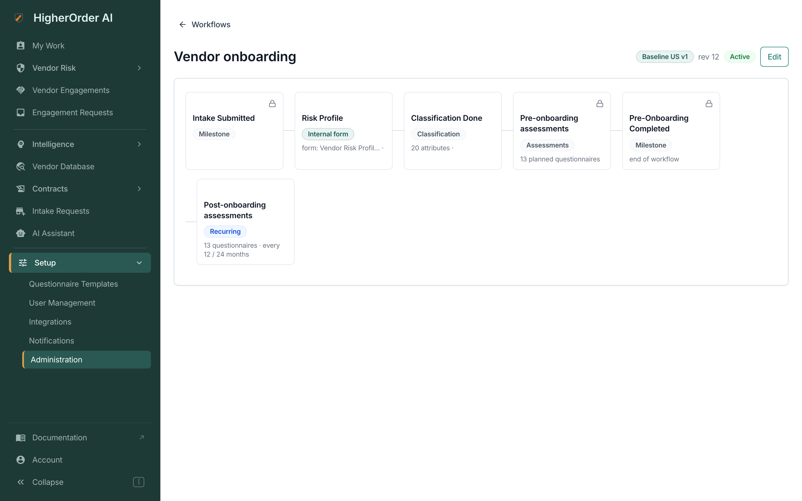
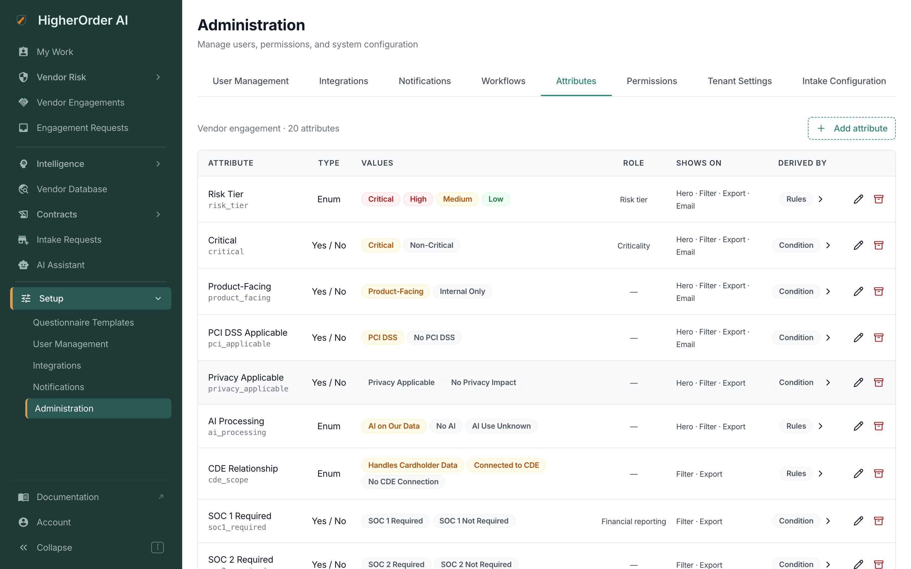

**Administration → Workflows** lists the engagement workflows the tenant runs and opens each in a designer where an administrator edits its steps in a draft, validates the draft, and publishes it. **Administration → Attributes** holds the registry of attributes engagements are classified on — their labels, values, and where they show — and the rules that derive each one from the risk profile's answers.

## What it does

- Lists each workflow with its revision, source, status, and whether a draft is open.
- Shows a workflow's live steps read-only until **Edit** opens a draft. Edits are saved to the draft as you make them and do not affect engagements until **Publish**.
- Lets an administrator add, rename, reorder, disable, and remove steps; choose the form a form step uses; set which questionnaires the Assessments step sends and when; set how often an onboarded vendor is reassessed; and add notification rules to a step.
- Edits the risk profile form — sections, questions, options, and conditional visibility — and publishes it as a new version.
- Keeps one attribute registry that the engagement header chips, filters, exports, dashboards, and the classification email read their labels from.
- Checks a draft before it goes live and refuses a publish that would break engagements in progress.

## Inputs

### The workflow list

| Column | What it shows |
|---|---|
| **Workflow** | Name and description, plus any warning on its live steps — for example a notification rule whose team has no members |
| **Applies to** | The kind of record the workflow runs on, such as *Vendor engagement* |
| **Steps** | Number of live steps |
| **Rev** | The revision. It counts publishes |
| **Source** | Where the definition came from: a HigherOrder baseline (for example *Baseline US v1*), *Imported*, or *Authored* |
| **Status** | *Active* or *Paused* |
| **Draft** | *Draft open* or *No draft* |

**Open** goes to the designer. **Pause** is offered on the onboarding workflow only: while it is paused, new intakes are refused and engagements already on the workflow carry on. **Resume** reverses it.

Workflows are installed for a tenant by HigherOrder. The list has no action to create or delete a workflow; administrators edit the ones that are there.

### The designer

The designer at `/administration/workflows/:workflowId` shows the workflow as a rail of step cards, each with its label, type, and one fact about its configuration. Selecting a card opens its editor.

<Frame caption="The workflow designer with a draft open: the step rail, the selected step's editor, and the draft bar with Discard and Validate & publish.">
  
</Frame>

Step types:

| Type | What the step does |
|---|---|
| **Milestone** | Records that the work reached this point; starts and ends a workflow |
| **Internal form** | A form your team fills in, such as the risk profile |
| **Classification** | Derives attributes (tier, category, flags) from a form's answers |
| **Assessments** | Sends the questionnaires the plan selects to the vendor and tracks them |
| **Manual gate** | Waits for a person to move the work on |
| **Sign-off** | A recorded approval that closes the stage |

With a draft open:

- **Add step** takes a label and a type and inserts the step after the selected one. The ‹ › buttons on a card move it earlier or later.
- The step editor sets the **Label**, **Type**, and **Enabled**, and **Remove step** deletes the step.
- An **Internal form** step chooses its **Form**. **Edit form →** opens the form editor.
- **Notification rules** on any step: a label, a condition, and the notification teams to notify when the condition holds. The teams are the ones configured under [Tenant Settings](/administration#tenant-settings).

Steps marked with a lock are **mandatory**: the platform depends on them. A mandatory step can be renamed, but its type cannot change and it cannot be disabled or removed. The Mandatory switch is read-only.

### The Assessments step

Selecting the Assessments step shows its **Trigger matrix** under the rail.

- **Launch policy** — whether planned questionnaires launch automatically when the step opens (always, or only when a condition holds), or the TPRM reviewer reviews the proposed plan, adjusts it, and launches. A mandatory questionnaire cannot be removed from the reviewer's proposal.
- **Onboarding plan** — the questionnaires an engagement gets. Each row names a questionnaire, whether it is **Mandatory** or optional, and a **Planned when** condition.

On the onboarding workflow, a **Post-onboarding assessments** card follows the last step. It is not a step and cannot be moved or removed. It holds:

- **Post-onboarding questionnaires** — the questionnaires offered to the reviewer when a reassessment cycle starts, each with an **Offered when** condition. A reviewer starts each cycle and confirms its scope.
- **Recurrence** — **Reassess on a schedule**. One attribute decides the interval: each rule lists some of the attribute's values and a number of months (1–120), the first matching rule wins, and **Everything else** takes the default. With the schedule off, each engagement keeps its own interval, 12 months unless set.

### Conditions

Plan rows, launch policy, notification rules, question visibility, and derivations all use the same condition builder. A condition checks a **Question** (an answer on the risk profile form) or an **Attribute** (a value in the registry) with *is any of* or *is none of*, and conditions combine in **Any of**, **All of**, and **None of** groups. An empty condition always applies.

### The form editor

**Edit form →** on an Internal form step opens the form editor at `/administration/workflows/:workflowId/forms/:formKey`. It edits a working copy of the live version, with a preview that shows conditional questions appearing as you answer.

- **Sections** — add, rename, reorder, and delete; each has a category that applies to its questions.
- **Questions** — wording, code, type (Text, Text (long), Yes / No, Select, Multi-select, Date, Number), guidance, **Required**, options, and **Show only when**, which can reference only earlier questions.
- **Publish** lists what changed against the live version and creates the next version. The steps that use the form are pointed at the new version.

A question that is already live keeps its key, its type, and the values of its live options, because submitted answers, conditions, and derivations reference them; its wording and option labels can always change. Deleting a live question or dropping a live option requires ticking **Retire these keys** in the publish dialog. A retired key is never reused.

**Edit form →** is disabled while a workflow draft is open, because publishing a form changes the live workflow. Publish or discard the draft first.

### The attribute registry

**Administration → Attributes** lists every attribute the tenant classifies engagements on: Attribute, Type, Values, Role, Shows on, and Derived by.

<Frame caption="Administration → Attributes: the registry, with one attribute expanded to its derivation and the live preview.">
  
</Frame>

**Add attribute**, or the edit action on a row, sets:

- **Key** — fixed once the attribute is created.
- **Label** and **Description**.
- **Type** — Enum, Yes / No, Text, or Score.
- **Values** — for an enum, each value with its label and tone (high, medium, or low risk; attention; neutral). For a yes/no attribute, the chip label and tone for each side; a blank label on the "false" side shows no chip.
- **Platform role** — what the platform uses the attribute for: Category, Risk tier, Criticality, Outsourcing, Materiality, Data localisation, EDD required, Financial reporting, or Team rating. A role is held by one attribute at a time.
- **Where it shows** — on the engagement header, as a filter, in exports, and in emails.

Registry changes take effect when saved. They are not part of a workflow draft.

**Retire** removes an attribute from use. Values engagements already carry stay readable, and its key cannot be reused. An attribute cannot be retired while a derivation still writes it or the reassessment rules still read it.

### Derivations

Expanding a row's **Derived by** opens the rule that sets that attribute when a risk profile is submitted. Three kinds can be authored:

- **Rules** — an ordered list of conditions, each with a value. The first rule that matches sets the value; when none matches, the default applies.
- **Condition** — a yes/no verdict: the attribute is true when the condition holds.
- **Scoring** — questions grouped into domains, each with a weight and a score per option, and bands that map the total to a value.

**Live preview** runs sample answers through the derivations and shows the resulting value and why.

Derivation edits go to the onboarding workflow's draft, not straight to live: open the workflow from the Attributes tab and publish it there. A derivation run by the platform is shown read-only. On a tenant whose workflow classifies with built-in rules, derivations are not editable in this tab.

## Outputs

- **A published revision.** Publishing replaces the workflow's live steps with the draft's and raises **Rev** by one.
- **A new form version**, used by the steps that reference the form.
- **Registry-driven labels.** The engagement header chips, the filter sheet and its chips, the export column picker, the risk card on the risk profile, the pre-onboarding coverage dialog, the Engagements dashboard, and the classification email take attribute labels from the registry. Renaming an attribute or a value there renames it in all of them.

## How it works

### Draft, validate, publish

<Steps>
  <Step title="Edit">
    **Edit** copies the live steps into a draft. A workflow has at most one draft, shared by everyone who edits it. The draft bar counts unpublished changes.
  </Step>
  <Step title="Validate & publish">
    The draft is checked and every result is listed as passed, a warning, or an error: step keys and order, one start and one terminal step, mandatory steps kept and enabled, notification teams with members, forms and questionnaires that exist, conditions that reference real questions and attributes, derivations, and recurrence rules.
  </Step>
  <Step title="Publish">
    **Publish** is available when there are no errors. Warnings do not block it.
  </Step>
</Steps>

**Discard** drops the draft and leaves the live workflow untouched. If someone else saves or publishes the draft while you are editing, the designer says so and asks you to reload; your last edit is not saved.

### Engagements already in progress

- **A published workflow applies to engagements already in progress**, not only to new ones. For that reason a step that engagements are currently on, or that holds submitted answers, cannot be removed or change type; validation reports it as an error.
- **A risk profile stays on the form version it was first saved on.** Once an engagement has saved a draft or submitted its risk profile, it keeps that version of the form for viewing, editing, resubmitting, and AI suggestions. A newer form version applies to engagements that have not yet saved one.
- **Reassessment intervals are set at fixed moments** — when an engagement is onboarded and each time a cycle closes — from the engagement's attributes at that moment. Changing the recurrence rules does not move the next-assessment date of an engagement that is already onboarded until its next cycle.
- **A questionnaire a live workflow uses is protected.** Archiving a questionnaire template, or changing its slug, is refused while an enabled step of any workflow names it; the message names the workflow and step. Update the plan and publish first.

## Permissions

Workflows, the designer, the form editor, and Attributes need the *Configure engagement workflow* permission (`engagement.admin`). Admins hold it by default; it can be granted to a custom role under [Roles and Permissions](/administration/roles-and-permissions). Without it, the tabs show a message that the permission is needed instead of their content.

## Limitations

- Workflows cannot be created, deleted, or copied in Administration. HigherOrder installs them per tenant.
- Only the onboarding workflow can be paused, and only it carries post-onboarding questionnaires and recurrence.
- Mandatory steps cannot be disabled, removed, or re-typed, and a new step cannot be made mandatory.
- An engagement that has saved its risk profile never moves to a newer form version; there is no upgrade path. New questions reach only engagements that have not saved one yet.
- Form edits are held on the page until published. There is no saved form draft, so leaving the editor discards unpublished changes.
- The template guard reads live workflows, not open drafts. A draft that names a questionnaire archived in the meantime publishes with a warning, and launches of that questionnaire fail until a live template exists.
- An attribute's position among the engagement header chips is not editable in the registry.
- A draft is a single shared document: two administrators editing the same workflow work in the same draft, and the second save is refused until that administrator reloads.
