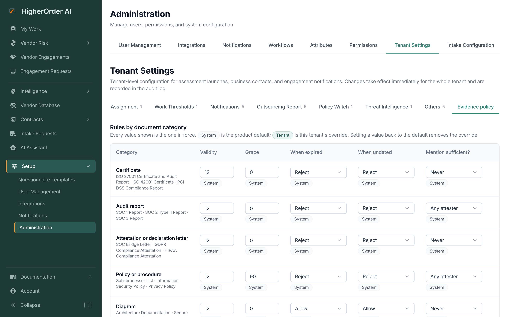
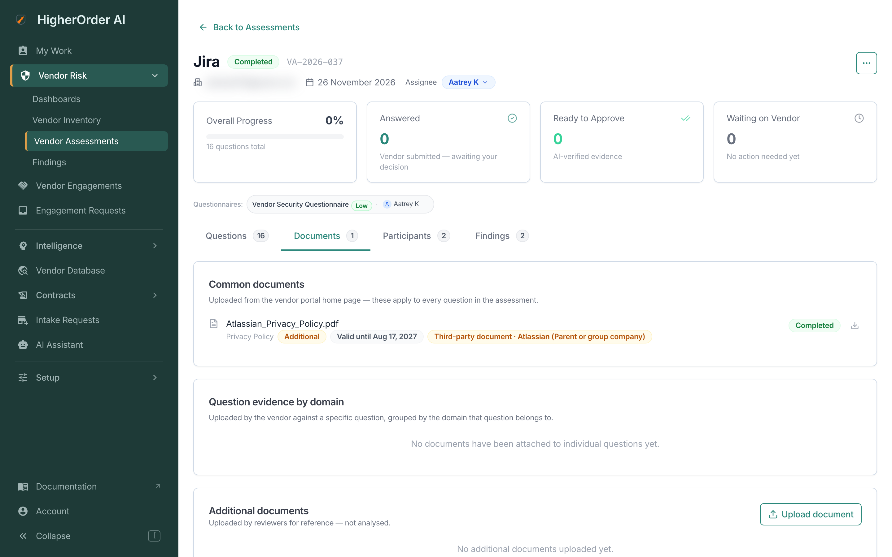

Every document a vendor supplies carries a validity read from its own dates — *Valid until*, *Grace until*, *Expired*, *Bridged until*, or *Undated* — and the tenant's **Evidence policy** decides what happens to one that is out of date: accepted, put to the vendor, or refused at upload.

## What it does

- Reads the dates printed in each document and computes a **valid until** date from them. Upload date plays no part.
- Applies the tenant's Evidence policy per document category and per document type: how many months a document stays current, how many days of grace follow, and what happens to an expired or undated one.
- Refuses an expired or undated certificate, audit report, attestation letter, or policy at upload by default, with a message that says what to upload instead.
- Accepts an expired SOC 1 or SOC 2 report only while one of the vendor's **bridge letters** is current.
- Holds an answer that rests only on an expired document under **Needs review**, and releases it without anyone acting once a current document arrives.
- Shows the same validity state to the vendor in the portal and to the reviewer on the assessment.

## Inputs

- **The document's own dates** — read from its text when it is uploaded.
- **The document's type and category** — decided by the classifier from the document's content (see [The classifier decides the type](#the-classifier-decides-the-type)).
- **The tenant's Evidence policy** — Administration → Tenant Settings → **Evidence policy**. See [Administration](/administration#evidence-policy).
- **The vendor's bridge letters**, for SOC 1 and SOC 2 reports.
- **The assessment's evaluation mode**, which decides whether an expired document can hold an answer (see [Evaluation modes](#evaluation-modes)).

## Outputs

| State | Meaning |
|---|---|
| **Valid until** *date* | Current. The date is the document's printed expiry, or its own date plus the policy's validity months |
| **Grace until** *date* | Past its valid-until date but inside the policy's grace days. Still accepted until the date shown |
| **Expired** *date* | Past its valid-until date and any grace |
| **Bridged until** *date* | An expired SOC 1 or SOC 2 report kept current by a bridge letter that ends on the date shown |
| **Undated** | No usable date could be read from the document |
| **Date disputed** | Reviewer-side only. A later analysis of the document read a date that contradicts the confirmed one and would make it expired |

Questionnaires and contracts are outside the Evidence policy and carry no validity state. The same is true of a document whose category could not be established.

## How a document's dates are read

When a document is uploaded, the platform reads up to six dates from its text: issue date, an "as of" or "reviewed on" date, the start and end of an audit period or test window, a printed expiry, and a policy's revision or effective date.

The **valid until** date is then worked out in this order:

1. **A printed expiry**, when the document states one — a certificate's expiry date, for example. The policy's validity months are not added.
2. Otherwise the first of these that was read, **plus the policy's validity months**: the period end, the "as of" date, the issue date, the revision date.

For a SOC report this means the clock starts at the **end of the audit period**, not at the date the report was issued. For a policy it starts at the policy's own revision or effective date.

A document is **Expired** once today is past its valid-until date plus the policy's grace days. It is **Undated** when neither a printed expiry nor any of the four anchor dates could be read.

Several rules keep a wrong date out:

- **A date must be quotable.** A date is kept only when the passage it came from is found in the document's text. A date that cannot be traced to the text is dropped.
- **Watermark and stamp dates are ignored.** A date printed with a time of day (`2026-09-15 11:10:45`) is treated as a data-room watermark, a download footer, or an export stamp. So is a date on a line that repeats three or more times through the document, such as a per-page header or footer. Neither is used as the document's date.
- **Implausible dates are dropped.** Years before 2000 are dropped, and so are issue, "as of", and period dates that lie in the future. A printed expiry may be in the future. A bridge letter's period may also end in the future, because it is the window the letter covers.
- **Partial dates round forward.** A month-only date counts as the last day of that month. A year-only date counts as 31 December of that year.

Status is computed each time the document is shown, from the stored valid-until date and the policy in force. It is never stored, so a document moves from *Valid until* to *Grace until* to *Expired* on the day it happens.

## The Evidence policy grid

The policy is a grid of six document categories against five rules, with exceptions by individual document type beneath it.

| Rule | Values | Meaning |
|---|---|---|
| **Validity** | 0–24 months | How long a document stays current when it prints no expiry, counted from its own date. **0** means valid until the document's own date or period end, with no extra months |
| **Grace** | 0–365 days | Days past the valid-until date before the document counts as expired |
| **When expired** | Allow · Ask vendor · Reject · Only with a bridge letter | What happens to an expired upload. *Only with a bridge letter* is offered on the SOC 1 and SOC 2 type rows only |
| **When undated** | Allow · Ask vendor · Reject | What happens to an upload with no readable date |
| **Mention sufficient?** | Never · External only · Any attester | Whether a statement in a document of this kind can settle a practice question on its own in the audited-report evaluation modes |

- **Allow** attaches the document. Its validity state is still shown, and an expired one can still hold an answer for review.
- **Ask vendor** holds the upload and shows the vendor the validity card described under [What the vendor sees](#what-the-vendor-sees).
- **Reject** refuses the upload. The vendor must supply a current or dated version.

### Current defaults

These are the values in force for a tenant that has saved no overrides.

| Category | Validity | Grace | When expired | When undated | Mention sufficient? |
|---|---|---|---|---|---|
| **Certificate** | 12 months | 0 days | Reject | Reject | Never |
| **Audit report** | 12 months | 0 days | Reject | Reject | Any attester |
| **Attestation or declaration letter** | 12 months | 0 days | Reject | Reject | Never |
| **Policy or procedure** | 12 months | 90 days | Reject | Reject | Any attester |
| **Diagram** | 12 months | 0 days | Allow | Allow | Never |
| **Specific evidence** (a screenshot, email, record, deck, or note offered for one control) | 12 months | 0 days | Allow | Allow | Never |

Built-in exceptions by document type:

| Document type | Exception |
|---|---|
| **SOC 1 Report**, **SOC 2 Type II Report** | When expired: **Only with a bridge letter**. Validity stays at the audit-report value, so a report is current for 12 months from its audit period end |
| **SOC Bridge Letter** | Validity **0** — current until the end of the period the letter covers. When expired: **Reject** |
| **Business Continuity and Disaster Recovery Report** | Mention sufficient: **Any attester** |

A SOC 3 report has no exception of its own: it follows the Audit report row and cannot be extended by a bridge letter.

<Note>
These defaults took effect on 12 October 2026. Before that date, expired and undated certificates, audit reports, and attestation letters defaulted to *Ask vendor*, policies defaulted to *Allow* with 30 days of grace, and a SOC report was current only until its audit period end. The [September 2026 changelog](/changelog/2026-09) describes that earlier behaviour.
</Note>

### How overrides resolve

Each rule is resolved on its own, most specific first: the tenant's row for the document type, then the tenant's row for the category, then the built-in type exception, then the built-in category default.

<Warning>
A tenant override on a category outranks a built-in type exception. Setting **When expired** on the Audit report category row replaces the bridge-letter rule for SOC 1 and SOC 2 reports unless those type rows are also set.
</Warning>

Changing a **Validity** value re-dates the documents already on file whose valid-until date was computed from the previous months. A document with a printed expiry is not re-dated.

<Frame caption="Administration → Tenant Settings → Evidence policy: each cell shows the value in force and whether it is the System default or a Tenant override.">
  
</Frame>

## What the vendor sees

Each document row in the portal carries its validity state: **Valid until**, **Grace until**, **Expired**, **Bridged until**, or **Undated**.

**When the policy is Reject** (the default for certificates, audit reports, attestation letters, and policies), the upload is refused with a message that names the document and what to do:

- An expired document: "*type* expired *date*. It is not accepted under this questionnaire's evidence policy — please upload a current version."
- An undated document: "*type* carries no date we could read. It is not accepted under this questionnaire's evidence policy — please upload a version that shows its date (issue, revision or effective date)."

**When the policy is Ask vendor**, the upload is held before it attaches to the assessment and the vendor gets a card. For an expired document the card is titled **This document looks out of date** and quotes the date that was read. For an undated one it is titled **We couldn't find a date in this document**. The options are:

| Option | Offered when | Effect |
|---|---|---|
| **Upload a newer version** | Always | Removes the held file. The vendor uploads its replacement on the same row |
| **Use this document anyway** | Always, except on a bridge letter | Requires a written reason of at least 20 characters. The document attaches and stays expired; the reviewer sees the reason beside it |
| **The date is wrong** | Only when no date could be read | The vendor enters the date and says which date it is. The platform looks for that date in the document's text |

A date that was read from the document and found to be past cannot be corrected by the vendor. The only answers are a newer version or proceeding with the document as it is.

When the vendor supplies a date and the platform finds it in the document, the document proceeds as current. When it does not find it, the document still attaches but counts as expired until a reviewer confirms the date, and the row reads "Date supplied by you · awaiting the reviewer". Every option accepts an optional note of up to 500 characters.

A held upload the vendor never answers is removed when the questionnaire is submitted.

## What the reviewer sees

- **Validity chips** on the assessment's Documents tab, on question evidence, and in the review workbench. *Valid until* and *Bridged until* are grey. *Grace until*, *Expired*, and *Date disputed* are amber. The grace chip's tooltip gives the date the document lapsed.
- **The vendor's statement** beside the document: the reason given for *Use this document anyway*, or the date the vendor supplied and whether it was found in the document.
- **Confirm the vendor's date** and **Return to vendor**, on a document whose supplied date was not found in its text:
  - *Confirm the vendor's date* makes the supplied date the document's date. The document counts as current from then on, and answers it was holding are restored.
  - *Return to vendor* opens a dialog that names the file and takes a note of up to 500 characters. The vendor sees the card again with the note. The document stays on the assessment meanwhile, so questions can still be approved by hand.

<Frame caption="The assessment's Documents tab: each document's own type and its validity state.">
  
</Frame>

### The hold, and how it lifts

An answer the agent verified is moved to **Needs review** when the evidence it rests on is expired or disputed and no current document supports the same answer strongly enough on its own. The row gives the reason — "Rests on *file*, which expired *date*" — the expired document is added to the answer's gaps, and the answer is left out of bulk approval. The answer's score and reasoning are not changed, and the reviewer can still approve it by hand.

The hold lifts without a reviewer acting when:

- a current document that supports the answer is uploaded and evaluated,
- the reviewer confirms the vendor's supplied date, or
- the vendor supplies a date that the platform finds in the document.

Three cases are never held:

- A document in grace, a bridged SOC report, or an undated document that the policy allowed.
- A suggested answer the vendor confirms on a yes/no, single-select, or multi-select question, even when the report the suggestion came from has since expired.
- An answer that is judged on the answer itself and not on evidence (see [Evaluation modes](#evaluation-modes)).

Approving a question also releases any upload still held on that question for its date.

## SOC bridge letters

A SOC 1 or SOC 2 report is current for 12 months from the end of its audit period. After that, under the default policy, it is accepted only while one of the vendor's bridge letters has not ended.

- **A letter counts while its end date is today or later.** Its start date, and any gap between the report's period and the letter's, do not matter.
- **Any of the vendor's bridge letters counts**, wherever it was uploaded. When there are several, the one that runs longest is used.
- **Order matters for the vendor.** In the portal, an empty or expired SOC 1 or SOC 2 row reads "Audit period ended? Upload its bridge letter first, then the report." and offers **Upload bridge letter**.
- **A covered report reads "Bridged until *date*"**, with "Audit period ended *date* · kept current by *letter*" beneath it on both the portal and the reviewer's document rows. A bridged report is not treated as expired, so answers resting on it are not held.
- **A bridge letter is kept on file but never matched to questions.** Its row reads "Keeps your SOC report current — not matched to questions".
- **A letter whose period has ended is always refused**, whatever the tenant has set for attestation letters, and *Use this document anyway* is never offered on a bridge letter.

When neither a current report nor a current letter is on file, the upload is refused with a message that gives the report's audit period end and, where a letter was found but has ended, the letter's end date.

A tenant that prefers to accept an expired SOC report on the vendor's explanation sets **Ask vendor** on the SOC 1 and SOC 2 rows.

## PCI DSS Attestation of Compliance

A PCI DSS Attestation of Compliance states a result per requirement and does not describe practices, so its text alone answers few questionnaire questions. For a **PCI DSS v4.x service-provider Attestation of Compliance for a Report on Compliance** whose overall result is Compliant, the platform reads the attestation once and expands it into one line per PCI DSS sub-requirement — *In Place*, or *Not Applicable* with the assessor's stated reason. Sub-requirements the assessor marked Not Tested are left out. Questions are then evaluated against that expanded text.

- Evaluation of the assessment waits until the attestation has been read.
- The attestation is classified as an **audit report**, so the Audit report row of the Evidence policy applies to it. A vendor's Self-Assessment Questionnaire is classified as an attestation letter, and a PCI DSS Certificate of Compliance as a certificate.
- An attestation that is not confirmed as Compliant keeps its original text and is marked as such. Nothing is shown as In Place that the attestation did not state.

## Expected Documents on a template

A questionnaire template's **Expected Documents** tab lists the documents the vendor portal suggests uploading. It is guidance only:

- Nothing on the list is required, and no validity is set there. Validity comes only from the tenant's Evidence policy.
- New templates start with four entries — SOC 2 Type II, Privacy Policy, VAPT Report, Policy Documents. Any can be deleted, and **Remove all** empties the list.
- With an empty list, the vendor is not asked for any specific document and sees only **Add Document**.

See [Questionnaire Templates](/vendor-risk/questionnaire-templates).

## The classifier decides the type

The document type the platform reads from an uploaded document — not the row or slot the vendor filed it under — decides how the document is named, which analysis runs on it, and which Evidence policy row applies. The slot records only what was asked for.

- A SOC 2 report filed under an architecture slot is analysed and held to the policy as a SOC 2 report.
- A policy filed under the SOC 2 slot is treated as a policy and is not analysed as a SOC 2 report.
- Reviewer and portal document rows show the document's own type.

Where the classifier cannot tell what a document is, the type of the slot it was filed under stands.

## Evaluation modes

The upload-time rules — refuse, ask, bridge — depend on the Evidence policy and apply the same way in every evaluation mode. The mode changes two things: which documents can settle a question by a statement alone, and whether an expired document can hold an answer.

| Mode | Interaction with validity |
|---|---|
| **Evidence required** | An answer resting only on an expired document is held under Needs review |
| **Answers sufficient** | The answer is the verdict. Answers are not held for a document's date |
| **Audited reports sufficient** | A specific statement in a document whose *Mention sufficient?* is anything but *Never* can settle a practice question — by default every audit-report type and every policy type. Validity does not decide which documents are accepted this way: an expired accepted document is still read, and the answer resting on it is then held. A yes/no or select question with an authored expected answer is judged on the answer and is not held |
| **Answers or audit reports accepted** | As above, and a text question with an authored expected answer is also judged on the answer, so it is not held for a document's date. A question whose expected answer demands a document is still judged on evidence |

See [Questionnaire Templates](/vendor-risk/questionnaire-templates#evidence-policy-evaluation-mode) for how a mode is chosen.

## Documents that arrive without a person

A document fetched from a trust center or a public URL, or synced from SharePoint, OneDrive, Google Drive, or a CRM, has no one to ask. For these sources **Ask vendor** behaves as **Reject**: an expired or undated document is not accepted, and the documents list gives the reason.

## Limitations

- **Bridge letters extend SOC 1 and SOC 2 reports only.** SOC 3 reports and every other document type cannot be bridged.
- **A lapsing bridge letter is not re-checked on a schedule.** The report's chip changes to *Expired* on the day the letter ends, but answers already verified against it are held only when the assessment is next evaluated.
- **An undated document cannot be bridged or put into grace.** It has no date to count from.
- **A document already in use is not put to the vendor again.** When the vendor re-sends a file that is already attached to an assessment, no card is shown under *Ask vendor*; its expiry still shows on the chips and can still hold answers. Under *Reject* the re-sent file is refused on the new assessment, and the other assessment keeps its copy.
- **Classification applies to new uploads.** Documents uploaded before the classifier decided the type keep the type they were filed under.
- **PCI DSS expansion is narrow.** Only a v4.x service-provider Attestation of Compliance for a Report on Compliance is expanded, and only from a PDF of 15 MB or less. Merchant attestations, v3.2.1 attestations, Self-Assessment Questionnaires, certificates, and full Reports on Compliance keep their original text. An attestation uploaded before this capability existed is expanded only when it is uploaded again.
- **Expected Documents cannot make a document mandatory.** There is no per-template validity and no required flag.
- **The attester does not gate uploads.** *Mention sufficient?* affects only which documents a statement can be accepted from in the audited-report modes. In those modes *External only* and *Any attester* currently behave the same.
