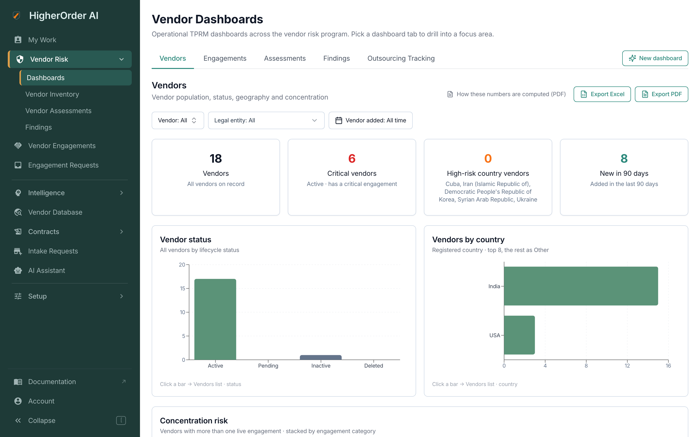

**Vendor Dashboards** is the programme's reporting surface: five standard dashboards over vendors, engagements, assessments, findings, and outsourcing tracking, on one shared filter bar. Every bar, slice, and KPI is a link — clicking it opens the Engagements, Vendors, or Findings list carrying exactly the filters that produced the number, so a dashboard figure always equals its landing list's row count.

<Frame>
  
</Frame>

## The standard dashboards

| Dashboard | What it reports |
|---|---|
| **Vendors** | Tiles for vendors on record, critical vendors (active vendors with a critical engagement — the same rule as the [Vendor Inventory](/vendor-risk/inventory#criticality)), high-risk-country vendors (the country list from Tenant Settings), and new in 90 days; **Vendor status** (all vendors by lifecycle status), **Vendors by country**, and **Concentration risk** — vendors with more than one live engagement, stacked by engagement category |
| **Engagements** | **Engagement category** and **SRP tier** (classifier output on live engagements; the tier chart is titled after the tenant's risk-tier attribute, so a renamed attribute renames the chart), **Engagements by legal entity** (consuming entity × disposition), **Pre-questionnaire rating** and **Risk assessment rating** (latest completed run per engagement), and **Renewals by month** — live Category 1 engagements by the month their next assessment falls due, twelve months out |
| **Assessments** | A searchable, multi-select **Questionnaires** picker narrows every tile and chart to one or several questionnaire types. The default view covers every type except Outsourcing and Data Localization, and the tiles say so ("All except …"). Tiles for total, open, and completed assessments, and **Overdue questionnaires** — questionnaires past their own due date and still open, with the number of engagements they sit on. **Assessments by status**, **Started by month and status**, **Risk rating**, **Category 2 with a risk assessment**, and the by-assessor charts — **Completed by month and assessor**, **Questionnaire owners**, **Overdue by due month**, **Started by month and assessor**, **Cycle time** (days from sent to completed) — which count questionnaires under their own owner, so a merged run with several questionnaires credits each to the person holding it |
| **Findings** | A grouping chart switched between **Assessor**, **Assessment** (the assessment that raised the findings, by status, top twelve), and **Legal entity**; **Severity**, **Open findings by vendor** (top twelve, new vs existing engagement), **Ageing by vendor** (stacked by ageing bucket), **Finding ageing** (days open or days to close), and **Overdue by due month** (open and past the remediation date, stacked by severity) |
| **Outsourcing Tracking** | Engagements classified as outsourcing under either regime (RBI or UAE): their external DD report status, the outsourcing questionnaire's progress, and the outsourcing report's ratings |

### Filters and drill-through

The filter bar (vendor, legal entity, date range, and per-dashboard extras) applies to every chart on the page. Drilling into a chart opens the matching list with the same filters as chips, and the list shows **Back to *X* dashboard** so you can return. On the Assessments dashboard, a drill carries the questionnaire selection the tiles counted, and a bar in an owner chart lands on exactly the engagements it counted. The **Overdue questionnaires** tile counts questionnaires but opens the engagements they sit on, so the list can be shorter than the tile's number — the tile states both. On the Findings dashboard, a segment of the **Assessment** grouping opens the findings list filtered to that assessment.

### Export and methodology

**Export Excel** and **Export PDF** in the page header export the dashboard's tables and charts. **How these numbers are computed (PDF)** opens the methodology document: the definition behind every tile and chart, including how a run is assigned to a questionnaire type and how an owner is resolved.

## Custom dashboards

**New dashboard** builds a dashboard from a natural-language prompt. The request compiles once to a saved, deterministic chart specification; viewing the dashboard later re-runs the query, not the model.

## Configuration

Three tenant settings shape the dashboards (Administration → Tenant Settings → Others):

- **Standard dashboards** — which of the five are shown, as tabs in the order above
- **Questionnaire types** — the tenant's list of questionnaire types. Each questionnaire template is given its **Type** in the template editor, and the Assessments picker groups by it; a template with no type is reported as *Other*. Renaming a type here renames it on the dashboards. The same types drive [assignment routing](/administration#assignment) and the engagement list's PQ / RA columns. See [Administration](/administration#questionnaire-types)
- **High-risk countries** — the list behind the *High-risk country vendors* tile

## Limitations

- Numbers are computed at view time over the current data; there is no historical snapshotting of a dashboard.
- The engagement list that a drill-through lands on loads its full projection; on very large tenants this is slower than the dashboard itself.
- The Regulatory Compliance tab was retired in November 2026 along with the vendor tier it was based on; a saved custom dashboard that groups vendors by tier shows an error banner and needs rebuilding.
