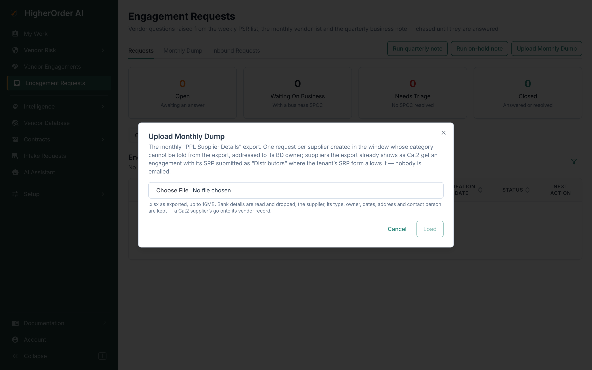

**Engagement Requests** is the front of the funnel for a programme that learns about new vendors from outside the platform: a weekly PSR list, new-vendor mail, a Jira ticket, a quarterly business note, or the monthly supplier export from the ERP. Each signal becomes a request — *does this supplier need an engagement, and who owns the answer?* — that is assigned to a TPRM analyst, routed to a business SPOC, chased on a cadence, and closed either by opening an engagement or by a recorded decision that none is needed.

<Frame caption="The tracker: status tiles, the Requests / Monthly Dump / Inbound Requests tabs, and the monthly supplier-list upload.">
  
</Frame>

## What it does

- Reads inbound mail on the tenant's intake alias — PSR notifications and new-vendor mail — and raises one request per supplier, matched against the vendor inventory.
- Reads Jira tickets — uploaded as an export, or fetched daily from the connected Jira projects — through the same pipeline, and creates the engagement itself when a fetched ticket carries every detail.
- Raises requests from the **Monthly Dump** — the month's supplier list — and onboards the suppliers that need no question as Category 2 engagements with nobody emailed.
- Runs the quarterly business note and the on-hold note sweeps from the page header.
- Assigns every new request a **TPRM owner** automatically — the active analyst with the least open work — and lets managers reassign from the triage drawer.
- Routes each request to a **business SPOC** from the tenant's SPOC directory, chases on a follow-up cadence, and escalates when nobody answers.
- Closes a request against the engagement that answers it, and keeps the full trail on the request.

## The list

Three top-level tabs: **Requests**, **Monthly Dump**, and **Inbound Requests**.

**Requests** carries the tiles (Open, Waiting on Business, Needs Triage, Closed) and the queue, filterable by status — *Open, Waiting on business, Waiting on TPRM, Triage, Stalled, Closed, All* — and by TPRM owner (*All owners, Mine, Unassigned*, or a person with their open-work count). Columns: vendor / engagement, source (*PSR (weekly)*, *New vendor mail*, *Monthly Dump*, *Quarterly note*), reference (a PSR requirement or a supplier number), business SPOC, TPRM owner, follow-ups sent, creation date with age beneath, status, and next action. *All* is ordered newest first; every other tab keeps the triage order, most-chased first. A request the system closed reads *Nobody asked* in the SPOC cell — it owes nobody an assignment.

Opening a row shows the triage drawer: the request's facts, the SPOC picker, the **TPRM Owner** picker (analysts first with their open work, then managers and admins; a hint says whether the owner was set automatically or reassigned, and by whom), the follow-up history, and the activity trail.

**Monthly Dump** shows what each monthly upload did: the engagements it created (vendor and engagement linked), with the supplier's **Created in EBS** date beside the record's creation date here, and the upload runs — file, window, rows, and what each produced — collapsed beneath as the audit trail.

**Inbound Requests** is the log of every email the intake alias received and every Jira ticket uploaded or fetched, and what the tracker did with each. Open a row to see where it stopped.

## Inbound requests

Mail reaches the tracker on the intake alias. A new-vendor thread is recognised whether the risk team started it or the business did ("please initiate the process for this vendor"), and a vendor domain or engagement name is kept only when the mail itself states it.

**Upload** on the Inbound Requests tab takes a file by hand. The dialog starts with *What are you uploading?*:

- **Email** — a saved thread as `.eml`, PDF, or text. `.eml` is preferred: it keeps the real dates and sender, and is decoded the same way as mail received on the alias.
- **Jira ticket** — a ticket export from Jira's Export menu, as XML, Excel, or Word. An export with no issue key is refused. The preview shows the issue key, the comments found, the reporter, and the created date, and warns when a Word export could not separate the comments. Re-uploading a ticket with new comments extends the existing request instead of raising a new one; XML and Excel keep each comment's author and date, so they extend most reliably.

Uploaded rows are badged *Uploaded* or *Jira ticket* in the log.

### Daily Jira ticket fetch

Once a day, tickets created or changed in the past week in the projects ticked in the Jira dialog under [Integrations](/administration/integrations) become inbound requests, labelled *Jira (daily fetch)* in the log. What happens next depends on the ticket:

- A ticket with every detail the intake form needs **creates its engagement automatically**, with the Jira key stamped on the engagement. It is owned by the administrator who connected Jira until reassigned, and the request closes as answered by that engagement.
- A ticket with something missing stays an **open request** for a person to complete.
- A ticket that duplicates or overlaps an engagement the vendor already has is **held for TPRM**.

A ticket already brought in — by fetch or by upload — is not fetched again until it changes. The Jira dialog shows the connected site and a **Ticket Fetch** line with the last run, how many tickets it brought in, or why it failed.

<Note>
The daily fetch is off until it is enabled for your deployment, and it follows the **Engagement request tracker** switch. A Jira connection made before the fetch existed has to be disconnected and reconnected once.
</Note>

An engagement created from a Jira ticket reports its milestones back to the ticket as comments — see [Engagements](/engagements#jira-ticket-updates).

## Monthly Dump

**Upload Monthly Dump** takes the month's supplier export. Nothing is written until you commit; the preview and the upload are the same run with dry-run flipped, so the preview promises exactly what the upload will do:

<Steps>
  <Step title="Choose the export and the window">
    The window defaults to last month and is editable. Editing the dates makes the preview stale, and nothing can be raised or reported until it catches up.
  </Step>
  <Step title="Read the preview">
    Three counts — suppliers whose BD owner will be emailed the PSR question · suppliers that onboard silently as Category 2 (engagement plus SRP, and how many get a vendor record only) · owners the tracker cannot mail, which go to Triage. Then what is **held back** with nothing written: an inactive vendor, two suppliers sharing one name, an earlier upload's unfinished intake, a simplified-name match awaiting confirmation. And suppliers that **changed side** since an earlier upload — "3 open requests will be closed — those suppliers are Cat 2 now, so the engagement answers them."
  </Step>
  <Step title="Download the row-by-row check">
    An Excel workbook — Summary, All suppliers, To email, Cat 2 entries, Needs attention — with a sentence per row explaining the rule that placed it.
  </Step>
  <Step title="Commit">
    Requests are raised, Category 2 engagements are created with their SRP submitted as the standard profile, and auto-onboarded suppliers are recorded as requests closed by the system in the same act.
  </Step>
</Steps>

The sort is a rule tree, in order: excluded supplier types first, then the Category 2 rules (supplier type, tax organisation, business unit), then the types that are asked; anything the tree does not name is asked *and* flagged so an unrecognised type surfaces instead of being guessed at. One supplier number maps to one engagement, forever: a re-upload creates nothing twice, and a row with no supplier number is skipped and counted rather than minting a fresh record every month.

<Warning>
Category 2 auto-onboarding is silent by design — no invitation, no brief, no annual scan. A Category 2 engagement a person builds through the wizard is still swept and chased normally.
</Warning>

## Automatic assignment

Every new request, from any source, is assigned to the active analyst with the least open work (open requests owned plus questionnaires held on live runs). The write is guarded on "still no owner", so a manual choice always wins, and automatic assignments send no email. The same open-work measure balances questionnaire routing under **Tenant Settings → Assignment** — see [Administration](/administration#assignment).

## Configuration

- **Engagement request tracker** switch (Tenant Settings → Notifications) — off, the mail and Jira ticket workers skip every inbound message and the Monthly Dump upload is refused. Turning it back on does not reprocess mail that arrived while it was off. The same card carries the follow-up cadence: send window, escalation, and the maximum number of follow-ups.
- **Business SPOC directory** (Tenant Settings → Notifications) — name → email rows the router resolves SPOCs from.
- The request digests are governed under [Notifications](/administration/notifications).

## Permissions

Viewing the tracker needs *engagement_request.view*; running sweeps, uploading the Monthly Dump, an email, or a Jira ticket, triaging, and reassigning need *engagement_request.manage*.

## Limitations

- The analyst pool for automatic assignment is every active user with the *User* access level; managers and admins are excluded.
- A Jira export that holds several issues is read for the first issue only, and the preview says so.
- The Monthly Dump rule tree and the Category 2 SRP profile are tenant-specific configuration; a tenant whose SRP form does not fit the standard profile gets a vendor record only for those suppliers, and the preview says so.
- A supplier held back for a person is never recorded as a request until a person looks at it.
