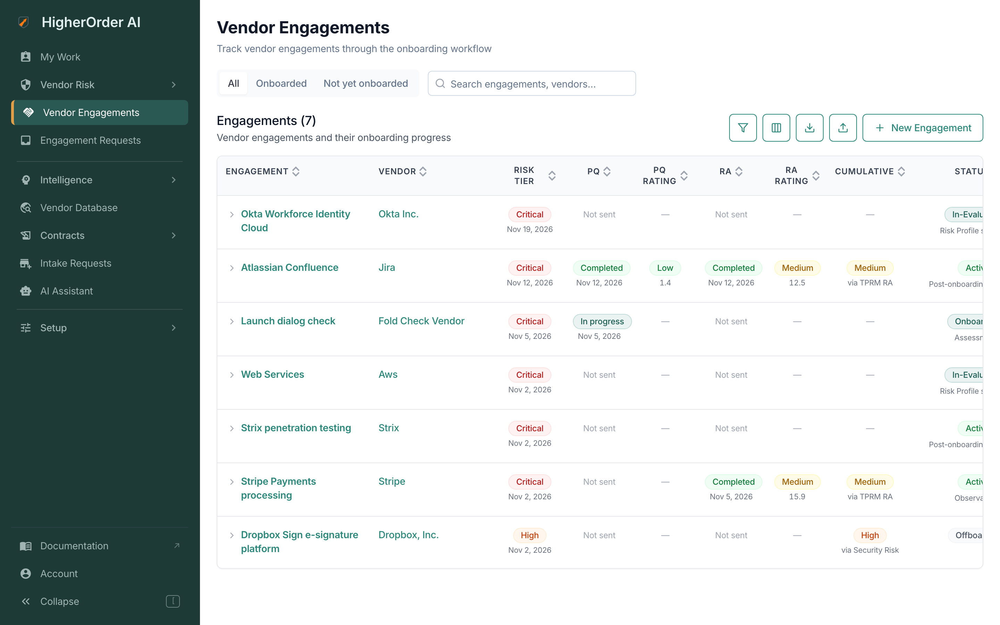
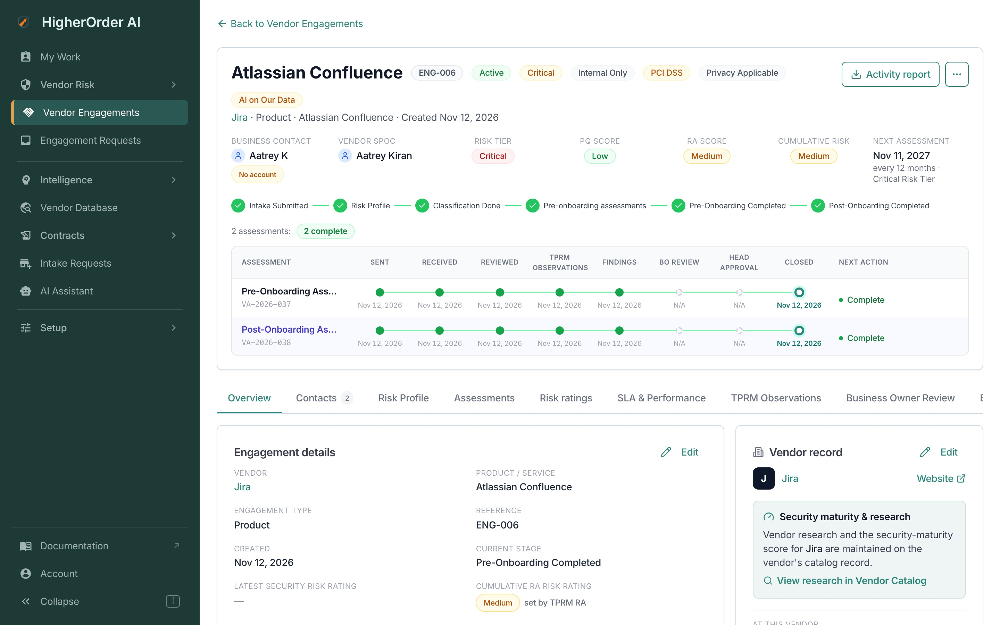
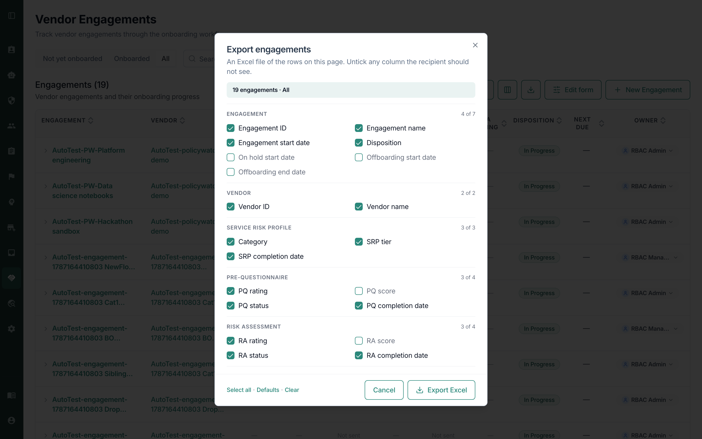
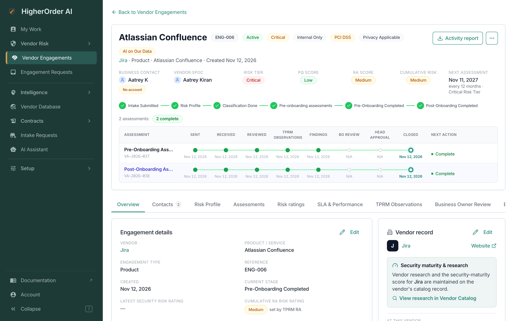
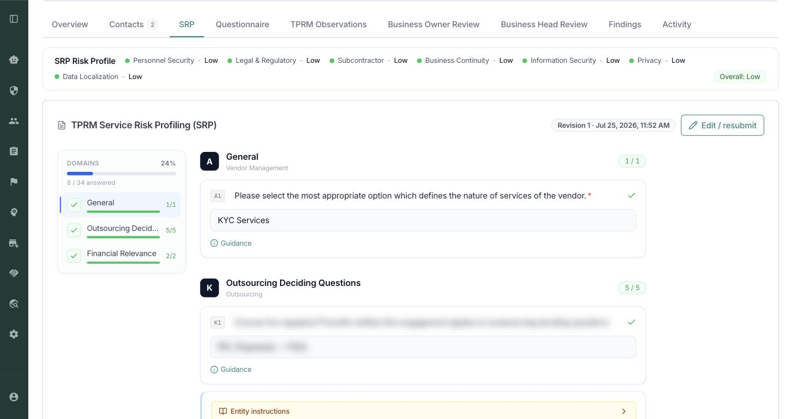
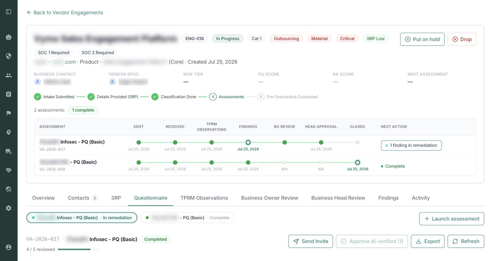
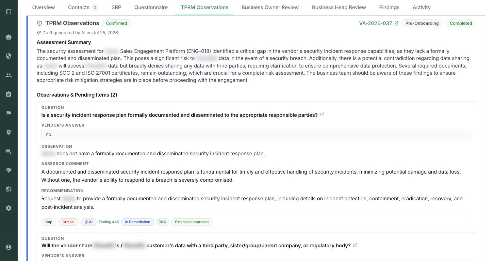
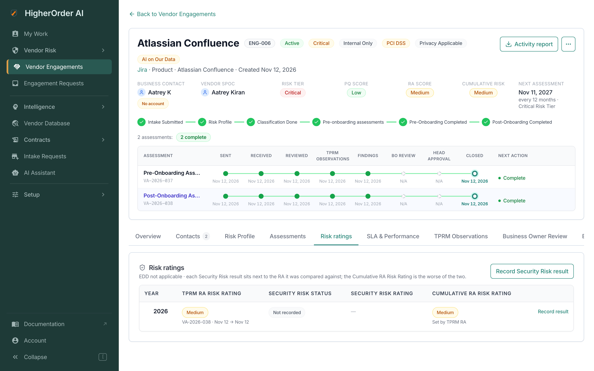

An **Engagement** is one vendor-and-product relationship, tracked end to end as a single object. It is the connective tissue that ties an intake request to the assessments it triggers, the observations those assessments produce, the findings that get remediated, and the sign-offs that close the review out. One vendor can have many engagements — one per product or service you consume from them — each with its own risk profile, assessment set, and lifecycle.

Where [Vendor Intake](/vendor-intake) is the front door, an Engagement is the workflow that runs behind it: it replaces the older one-shot intake request with a durable record that stays open across the full onboarding and continues into periodic reassessment.

<Frame>
  
</Frame>

## The stages at a glance

Every engagement moves through the same sequence. The chain is configurable per tenant in the [workflow designer](/administration/workflows); the default shape is:

<Steps>
  <Step title="Intake — start the engagement">
    A business user submits the request: vendor, product/service, use case, and which parts of your own organization will consume it. An AI copilot assists as they type. → [Start an engagement](#stage-1-start-an-engagement)
  </Step>
  <Step title="Service Risk Profile (SRP) — describe the risk">
    The business and risk teams jointly complete an internal form describing the service and its exposure, with drafts and AI-suggested answers. → [Complete the SRP](#stage-2-complete-the-service-risk-profile)
  </Step>
  <Step title="Classification — the platform tiers it">
    The platform reads the SRP answers and derives the engagement's category, service risk tier, and review flags. Automatic. → [Classification](#stage-3-classification)
  </Step>
  <Step title="Assessments — send the questionnaires">
    The classification decides which questionnaires apply. A reviewer checks the planned scope and launches it; by default everything planned goes to the vendor as one assessment and one invite. → [Run the assessments](#stage-4-run-the-assessments)
  </Step>
  <Step title="Observations & findings — review what came back">
    Each returned assessment produces an AI-drafted observations report; the reviewer curates it and approves it into findings. → [Review observations](#stage-5-review-observations-and-create-findings)
  </Step>
  <Step title="Completion — close it out">
    Once every assessment is confirmed and every finding is closed, the engagement completes and its next reassessment date is set. → [Complete the engagement](#stage-6-complete-the-engagement)
  </Step>
</Steps>

Two things move independently. **State** is where the engagement sits in the chain above. **Status** is the business standing of the relationship, shown as a chip on the engagement header and in the list's Status column:

| Status | Meaning |
|---|---|
| **In-Evaluation** | Pre-onboarding is running and the engagement is not yet classified |
| **Onboarding** | Pre-onboarding is running; the SRP is classified or a questionnaire has been sent |
| **On Hold** | Paused in its current state; resume it later |
| **POC Stage** | Paused, like a hold, while the vendor runs a proof of concept |
| **Not Selected** | Final. The engagement ends and cannot be resumed |
| **Pre-Onboarding Completed** | Onboarding finished; not yet marked live |
| **Active** | Live. Set by hand, or automatically when the post-onboarding assessment starts |
| **To Be Terminated** | Still live, with the date termination starts; nothing is cancelled or closed |
| **Offboarding** / **Offboarded** | Reached through **Initiate offboarding**, never picked directly |

The workflow sets In-Evaluation, Onboarding, and Pre-Onboarding Completed. The rest are set from **Change status** on the engagement's actions menu (⋯), which offers only the moves open from the current status — a running pre-onboarding can be put on hold, moved to POC Stage, or marked Not Selected; a paused one can be resumed; Pre-Onboarding Completed can be made Active; Active and To Be Terminated switch between each other. None of these moves requires walking the rest of the chain.

- **Not Selected** needs a reason. Its dialog lists what the move closes before you confirm: assessments in flight are cancelled, open findings are closed with that reason, and the vendor is marked inactive if this was its last live engagement.
- **To Be Terminated** needs the date termination starts. Change the date later from the same menu.
- **Supporting documents.** The Change status and Initiate offboarding dialogs accept emails and files (10 MB each), each with a required *What is this?* comment. A failed upload never undoes the decision; retry it from the dialog or add the file later from the Overview tab.

Deleting a vendor moves each of its open engagements to Not Selected; the list's **Vendor Deleted** filter finds them separately from engagements a person marked Not Selected.

## Finding your next step

You never have to guess what to do next. On every engagement's detail page:

- A **guided next-action banner** at the top names the one thing the engagement is waiting on — "Complete the Service Risk Profile," "Launch the planned assessments," "Review observations," "Awaiting vendor response" — and links straight to it.
- The **state-chain progress bar** shows which stage the engagement is in and which are done.
- The **track matrix** shows one row per assessment across eight steps — Sent, Received, Reviewed, TPRM Observations, Findings, BO Review, Head Approval, Closed — so mid-flow you can see which questionnaires are out with the vendor, which have come back, and which are in remediation. **Reviewed** is dated when the reviewer closes the assessment.

An engagement that is waiting on its Service Risk Profile opens on the **SRP** tab — straight after intake and on every later visit — with a short dismissible card above the form explaining what the SRP decides. A link to a specific tab still opens that tab.

<Frame caption="An engagement's detail header: the state-chain progress bar and the track matrix, with one assessment complete and one still in remediation.">
  
</Frame>

Open an engagement from **Vendor Engagements** in the sidebar. The list has three tabs — **All** (the default), **Onboarded**, and **Not yet onboarded** — so you can see everything still in flight separately from what's live, with search beside the tabs. Each row carries the engagement and vendor (both linked), **Category**, **SRP tier**, the pre-onboarding questionnaire (**PQ**) and **Risk Assessment (RA)** status — *Not sent / In progress / Completed*, with the sent date beneath, and a link icon where the PQ is covered by a sibling engagement — the **PQ rating** and **RA rating** (tier chip with the score beneath), **Cumulative** (the [Cumulative RA Risk Rating](#risk-ratings), with what set it beneath — "via Security Risk" or "via TPRM RA"), **Status**, **Next due**, and **Owner**. The Status column shows the business status chip with the current step beneath it — *Intake submitted, SRP submitted, Assessments, Observations, Business approvals, Remediation* while pre-onboarding runs — or the termination date under To Be Terminated, and sorts in lifecycle order. A tag line under each row shows every hero chip. The **Owner** chip names the engagement's owner (its creator until handed on) and reassigns inline — nobody is emailed, and questionnaires stay with their assignees. The arrow on a row expands it to show each assessment and questionnaire on the engagement with its owner.

Three icon buttons sit beside the list: **Filters** (with a count of what is applied) opens a filter sheet covering the whole [dashboard](/dashboards) vocabulary with an *Applied* strip — including Status, Vendor Deleted, Security Risk Status, and Cumulative RA Risk Rating; **Columns** picks the optional columns (Owner, Security Risk, Legal entity, Created), remembered per user; **Export** builds an Excel file of exactly the rows and filters on screen. Picking a status filter switches the list to the All tab, so the filter is never applied inside a tab that excludes it.

<Frame caption="Export: the scope line states the rows and filters; the column picker starts from the defaults on every open, so a column unticked for one recipient never leaks to the next.">
  
</Frame>

<Note>
Each stage below ends with a **Your next step** line. That is exactly what the guided banner will prompt you to do when the engagement reaches that stage.
</Note>

## Stage 1: Start an engagement

**Who:** any user with engagement *manage* permission. **Where:** **Engagements → New engagement**.

Starting an engagement is a single form:

- **Vendor** and domain — matched to the [Vendor Database](/vendor-database) as you type, or created on the spot if net-new.
- **Product or service** and the **use case**.
- **Business owner** — the person accountable for the relationship.
- **Consuming entities** — which of your own legal entities will use the service.
- **Contacts** — the business contact, and optionally the vendor's contacts, a **Privacy POC**, and a **Vendor Manager**. The Privacy POC is recorded for reference and is not emailed about assessments; the Vendor Manager is mailed like a vendor contact.

As you fill it in, the **AI intake copilot** works alongside you. It never blocks submission, but it surfaces:

- **Vendor autofill** — identifies the vendor from name and domain and pre-fills known details (security contact, headquarters, a use-case-aware summary), and shows the vendor's existing engagements.
- **Same-vendor overlap** — checks your use case against this vendor's other engagements and labels it *duplicate*, *overlaps*, *complementary*, or *unrelated*, so you don't open a redundant review.
- **Cross-vendor similarity** — flags when the same use case already runs with a *different* vendor.
- **Research on miss** — when the vendor isn't in the database yet, offers to kick off a background research job to build its profile.

The copilot's analysis is saved with the engagement, so anyone who opens it later sees the same overlap and duplicate warnings you saw.

Click **Submit** to create the engagement. The vendor and contacts are recorded and the engagement advances to the Service Risk Profile.

Nothing entered here is locked in. The intake fields — name, engagement type, product/service, use case, consuming entities — stay editable from **Edit** on the Overview tab's *Engagement details* card, with every change recorded in the activity log.

<Info>
Only the **business contact** is mandatory. A vendor contact is not required to start the engagement or to submit the SRP — but an assessment cannot be launched until the vendor has one.
</Info>

### The Overview tab

<Frame caption="The Overview tab: engagement details, the shared Notes & documents card, and the Vendor record card with what else is running at this vendor.">
  
</Frame>

Beside the engagement details, the Overview tab carries three cards:

- **Notes & documents** — one shared engagement note that anyone on the team can edit, and every email or file kept on the engagement: those attached to a status change or an offboarding start, each marked with the decision it came with, and anything added here later with **Add document**. Only your team sees them; nothing is sent to the vendor.
- **Notes on this SRP** — a read-only list of every per-question note on the submitted SRP, each with **Open in SRP** to jump to the question.
- **Vendor record** — the vendor's name linked to its vendor page, a link to its research and security-maturity score in the [Vendor Database](/vendor-database), and **At this vendor**: its other engagements, whether a pre-onboarding questionnaire is with the vendor and which engagement sent it, the last completed PQ and RA with their ratings, and the earliest next due date across its onboarded engagements.

**Edit** on the Vendor record card opens the *Vendor identity* dialog, which asks which of two fixes you need:

- **Rename this vendor** — two fields. **Registered name** is the legal name shown across the app and in the vendor's portal; **Also known as** is an optional second name that is not shown on screens but still matches uploaded documents to the vendor. The dialog states how many engagements and assessments the rename touches before you confirm, and refuses a name another vendor already uses. Renaming changes the shared vendor record and is limited to administrators.
- **Move this engagement** to a different vendor record — the usual fix when intake created a duplicate — which needs engagement *manage* and is allowed only while no assessment or SRP submission exists yet.

When the engagement has no scored PQ or RA of its own, the header shows the vendor's rating from another engagement, with a link to where it came from.

**Your next step:** complete the Service Risk Profile.

## Stage 2: Complete the Service Risk Profile

The **Service Risk Profile (SRP)** is an internal form — the vendor never sees it. It is filled jointly by the **business** team (who own the relationship) and the **risk / TPRM** team (who own the review). Open the **SRP** tab on the engagement.

<Frame caption="The SRP tab: the per-domain risk profile across the top, and the form organized by domain with completion progress.">
  
</Frame>

**Who:** business and risk users with engagement *manage* permission. Sections are labelled by owning team, but both teams can edit the whole form.

While filling it in:

- **Save draft.** Either team can save a draft at any time without advancing the workflow. **Save draft** and **Submit** stay pinned to the bottom of the screen while you scroll, beside a count of questions answered and of required questions still missing — click the missing count to jump to the first one. If both teams edit the same draft, the platform detects the collision and offers to load the other team's latest version rather than silently overwriting it — you'll see a "draft changed elsewhere" prompt.
- **Suggest with AI.** Runs one pass over the vendor's analyzed evidence — public documents, trust-center material, uploaded files, and the intake context — and proposes answers, each with a confidence score and a source citation. Nothing is applied automatically; **Apply all unanswered** fills only blank questions and never overwrites what a person typed.
- **Upload vendor docs.** Attach documents from the SRP step; they feed the same evidence pipeline (website crawl, trust-center fetch, document analysis) that a vendor assessment uses, and become sources the AI can suggest from.

When the form is complete, click **Submit**. Before the submission goes through, a **consistency check** sweeps the answers for contradictions — deterministic rules over structured answer pairs, with a model pass covering the free-text tail. Each conflict names every question involved (number, full text, and the answer given) and is resolved either by revisiting the answers — flagged questions are highlighted on the form with the explanation inline — or by **keeping** them with a note that is stored with the submission for audit. The check advises; it never blocks a submit, and conflicts acknowledged on an earlier submit stay suppressed while the cited answers are unchanged.

Submitting pins the answers as a numbered revision and advances the engagement to classification. (Resubmitting later creates a new revision; prior revisions are retained.)

An engagement's SRP stays on the form version that was current when it was first saved — as a draft or a submission — for viewing, editing, resubmitting, and AI suggestions. If an administrator later changes the form, the change applies only to engagements that have not yet saved an SRP.

**Your next step:** nothing — classification runs automatically on submit.

## Stage 3: Classification

Classification is automatic. On SRP submit, the platform reads the answers and derives the structured attributes that drive the rest of the workflow. The classifier is configured per tenant; a typical classification produces:

- a **category** — the review depth the engagement warrants,
- a **service risk tier** (Low / Medium / High), computed deterministically from weighted per-domain answers,
- per-domain **risk ratings** (e.g. information security, data privacy, business continuity),
- and **review flags** — enhanced due diligence, specific report requirements (SOC 1 / SOC 2), regulatory determinations, and the reassessment cadence.

The result appears on the engagement's header as hero chips — Category (Cat 1 in red), Material, Outsourcing or UAE Entity, **EDD Applicable**, and report requirements such as **ICFR** or **Infosec Required**. The chips take their labels from the tenant's attribute registry (Administration → **Attributes**), so a renamed attribute reads the same on the header, the filters, and the export. Where a tenant's pre-onboarding plan defines tracks, a Cat 2 engagement's Category chip also names the part of the PQ it is sent ("Cat 2 + HR", "Cat 2 + Full PQ"), with a matching **Cat 2 track** filter on the list. Where the classifier has no basis for a verdict it shows no chip rather than a false negative. There is nothing to approve here — classification decides which assessments the next stage plans.

An engagement classified as outsourcing also gains an **Outsourcing Risk** tab — a ten-dimension report rated from the outsourcing questionnaire, the external due-diligence report, the Risk Assessment, and public-source research. See [Outsourcing Risk](/outsourcing-risk).

<Note>
Classification uses the **declared** answers in the SRP. It is distinct from the validated [Risk Band](/concepts/risk-scoring) produced later, once the assessments analyze the vendor's actual evidence.
</Note>

**Your next step:** review and launch the planned assessments.

## Stage 4: Run the assessments

Which questionnaires apply is decided by the classification. Each assessment sent to the vendor is a **track**, and an engagement can carry several. Open the **Assessments** tab.

<Frame caption="The Assessments tab: switch between assessment tracks, launch new ones, and act on each — send invite, approve AI-verified answers, or export.">
  
</Frame>

**How they launch:**

Nothing is sent when the SRP is submitted. Every pre-onboarding launch is a reviewed launch: **Launch assessments** — on the Assessments tab, the next-action banner, or the *Pre-launch pending* row on [My Work](/my-work) — opens the planned scope for a reviewer to check before anything reaches the vendor.

- **The plan, pre-checked.** Each questionnaire the classification routed is ticked and tagged *Planned*, or *Required* where onboarding waits on it. Untick one and it reads *Removed from plan*; add one from the catalogue and it reads *Added*. A Required questionnaire cannot be dropped — narrow its domains instead.
- **Justification.** Required, pre-filled with what was planned and what you changed, editable, and recorded in the engagement history.
- **Due date**, computed from the questionnaires selected.
- **Vendor contact.** The dialog can be reviewed without one, but launching is blocked until the vendor has a contact; **Add vendor contact** is offered in place.

The tenant's **Assessment launch mode** (Administration → Tenant Settings) decides how the selection is sent. **Merged**, the default, sends every selected questionnaire to the vendor as one assessment and one invite. **Parallel** sends one assessment per questionnaire, each on its own track. See [Vendor Assessments](/vendor-risk/assessments).

When the SRP matches no questionnaire, nothing is launched: the progress bar shows a grey **Assessments · Not required** with the reason, the Assessments and TPRM Observations tabs say the same, and pre-onboarding completes without a questionnaire.

Each track:

- sends its own invitation to the vendor's [Vendor Portal](/vendor-portal),
- follows the normal [assessment](/vendor-risk/assessments) lifecycle (sent → received → under review → confirmed),
- and reports its own status on the **track matrix**, so you can see at a glance which questionnaires are out, which are back, and which are in remediation.

When the reviewer presses **Close assessment**, the track's **Reviewed** step is dated and an "Answer review complete" mail goes out: the vendor hears that every answer was reviewed, and the business owner and TPRM that the observations are being drafted. The mail is on by default and can be switched off under [Notifications](/administration/notifications).

Mandatory tracks block completion until they finish. Beyond pre-onboarding, a vendor-level **Risk Assessment** is launched with **Start Post-Onboarding Assessment**; it is shared across all of that vendor's engagements and visible read-only from each of them. It opens the same review dialog as the pre-onboarding launch — routed questionnaires pre-checked but editable, templates already live for the vendor shown as included, a required justification, and the same vendor-contact check — before anything is emailed. Starting it makes the engagement **Active**. When no Risk Assessment is routed for an engagement, the action is not offered and the progress strip reads **Post-Onboarding · Not required**.

**The pre-onboarding questionnaire is asked once per vendor.** A first-time vendor goes through the reviewed launch above. A later engagement for a vendor whose PQ is completed and still within the tenant's validity window stops at Assessments with a coverage dialog: **Complete pre-onboarding** links the engagement to the covering run and onboards it with nothing sent, or **Send a questionnaire anyway** opens the scope tree with the covered domains locked — a covered domain can be re-asked with a reason. If the vendor's PQ is still with the vendor, the new engagement simply follows it and completes when that run is approved; the owning engagement's lane reads "Also covers #N". Validity is the **Pre-onboarding questionnaire validity** tenant setting: blank means a completed PQ never expires and no annual questionnaire is sent; set, the annual renewal becomes one questionnaire per vendor, sent from the newest onboarded engagement with the union of its engagements' scopes.

**Who reviews each questionnaire** is decided at launch by the **Assignment** tenant setting — per questionnaire kind, the engagement owner (default), one named person, or a pool of people balanced by least open work. Every routed questionnaire gets its own assignment, automatic assignments send no email, and routing never blocks a launch. See [Administration](/administration#assignment).

**What the vendor receives at launch.** Two mails, with distinct jobs: the **invitation** carries the access code and nothing else, and the **programme brief** — your own copy, templated per tenant — is the mail the conversation happens on, with the due date highlighted and the business owner on CC. Everything goes out under your tenant's own sender address with Reply-To set to your risk desk — the **first** address in the `tprm` [notification team](/administration#tenant-settings); put a group address first to reach the whole desk — so a vendor's reply reaches your team. The due date comes from the client deadline if one was set, otherwise from the due windows of the questionnaires in scope; for engagement assessments it is a chase target — a vendor past the date is followed up with, never locked out mid-questionnaire.

**While the questionnaire is out**, two scheduled mails keep it moving without anyone drafting them: a **progress nudge** to the vendor's contacts every Monday and Thursday at 09:00 tenant time — progress so far, days remaining, an offer of help, with the business owner and risk desk on CC; nothing in the first five days after launch — and, Monday to Friday at 09:00 tenant time by default, a **questions-waiting email** listing the questions the risk team has asked in the portal that the vendor has not yet answered, deep-linked to the portal's *Customer asked* tab, with whoever asked and the risk desk on CC. The mail escalates as questions age: the Business Owner is copied once the oldest unanswered question has waited three days, and the Business Head from six; an escalated mail is headed "Action needed" with the days open. A vendor who changes the answer, edits the note, marks the question not applicable, or attaches evidence has replied, and the question stops being chased. Both are governed under [Notifications](/administration/notifications). The review page marks each such question **Awaiting vendor reply** with its age, and [My Work](/my-work) lists them per questionnaire.

To write to the vendor yourself, **Email vendor** on the engagement's actions menu opens the drafting panel from My Work, pre-filled with the engagement's questionnaire facts and recent thread; the mail sends under the tenant's identity and files on the Activity → Email trail.

**Send Invite** (on the track) records the invitee as an engagement contact — filed as vendor or business automatically based on your portal allowed domains — and briefs them if they are on the vendor side. Removing an engagement contact revokes their portal access on every active assessment. Correcting a contact's email address rotates the access code without sending anything; resend the invite when ready.

**Contacts** are kept on the engagement's Contacts tab, in two columns: internal (Business Head, TPRM Owner, business contacts) and vendor (vendor contacts, Vendor Manager, CISO, Privacy POC, DPO, and others). Any signed-in user can add, edit, and remove contacts. **Resend invite** on a contact that can be invited — business and vendor contacts, the Vendor Manager, and the TPRM Owner — sends a fresh access code for an open assessment to the name and email on file; any code they already hold for that assessment stops working. If the email on file is a placeholder, the dialog asks for one and saves it first. The TPRM Owner is the engagement's owner, shown on the tab for reference; inviting them does not file them as a contact.

**Your next step:** when a track comes back, review its observations.

## Stage 5: Review observations and create findings

When an assessment track comes back, the platform AI-drafts a **TPRM Observations** report for it — a summary plus a set of observation rows, each anchored to the assessment question it came from and split into the deficiency, the assessor's comment, and a recommendation. Open the **TPRM Observations** tab.

<Frame caption="A confirmed observations report: the AI-drafted summary, then each observation split into observation, assessor comment, and recommendation — this one already converted to a finding in remediation.">
  
</Frame>

**Who:** risk / TPRM reviewers with engagement *manage* permission.

**How to review and approve:**

Where an observation is a **contradiction** between answers, it cites every question involved — number, section, the full question text, and what the vendor answered — each deep-linked into the review workbench, so both sides of the conflict are on the page.

1. **Curate the draft.** Edit the summary, add or remove observations, set each one's severity and category, and **Regenerate** if you want a fresh draft. Severity is High, Medium, or Low, and every observation — drafted or added by hand — starts at **Low**; raising it is the reviewer's call.
2. **Select** the observations you want to carry forward.
3. Click **Approve**. Each selected observation converts directly into a [Finding](/findings) with a remediation due date assigned automatically from its severity (more severe → sooner). The report is marked confirmed.

A finding raised during the answer review appears on the report as its own row, badged *Raised in review* with its finding number and due date. It cannot be deselected or removed; its observation, assessor comment, recommendation, and severity stay editable, and a severity change moves its due date.

From there, findings enter the normal remediation lifecycle and go to the vendor to fix. Closing a finding — by remediation, waiver, or reviewer decision — emails the vendor and the business, and an assessment that closes out after onboarding announces itself the same way.

**Your next step:** track the findings to closure — and handle any extension requests (below).

## Approving extensions and accepting risk

When a vendor asks for more time on a finding, the request runs a **two-stage business approval** so that the person who *sponsors* the vendor is not the same person who *accepts residual risk*:

<Steps>
  <Step title="Business Owner endorses">
    A business contact on the engagement (with *endorse extension* permission) reviews the request and either endorses it onward or rejects it. The Business Owner **cannot** move a remediation date themselves.
  </Step>
  <Step title="Business Head accepts the risk">
    The engagement's accountable Business Head (with *risk acceptance* permission) is the only role that can grant the risk acceptance and move the remediation date — and only after the Business Owner has endorsed.
  </Step>
</Steps>

Both actions are on the finding, surfaced from the engagement's **Business Owner Review** and **Business Head Review** tabs. A stage-two approval before a stage-one endorsement is rejected.

## Stage 6: Complete the engagement

An engagement completes **automatically** once every non-cancelled assessment track is confirmed, every mandatory questionnaire has finished, and **every finding is closed**. There is no separate manual go-live gate — closing out remediation is the last thing standing between the engagement and completion.

On completion the engagement's status becomes **Pre-Onboarding Completed** and it records its **next assessment date**: the tenant's recurrence rules set the interval from the engagement's attributes — typically the service risk tier, higher tier → sooner — and it is 12 months where no rule applies. No date is set when no Risk Assessment is routed for the engagement. Post-onboarding Risk Assessments then continue for the life of the vendor relationship; the due date surfaces as a hint on the engagement, and you launch the reassessment deliberately when you're ready. A tenant's classifier can also name categories that become **Active** as soon as pre-onboarding completes when no Risk Assessment is routed for them.

The progress strip keeps telling the story after onboarding: one node per periodic assessment cycle — **Pending**, **Triggered** (with the vendor), **Ongoing** (under TPRM review), **In Remediation**, or **Completed** — year-qualified once there are several, with hover detail showing the questionnaire, dates, and risk rating. A Pending node turns amber when the next cycle is overdue, and cycles started from a sibling engagement on the same vendor appear too.

A post-onboarding cycle is complete only when every finding it raised is closed. Until then it shows as **In Remediation** and the engagement carries no *Next assessment* date. The date is set when the cycle closes out, counted from the day its observations were approved, so a long remediation does not push the next cycle out.

## Risk ratings

The **Risk ratings** tab sets the TPRM Risk Assessment beside the result of the enhanced due diligence (EDD) team's **Security Risk** review, one result per completed RA.

<Frame caption="The Risk ratings tab: each Security Risk result beside the RA it was compared against, and the Cumulative RA Risk Rating.">
  
</Frame>

- **Record Security Risk result** captures the review's status — *Not Started, In-Progress, On Hold – PoC Unresponsive, Exempted, Completed* — its rating, review period, methods (questionnaire, document review, pen test, red team), risk drivers with a severity each, a summary, and evidence files with a comment each.
- Each row shows the **TPRM RA Risk Rating**, the **Security Risk Status** and **Security Risk Rating**, and the **Cumulative RA Risk Rating**: the worse of the two ratings, with which one set it.
- The engagement's Cumulative RA Risk Rating uses the latest TPRM RA rating and the latest Security Risk Rating. It appears on the engagement header as *Cumulative risk*, in the list's **Cumulative** column, and in the export's "Security Risk (EDD)" column group.

Anyone who can open the engagement can read the tab. Recording, editing, and deleting a result need engagement *manage*, and every save and delete is audited.

## SLA & Performance

The **SLA & Performance** tab tracks monthly and quarterly readings for each availability or performance metric against its target, and turns a missed target into a finding. See [SLA & Performance](/sla-performance).

### The Risk Assessment report

Once an engagement has a completed Risk Assessment, a **Report** button on the engagement header downloads it as a controls-format PDF. It opens with a **compliance summary** — the headline compliance percentage, count tiles, and a per-domain breakdown — followed by a meta block (vendor, engagement, consuming entities printed by their legal names, nature of service, RA risk rating, RA Risk Impact) and one row per applicable scored question: control number, control objective, domain, question, a **Compliant / Non-Compliant** status derived from the answer against the question's expected answer, and its **RA Risk Impact**.

**RA Risk Impact** is a second verdict per control that reflects what happened after the answer: a control whose findings are all closed is Compliant; otherwise an answer the reviewer approved counts as Compliant and one the reviewer rejected as Non-Compliant; every other control keeps its Status. After the controls table come **Open Findings** — every finding not yet closed, named by its control, worst first — and **Reviewer Comments** for every control whose RA Risk Impact differs from its Status.

Not Applicable answers are excluded, and control numbering runs dense over the applicable controls only. A dropdown on the button lists every completed RA cycle, newest first, so you can pull an earlier year's report as well as the latest. Available to anyone who can view the engagement.

### The activity report

The same **Report** menu — or the **Download** button on the Activity tab — produces a PDF of the engagement's Activity tab: a summary block and count tiles, the timeline oldest first (when, action, by whom, assessment, notes and documents), and the emails sent (when, which mail, read by, recipients, delivery — no email bodies). Before the engagement has a controls report, the header button reads **Activity report**. Either route gives the whole report whatever filter is on screen. Times are printed in your browser's time zone, which the PDF names. The report carries the most recent 1,000 timeline entries and 1,000 emails and says so when there are more.

## The email trail

The engagement's **Activity** tab carries an **Email** view: one row per mail the platform actually sent for this engagement — invitations, briefs, chase mails, review notices — each with its own subject, To/Cc, Reply-To, and delivery status, and the full rendered body available in a drawer. Where one event produced different mails for different audiences (the vendor's copy and the risk team's copy of an "assessment sent," say), each appears as its own row; a combined mail that went to several roles on one To line is tagged with every role that read it, so filtering by *Business* shows the mails the business owner's address was on. Mails written by hand from My Work or *Email vendor* appear as *Email written by the Risk team*. The same trail, tenant-wide, is under [Administration → Notifications](/administration/notifications). Vendor access codes are stripped before a body is stored, so the trail can be read by anyone who can open the engagement without exposing credentials.

The Activity tab's **Timeline** view lists the change history newest first; a status change or offboarding start shows the documents attached with it, each downloadable.

## Jira ticket updates

An engagement that began as a Jira ticket carries the ticket key as a chip on its header and posts a short comment on that ticket at each milestone: intake submitted, classified, assessment sent, assessment submitted, review complete, extension requested and decided, and completed. HigherOrder only comments — it never creates a ticket. Comments post for a tenant with Jira connected under [Integrations](/administration/integrations), and each one has its own **Jira** switch under [Notifications](/administration/notifications). See [Engagement Requests](/engagement-requests#inbound-requests) for how tickets come in.

## Permissions

Engagement access is governed by dedicated permissions (assigned via [Roles & Permissions](/administration/roles-and-permissions)):

| Permission | Grants |
|---|---|
| **View** | Draft a vendor follow-up; the base permission for the business-side actions that carry their own role check (extension endorsement and risk acceptance) |
| **Manage** | Submit intake, fill forms, launch assessments, record sign-offs, change status, record Security Risk results, and all observation actions |
| **Admin** | Configure engagement workflows and risk profile forms in the [workflow designer](/administration/workflows) |
| **Endorse extension** | Stage-one (Business Owner) endorsement of a vendor extension request |
| **Risk acceptance** | Stage-two (Business Head) risk acceptance and remediation-date changes |

Reading needs no permission: the engagement list, every engagement's detail, history, forms, classification, email trail, and reports are open to every signed-in user in the tenant. Any signed-in user can also keep an engagement's contacts, shared note, and documents up to date. Every other change needs its permission above, and Manage actions are limited to engagements the user may act on under the platform's team scoping. [My Work](/my-work) keeps its own scoping.

## Limitations

- Classification reflects **declared** SRP answers, not analyzed evidence. The validated Risk Band on the vendor profile takes precedence once assessments complete.
- The state chain, SRP form, and classifier are tenant-configured. A tenant that hasn't configured them sees the default chain and no classification step.
- Periodic reassessment dates are surfaced as a due hint; the Risk Assessment is launched deliberately, not fired automatically on the due date.
- An engagement will not complete while any finding remains open — closing out remediation is a prerequisite, not a parallel task.
- **Not Selected** is final. If the vendor comes back, start a new engagement.
- The activity report prints text outside the Latin alphabet as "?".
