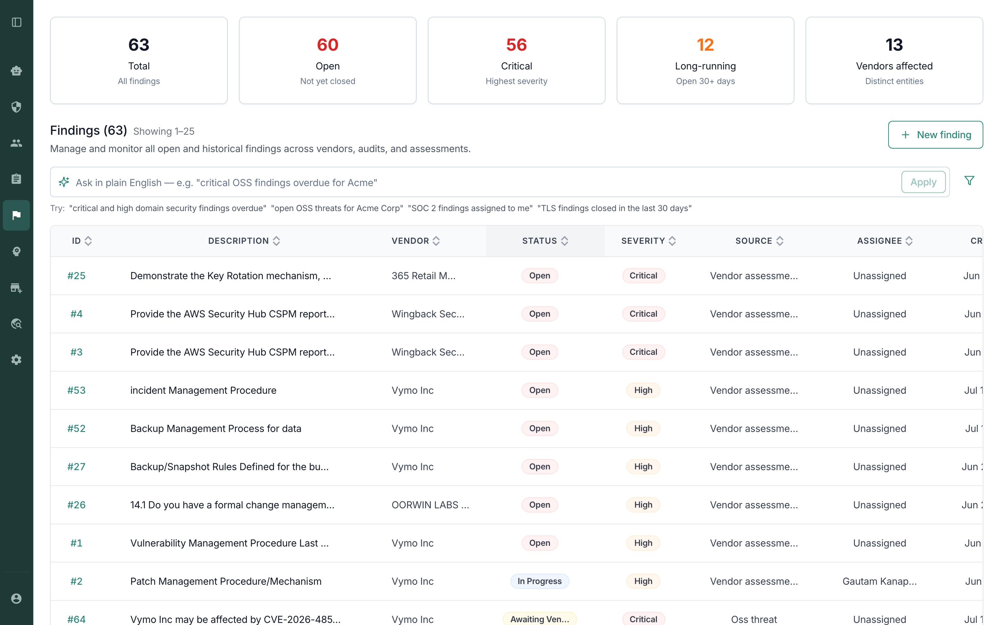
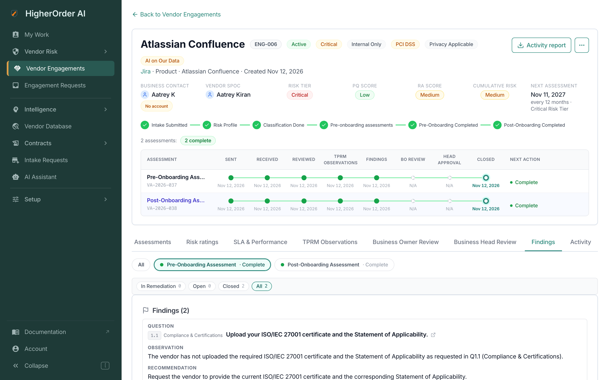

The single register of every risk finding across your program. Findings come from the analyzers automatically (control gaps, VAPT results, OSS threats, domain-security signals, assessment-question gaps) and from analysts — raised during an assessment review, approved from a TPRM observation, raised from an SLA reading, or entered by hand. The page is a filterable list with global stat cards, natural-language search, and per-finding detail with a full audit trail.

<Frame>
  
</Frame>

## What it does

- Lists every finding for the tenant with its vendor, engagement and assessment, status, severity, source, assignee, target date, and age.
- Global stat cards summarise the state of the program: total, open, critical, long-running (open 30+ days), vendors affected. Cards are filter-independent and clickable — clicking "Open" filters the list to any non-closed status.
- **Natural-language search.** Ask questions like *"critical findings assigned to Priya"* or *"open findings on Salesforce due this week."* The query is parsed to structured filters.
- Column and dropdown filters on source, severity, status, framework, category, vendor, assignee, date ranges.
- Per-finding detail page with inline editing, lifecycle actions (request approval, escalate, update remediation, close), and a comments thread.

## Inputs

### Filters (on the list)

- **Source** — Control implementation gap, OSS threat, VAPT finding, Manual, Domain security, Vendor assessment gap, Engagement observation, SLA breach. The list's Source column uses the same wording as this filter
- **Severity** — Critical / High / Medium / Low
- **Status** — Open, In Progress, Awaiting Vendor Action, Awaiting Client Approval, In Remediation, Escalated, Closed
- **Framework** and **Category** — set by the analyzer that produced the finding
- **Vendor** — filter to findings on a specific entity
- **Assignee** — filter to findings assigned to a specific user
- **Created** and **Due** date ranges

A drill-down from the Findings dashboard arrives with its filters applied — including **Assessment**, from the dashboard's *Findings by assessment* grouping, which shows the list filtered to the findings one assessment raised. See [Dashboards](/dashboards).

### Add finding dialog

Manual entry. Required fields:

- **Description**
- **Vendor** (from your inventory)
- **Severity** (Critical / High / Medium / Low; defaults to Medium)
- **Status** (defaults to Open)
- **Source** (Manual is the default; a small subset of sources allow manual creation)
- **Control ID** (optional; defaults to `MANUAL`)
- **Target date**

## Outputs

### List view

Columns: ID (`#N`, clickable), Description, Vendor, Engagement (the engagement name, with the assessment that raised the finding linked beneath it), Status, Severity, Source, Assignee, Created, Target Date, and Ageing — days open, or days from creation to closure for a closed finding. Default sort is a composite priority (Open status floats to the top, then Critical → Low).

### Detail view

Sections:

- **Header** — finding ID, status (inline-editable badge), severity (inline-editable), assignee (dropdown), back button.
- **Overview** — description (inline-editable), control ID and name, framework, category, timestamps.
- **Source Context** — source-specific metadata (CVE for OSS threats, subdomain for domain-security signals, question snapshot + expected vs submitted answer for assessment gaps, metric, period, reported value, and target for SLA breaches).
- **Remediation** — due date (inline-editable), progress percentage, notes; **Update Remediation** button opens a dialog to log progress.
- **Approvals** — history of approval requests (Extension / Waiver / Risk Acceptance) with type, status, dates, justification; **Request Approval** button.
- **Escalations** — history of escalations with reason and status; **Escalate** button.
- **Activity Feed** — full audit log: who changed which field, from what value to what value, and when.
- **Comments** — threaded comments (add, edit, delete).

### Close finding

The **Close** action opens a dialog with an optional **resolution note**. The note is pre-filled with an AI draft, marked as a draft for the reviewer to edit or **Regenerate**; closing never waits on the draft, and if drafting fails the note is simply left empty. Closing marks the finding Closed and records the note in the activity log. Closed findings remain visible via the Status filter.

## Where findings come from

| Source | What generates it |
|---|---|
| `control_implementation_gap` | Control readiness assessment finds an ungrounded or under-evidenced control |
| `vapt_finding` | VAPT analyzer surfaces a finding from a penetration test report |
| `oss_threat` | OSS threat scanner flags a CVE or malicious package |
| `domain_security` | Continuous domain security monitoring detects a change |
| `vendor_assessment_gap` | A vendor's questionnaire answer falls short of the expected answer, a reviewer raises a finding on a question with **Create finding** in the [review workbench](/vendor-risk/assessments#the-detail-pane), or a question is approved while its evidence is still pending — the finding's due date is the vendor's committed ETA (30 days if none was given) |
| `engagement_observation` | A TPRM observation approved on a post-assessment report converts into a finding (see below) |
| `sla_breach` | A reviewer raises a finding from a reading on an engagement's SLA & Performance tab (see below) |
| `manual` | Analyst-created via the Add Finding dialog |

Auto-generated findings inherit their control ID, framework, category, and additional context from the source analyzer. Manual findings carry only what the analyst enters.

### Observation-derived findings

When an analyst approves a TPRM observation report on an assessment (see [Engagements](/engagements)), each accepted observation becomes a finding: the observation text and recommendation become the description, the anchoring assessment question becomes the source context, and the finding links back to the observation it came from. The engagement's Findings tab badges each finding's origin — **From Observation**, **Assessment**, **SLA breach**, or **Manual** — and cites the question the finding came from, with its number and full text.

**Observation severity.** An observation's severity is **High**, **Medium**, or **Low** — Critical cannot be chosen. Every observation, whether drafted by the AI or added by hand, starts at **Low**; raising it is the reviewer's decision, and approving without raising creates Low findings on the Low remediation window. An observation that already carried Critical before this rule keeps it and still converts to a Critical finding.

**The draft.** Between closing the assessment and the draft arriving, the report shows a *Drafting observations…* panel. If the AI pass fails, the report says the empty list is not a result and offers **Regenerate**, which re-runs the draft and keeps rows already edited or added by hand.

**Findings raised during the review.** A finding a reviewer raised while reviewing answers appears on the TPRM Observations report as its own row, badged **Raised in review** with its finding number and due date. It is already a finding, so the row is locked in: it cannot be deselected or removed. Its observation text, assessor comment, recommendation, and severity stay editable, and changing the severity re-grades the finding and moves its due date. The approval dialog counts only the observations that will become new findings and states that the review-raised ones are included as they are.

<Frame caption="The engagement's Findings tab: each finding with its origin badge and the question it came from.">
  
</Frame>

The engagement's Findings tab is built for the remediation loop: a status triage bar (**In Remediation / Open / Closed / All**) filters the list, vendor updates show their attachments for download, and a finding can be **closed in place** — the close dialog pre-fills an AI-drafted resolution note composed strictly from the question, the observation, and the vendor's own submitted updates, marked as a draft for the reviewer to edit or regenerate. Closing the last finding can complete the engagement.

The remediation due date is set from the observation's severity, counted from the approval date:

| Severity | Due window |
|---|---|
| Critical | 30 days |
| High | 30 days |
| Medium | 60 days |
| Low | 90 days |

Critical intentionally shares High's 30-day window — the finding keeps its Critical severity; only the clock is shared. The Critical row applies to observations that carried Critical before it stopped being offered, and to SLA breach findings raised as Critical. The windows are tenant-configurable.

### SLA breach findings

On an engagement's **SLA & Performance** tab, **Raise finding** turns one reading into a finding (see [SLA & Performance](/sla-performance)). The reviewer picks the severity — Critical, High, Medium, or Low — and the due date is set from the same severity windows as above. The finding sits on the engagement and its vendor, is assigned to the engagement's business owner, and its Source Context shows the metric, the period, the reported value, and the target. A reading can raise one finding; nothing is raised automatically when a target is missed.

## Lifecycle actions

- **Request Approval** — request an Extension, Waiver, or Risk Acceptance. Requires a justification. Moves the finding to "Awaiting Client Approval."
- **Escalate** — escalate to a stakeholder with a reason. Moves the finding to "Escalated."
- **Update Remediation** — log progress percentage and notes.
- **Assign** — reassign the finding to another user (inline in the header).
- **Close** — final state. The resolution note is optional. Closing emails the vendor, the business owner, and TPRM (the *Finding closed* notification), whichever path closed it — remediation completed, waiver approved, or closed by the reviewer. The internal copy includes the reviewer's resolution note.

Every action lands in the Activity Feed with actor, timestamp, and field-level diff. Findings in remediation and findings past their due date also surface on [My Work](/my-work) under the finding's assignee, with a one-click drafted follow-up to the vendor.

### Finding mails and the vendor's view

The recurring findings mails — the open findings reminder, *Remediation date approaching*, and *Remediation date missed* — go out as **one mail per assessment**, so an engagement with two assessments sends two, and the portal button in each opens that assessment. Each is governed under [Administration → Notifications](/administration/notifications).

In the [Vendor Portal](/vendor-portal#findings), a finding card is titled with the question the finding came from and shows the vendor's answer, the conversation on that question, the observation, and the recommendation. A file the vendor sends with a finding update becomes evidence on that question — including on a completed assessment — and the reviewer can reply from the question in the review workbench, where the message box stays available while the finding is open.

## Vendor extension requests — two-stage business approval

A vendor can ask for more time on a finding directly from the Vendor Portal. Because moving a remediation date is a risk-acceptance decision, the request passes through two business approvers in sequence — neither the vendor nor the TPRM team can move the date alone.

<Steps>
  <Step title="The vendor requests">
    From the portal, the vendor proposes a new date with a justification and must explicitly acknowledge the launch impact. The new date can be at most **30 days** beyond the current due date, and each finding allows **one request, ever**. The finding moves to "Awaiting Client Approval."
  </Step>
  <Step title="The Business Owner endorses">
    A business contact on the engagement reviews the request — alongside an AI-drafted business-impact brief — and endorses or rejects it. Endorsing does **not** move the date; it forwards the request to the Business Head. Rejection is final. The vendor is not notified of an endorsement, only of a decision.
  </Step>
  <Step title="The Business Head decides">
    The engagement's Business Head — the only role with risk-acceptance authority — approves with a justification or rejects. Approval moves the remediation due date to the requested date; rejection leaves it untouched. Either way the finding returns to "In Remediation," and all parties (TPRM, Business Owner, Business Head, vendor) are notified.
  </Step>
</Steps>

The finding shows which stage a pending request is at ("Extension — awaiting Business Owner" / "awaiting Business Head"), and the request card records the endorsement note and endorser alongside the final decision.

## Limitations

- Bulk actions are not yet supported — assignment and status changes are per-finding.
- SLA breach findings are raised by hand, one per reading; a missed target does not create a finding by itself.
- Long-running is a fixed threshold (open 30+ days). This is not currently configurable per tenant.
