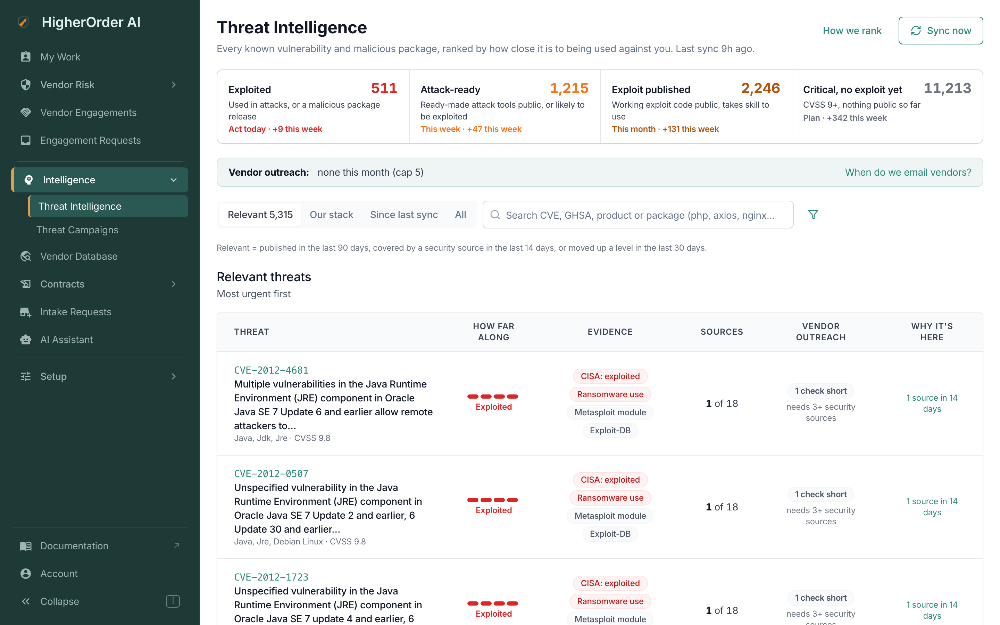
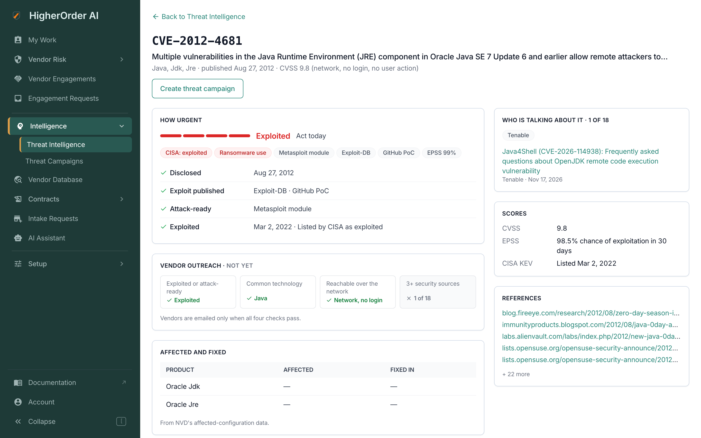

**Threat Intelligence** ranks every known vulnerability and malicious package by how far it has moved toward real-world exploitation, and **Threat Campaigns** turns one of those threats into a tracked question to your vendors: a finding per vendor, an email with a response link, and a running count of who is exposed, who is not, and who has not answered.

<Frame>
  
</Frame>

## What it does

- Places each threat on one urgency ladder named after what has happened: **Exploited**, **Attack-ready**, **Exploit published**, **Critical, no exploit yet**, and Low.
- Shows the evidence behind each placement — CISA listing, public exploit tooling, EPSS, package downloads — and how many security news and research sources are covering it.
- Opens on **Relevant**, a view limited to threats that are recent, currently covered, or recently moved up, so the list stays readable against a corpus of tens of thousands of records.
- Lists the threats that name your own technologies under **Our stack**.
- Marks, separately from urgency, the few threats that justify emailing vendors, and caps that at five a month.
- Creates a **threat campaign** from any threat: one finding per vendor, an outreach email with a response link, and a campaign page that tracks responses to closure.

## Inputs

| Input | Used for |
|---|---|
| **NVD** | CVE records, CVSS scores and vectors, affected-product (CPE) data |
| **OSV** | Package advisories and malicious-package reports for npm, PyPI, Maven, Go, NuGet, RubyGems, and crates.io |
| **CVE.org** | The publishing organisation's own title and affected-product list for a CVE, and CISA's exploitation assessment (SSVC) |
| **CISA KEV** | Whether a CVE is known to be exploited, and whether ransomware use is known |
| **FIRST EPSS** | The probability of exploitation in the next 30 days |
| **Exploit lists** | Metasploit modules, Nuclei scan templates, Exploit-DB entries, and public proof-of-concept repositories on GitHub |
| **npm and PyPI download counts** | Weekly downloads, which decide how much a malicious package release matters |
| **18 security news and research sources** | Coverage of a threat in the last 14 days (for example BleepingComputer, The Hacker News, CISA advisories, Rapid7, Unit 42, Microsoft MSRC, SANS ISC) |
| **Our stack** (tenant setting) | The technologies your organisation and vendors run |
| **Your vendor inventory** | The vendors a campaign assesses, and the contact email outreach is sent to |

The threat corpus and its ranking are shared reference data, identical for every tenant. Our stack, campaigns, findings, and vendor responses belong to your tenant.

## Outputs

- A ranked feed at **Intelligence → Threat Intelligence**, with counts per urgency level and the number that entered each level this week.
- A detail page per threat: the steps toward exploitation with dates and evidence, the four vendor-outreach checks, affected and fixed versions, recent coverage, scores, and references.
- A threat campaign at **Intelligence → Threat Campaigns**, with a finding per vendor in scope, an outreach log, and response counts.
- Findings with the source *OSS threat* in [Findings](/findings), and on each vendor profile's **OSS Threats** tab.

## How it works

### Urgency levels

Ranking is rule-based and deterministic; no AI model is involved. **How we rank** in the page header shows the same rules in the product.

| Level | A threat is placed here when | Suggested pace |
|---|---|---|
| **Exploited** | CISA lists it as exploited, CISA reports active exploitation, or it is a malicious release of a package with 100,000 or more weekly downloads | Act today |
| **Attack-ready** | A Metasploit module or Nuclei scan template exists (CVSS 7 or higher, or not yet scored), or EPSS gives a 10% or higher chance of exploitation in 30 days | This week |
| **Exploit published** | Exploit code is on Exploit-DB or GitHub (CVSS 7 or higher, or not yet scored), or it is a CVSS 9+ vulnerability published in the last 14 days in widely used software that needs no login and no user action | This month |
| **Critical, no exploit yet** | CVSS 9 or higher with nothing public so far, or a malicious package whose downloads cannot be measured | Plan |
| **Low** | Everything else, including CVEs that CVE.org has rejected | Monitor |

Within a level, threats are ordered by a score that weighs known ransomware use most, then whether the technology is common, the number of sources covering it, EPSS, package popularity, and CVSS; ties go to the more recently published.

Low is hidden by default; **show all** under the table includes it.

### Views, search, and filters

| View | Shows |
|---|---|
| **Relevant** (default) | Threats published in the last 90 days, covered by a security source in the last 14 days, or moved up a level in the last 30 days |
| **Our stack** | Threats that name a technology on your Our stack list, with a count per entry |
| **Since last sync** | **New** threats and threats that **Moved up** a level since the last scheduled sync, covering at least the last 24 hours |
| **All** | Every ranked threat |

- Clicking an urgency tile narrows the current view to that level. In *Since last sync*, a tile opens *All* at that level instead.
- **Search** takes a CVE, GHSA, or other advisory ID, or the start of a product, vendor, or package name (`php`, `axios`, `nginx`). A search always looks across all threats, regardless of the view.
- **Filters**: Published (last 30 days, 90 days, or year), Technology, Kind (vulnerability or malicious package), and Vendor outreach (ready, or one to two checks short).
- The view and filters are kept in the URL, so a filtered list can be bookmarked or shared. The list shows 50 threats per page.

### Columns

| Column | Shows |
|---|---|
| **Threat** | The CVE, GHSA, or advisory ID, a readable title, up to three affected products, and CVSS |
| **How far along** | A four-step bar — disclosed, exploit published, attack-ready, exploited — filled to the threat's level |
| **Evidence** | The reasons for the level, for example *CISA: exploited*, *Ransomware use*, *Metasploit module*, *EPSS 42%*, *1.2M downloads/week* |
| **Sources** | How many of the 18 news and research sources covered it in the last 14 days |
| **Vendor outreach** | *Ready for outreach*, *Held for review*, *N checks short*, or the campaign already open for it |
| **Why it's here** | In *Relevant*, the rule that put the row in the view. In *Our stack* the column is **Matches** (the entries the threat named); in the other views it is **Changed** |

### The threat detail page

Opening a row shows why the threat ranks where it does:

- **How urgent** — each of the four steps with the date it was first seen and its evidence, and recent level changes.
- **Vendor outreach** — the four checks, each passed or failed with the detail behind it.
- **Affected and fixed** — products, affected version ranges, and fixed versions, labelled with where the data came from (the CVE record, the package advisory, or NVD).
- **Who is talking about it** — the sources and their most recent articles.
- **Scores** and **References** — CVSS, EPSS, CISA KEV status, weekly downloads for packages, and reference links.

**Create threat campaign** is in the header. Once a campaign exists for the threat, the button becomes **Open campaign**.

<Frame>
  
</Frame>

### When a threat is ready for vendor outreach

Vendor outreach is a separate status from urgency. A threat is **Ready for outreach** only when all four checks pass:

| Check | Passes when |
|---|---|
| **Exploited or attack-ready** | It is exploited, or a Metasploit module or Nuclei template is public |
| **Common technology** | It affects PHP, Node.js, Java, Python, .NET, React, Apache HTTP Server or Tomcat, nginx, IIS, MySQL or MariaDB, PostgreSQL, Oracle Database, Elasticsearch, Kafka, Linux, Windows, or an npm or PyPI package with 100,000 or more weekly downloads |
| **Reachable over the network** | The CVSS vector is network-reachable, or it is a malicious package (which runs on install) |
| **3+ security sources** | At least 3 of the 18 sources covered it in the last 14 days |

At most five threats a calendar month take an outreach slot; a further threat that passes all four checks shows **Held for review**. The strip above the feed lists this month's threats and the cap.

The status is a recommendation. Nothing is emailed until someone creates a threat campaign, and a campaign can be created for any threat — the confirmation dialog states which checks fail, or that the monthly cap is used, before you proceed.

### Threat campaigns

A campaign is your tenant's tracked response to one threat. Creating one does three things:

<Steps>
  <Step title="Selects the vendors in scope">
    Scope follows the threat's severity (CVSS 9.0+ Critical, 7.0+ High, 4.0+ Medium, below that Low; a CVE with no score yet is treated as Medium). For a **Critical** or **High** threat, every vendor in your inventory except terminated ones is in scope. See [Limitations](#limitations) for Medium and Low.
  </Step>
  <Step title="Raises one finding per vendor">
    Each finding starts as *Awaiting Vendor Action*, carries the threat's severity, and has a remediation due date of 14 days (Critical), 30 (High), 60 (Medium), or 90 (Low) from creation.
  </Step>
  <Step title="Emails each vendor">
    The email goes to the contact email on the vendor record. It states the vulnerability, severity, CVSS, affected packages, and whether a fix is available, and links to a response page. The campaign moves from *Open* to *Notified* once at least one email is sent.
  </Step>
</Steps>

The campaign page shows:

- **Counts** — in scope, exposed, remediated, not affected, pending response, and vendors that have not yet responded (labelled *No SBOM*).
- **Remediation progress** — findings closed out of the total.
- **Outreach Log** — each send, with time, recipients, and whether it was sent in full, in part, or failed.
- **Findings** — one row per vendor with the latest response, finding status, date, and notes; expanding a row shows the response history.

Actions on a campaign:

- **Send Outreach** emails again every vendor whose finding is still *Awaiting Vendor Action*.
- **Update** on a finding records a response on the vendor's behalf, with your name in the history. **Copy Link** copies that vendor's response link to send through another channel.
- The status selector moves the campaign between *Open*, *In Progress*, *Notified*, *Partially Mitigated*, and *Closed*; closing asks for optional closure notes.
- **Refresh** recomputes the counts. Delete removes the campaign from the list.

The Threat Campaigns list filters by status and severity, and each campaign links back to its threat.

### Vendor responses

The response link opens a page that needs no sign-in. The vendor picks a status and can add notes; they can return and update it until the finding is closed. Links are valid for 90 days.

| Response | Finding status becomes |
|---|---|
| We are affected — remediation in progress | In Progress |
| We are not affected | Closed |
| We need more time to assess | Awaiting Vendor Action |
| Unclear — still investigating | Awaiting Vendor Action |
| Remediation complete | Closed |

Every response is appended to the finding's history, and the campaign counts update as responses arrive.

### OSS Threats tab and Findings

Campaign findings are ordinary findings with the source *OSS threat*, so they appear in [Findings](/findings) with the rest of the vendor's record. A finding's source details show the CVE or advisory ID, the exposure basis, and its campaign.

Each vendor profile has an **OSS Threats** tab listing that vendor's campaign findings — threat, criticality, status, latest response, and date — with **View Campaign** on each row and **View all in Findings**, which opens Findings filtered to OSS threat findings for that vendor.

### Sync

The line under the page title shows when the feed last synced. **Sync now** starts a sync on demand; only one runs at a time, and a second request reports that one is already running. Sources are fetched independently, so one source being unavailable does not block the others. When a sync fails in part, the line turns orange and names the sources that failed and when the last complete sync finished, for example "Last sync 1d ago: CISA KEV, OSV failed. Last complete sync 5d ago."

## Configuration

**Our stack** is under **Administration → Tenant Settings → Threat Intelligence**. List up to 50 technologies, each up to 80 characters.

- Each entry is matched exactly, ignoring case, against the product, vendor, and package names in threat records — not as part of a longer name. Write entries the way those records do: a product (`connect secure`, `vcenter server`), a vendor (`ivanti`), a package (`axios`), or a technology the feed groups (`Java`, `Windows`, `PHP`, `nginx`, `MySQL`).
- The *Our stack* view shows how many threats each entry matches. An entry showing 0 is probably named differently in the records.
- With no entries, the *Our stack* view is empty and links to this setting.

## Limitations

- **No software-inventory matching.** SBOM collection is not available, so a campaign cannot confirm which vendors run the affected software. Every vendor in scope is treated as unconfirmed, and exposure is established only by the vendor's response. This is why outreach readiness is deliberately strict.
- **Medium and Low threats produce an empty campaign.** Their scope is limited to vendors confirmed exposed (Medium) or to none (Low), and nothing can be confirmed without SBOM data. The campaign is created with no findings and no emails.
- **The Outreach Policy tab is not applied.** *Administration → Outreach Policy* shows the scope and remediation period per severity, but changes made there are not saved. Campaigns use the fixed scopes and due dates described above.
- **Outreach is a single email per send.** There are no automatic reminders or escalations and no delivery or bounce tracking; use *Send Outreach* to send again.
- **Vendors without a contact email are skipped.** Outreach uses the contact email on the vendor record, not engagement contacts. A vendor without one still gets a finding but no email, and the outreach log lists only the vendors that were emailed.
- **The monthly outreach cap is shared.** The five slots and the *Ready* / *Held* status come from the shared ranking, not from your tenant's own campaigns, and the cap does not block campaign creation.
- **Closing or deleting a campaign leaves its findings as they are.** Close or update the findings themselves in Findings.
- **Our stack is a name match.** It does not consider versions, and it does not use your vendor inventory or any vendor's technology.
- **Affected-product data can lag.** Many new CVEs have no NVD product data when first published; the feed falls back to the CVE record's own product list, and a CVE with neither is not grouped under a technology.
- **Coverage counts only the 18 listed sources**, and CISA's exploitation assessments are collected from October 2026 onward with no backfill.
- **The OSS Threats tab reads up to 100 OSS threat findings** across the tenant before narrowing to the vendor. On a tenant with more than that, use *View all in Findings* for the complete list.
