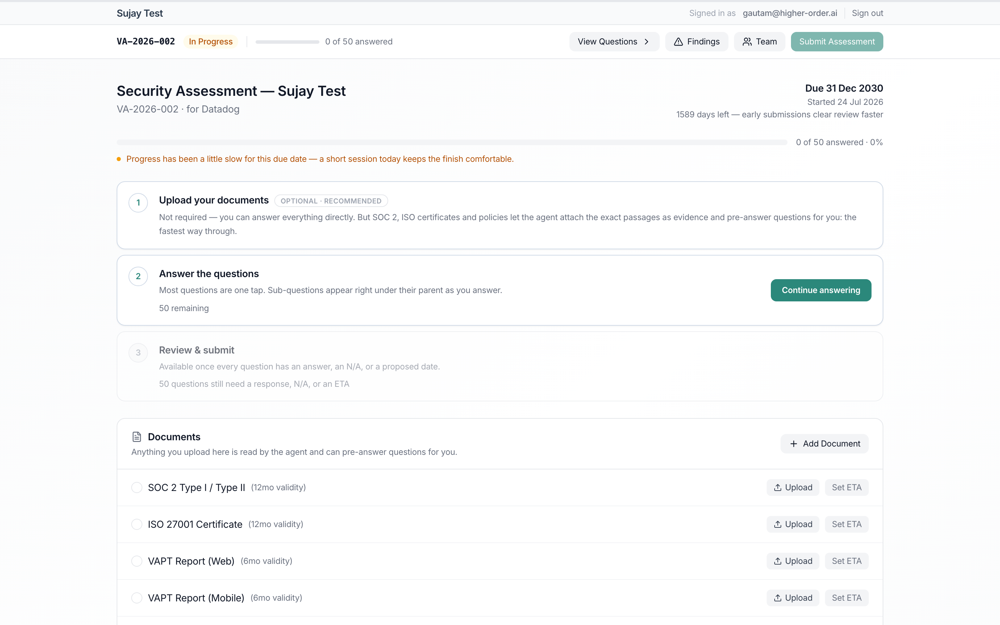

The Vendor Portal is where your third-party vendors respond to the assessments you send them. Vendors log in with an emailed access code, answer questions inline on a single sheet — grouped by questionnaire, domain, and sub-domain — accept answers the platform drafted from their uploaded documents, submit in bulk, and respond to findings the reviewer raises. Rebuilt in August 2026 on a lighter design carrying your brand colors and wordmark.

<Frame caption="The portal overview: the three-step journey, live progress with a pace nudge, and the Documents card.">
  
</Frame>

## What it does

- Presents the assessment as a three-step journey shown as a row of tiles: upload documents (optional, recommended), answer questions, review and submit.
- Takes any number of documents at once through **Add documents** and files each one itself — into the request it answers, or as a row of its own.
- Analyzes uploaded documents against the questionnaire and proposes answers — each with the source document and a confidence score — which the vendor can accept individually or sweep-accept in bulk.
- Shows where each document stands by its own dates — *Valid until*, *Expired*, or *Undated* — and asks the vendor about an out-of-date one before it counts.
- Lets vendors answer directly in the question list; answers stage locally and submit in batches, so a vendor can work through dozens of questions and submit once.
- Shows each question's customer queries and AI analysis inline; flags contradictions between answers.
- Lets the primary contact delegate all or part of the assessment to teammates, each with their own access code and scope.
- Lets vendors respond to findings — post an update with evidence, or request a remediation-date extension (up to 30 days, with justification).
- Enforces that every visible question is answered or marked N/A before submission. Documents are **not** required to submit.

## Inputs

### Login

Vendors visit **`/vendor-portal`** and enter:

- **Email address**
- **Assessment ID** (pre-filled if the vendor clicked the emailed link)
- **Access code** — an 8-digit numeric code emailed to the vendor when the assessment was created

Access codes can be reissued via **Get a new access code**. Requesting a new code invalidates the previous one immediately.

Every vendor email that carries a portal button opens the vendor's own assessment, with the Assessment ID already filled in.

<Note>
A vendor asked for an SLA report receives a separate signed link to an upload page that needs no portal sign-in. See [SLA & Performance](/sla-performance).
</Note>

### Answering a question

Most questions are answered **inline in the list**: pick an option or type the answer, optionally add context, and move on. Every choice question — Yes / No included — shows its options as one stacked list. Each answered row stages locally — a bottom bar counts "*N answered, not submitted*" and a single **Submit N** sends the batch. Rows the server refuses (locked by customer approval, out of scope, already answered) stay staged with a plain-English reason.

Each answer card states where it stands: green with "*Saved — change your answer to update it*" once it holds an answer, amber with a hint naming what is missing while it is outstanding. Secondary actions sit on one row: *Add notes · Add evidence · Doesn't apply to us*.

Opening a question's detail view adds the full response options:

- **Answer with evidence** — attach a supporting file. The upload is analyzed in the background: a "*Checking your document…*" state shows while the AI reads it against the question, and the analysis and evidence count appear on their own — no reload needed. A file the evaluator could not confirm against the question stays listed on it with a **Couldn't confirm** badge and the evaluator's reason, never silently dropped; uploading it again on the same question re-checks it.
- **Doesn't apply to us** — mark as N/A with a required reason. The reviewer decides whether to accept it.

**Cite a passage.** One click puts a passage the vendor is already looking at into the response, with its source: **Cite in my answer** on a text question, **Cite in my notes** on a choice question (the selected option is never touched). It is offered on the answer card's excerpt, on each row of the Evidence panel, and on the suggestion in the question list; the same passage cannot be added twice.

There is no action to propose a later date for a question or a document. Dates proposed before that action was retired still display and still count as resolved.

Accepted file formats: **PDF, DOCX, DOC, TXT, MD, JSON, XML, XLSX, XLSM, XLS, CSV, PNG, JPG, JPEG**, up to **50 MB** per file. Macro-enabled workbooks (`.xlsm`) are read like `.xlsx` — cell values only; macros are never run. Evidence attached on a question is one file per upload; the Overview's Documents card takes many at once (below).

### Adding documents

**Add documents** — on step one's tile and on the Overview's **Documents** card — opens a picker that takes several files; files can also be dropped anywhere on the card. The portal files each upload itself: into the requested document it answers, or as a row of its own. There is no document name or type to enter.

While anything is on its way in, a processing area at the top of the card lists each file as **Uploading**, **Analyzing**, **Waiting**, or **Done**, with the number of questions matched so far and the rough time left. Uploads continue if the vendor moves to another screen, and Submit waits while files are still being sent.

- A newer copy of an audit report, certificate, or attestation letter asks **Replace it** or **Keep both**.
- A file that is already uploaded is not added again; a notice on the existing file's row says so.
- A failed upload stays on the card with **Try again**.

#### Document validity

Each document row carries a chip read from the document's own dates: **Valid until** *date*, **Expired** *date*, **Undated**, or **Grace until** *date* for a document inside its grace period. What happens to an expired or undated upload follows the customer's evidence policy:

- Where the policy asks the vendor, the upload is held and a card — "*This document looks out of date*" — offers **Upload a newer version**, **Use this document anyway** with a written reason, or, when no date could be read, **The date is wrong** with the date supplied. The reviewer sees the vendor's statement beside the document.
- Where the policy refuses it, the upload is rejected with a message asking for a current or dated version.
- An empty or expired SOC 1 or SOC 2 row offers **Upload bridge letter**. A report covered by a bridge letter reads "*Bridged until date*" and names the letter that keeps it current.

When no answers could be filled and every uploaded document is expired, the completion banner says so and names the file and its expiry date. See [Evidence validity](/concepts/evidence-validity) for the rules behind these states.

#### When a document names a different company

If an uploaded document appears to belong to a different company than the vendor under assessment, it is **parked** rather than rejected: the vendor resolves it in the portal with one of four answers — **It's ours** (the name is registered as a known alias), **Third-party document** (with a short note on whose it is), **Wrong file** (withdraws it), or **Decide later**. A document still parked when the questionnaire is submitted is withdrawn. Re-uploading a file that was rejected earlier answers with the stored rejection reason.

Questions can nest: answering a parent question reveals its conditional follow-ups immediately, and not-yet-asked follow-ups appear as read-only previews so vendors can see what's coming.

### AI-suggested answers

When a vendor uploads documents, the platform analyzes them against the questionnaire in the background — a progress banner shows which file is being analyzed, how many questions have been checked, and a time estimate; the vendor can close the page and the analysis keeps running. Where the analysis finds an answer, the question shows a suggestion strip with the proposed value, the source document, and a confidence percentage:

- The suggestion bar quotes the **source passage** — the excerpt the answer was drafted from, with its page reference — beside **Use this**, so a suggestion can be checked without opening the detail page; **show full excerpt** expands it in place, and weaker suggestions carry a caution line.
- **Use this** accepts the suggestion; **Answer myself** dismisses it.
- An **AI suggested** tab collects every open suggestion in one place.
- **Review all** stages every high-confidence suggestion in one click; weaker suggestions must be reviewed one at a time.

### Delegation

The primary vendor contact can delegate from the **Team** tab — the whole assessment, specific domains, or specific questions. Each teammate receives their own access code by email; the owner can re-scope, resend, or revoke access at any time.

### Findings

The **Findings** screen lists findings the reviewer has raised, split into open and all. Due-date chips escalate as the deadline nears — amber from 14 days out, red once overdue — and submitting an update confirms the resulting status change and offers a jump to the next open finding. On each, the vendor can post a remediation update with evidence, or request an extension of the remediation date — a new date up to 30 days out, with a justification and an explicit acknowledgment of the launch impact. One extension request is allowed per finding; its review status (pending, under final review, approved, declined) is visible on the finding card.

A finding card is titled with the question the finding came from and opens from a labelled **Details** toggle. Opened, it shows the vendor's answer, the conversation on that question, the observation, and the recommendation, with **Open question** to jump to the question (Back returns to the finding). A file sent with a finding update becomes evidence on the question — including on a completed assessment — and can be downloaded from the thread. Findings are not repeated on the question page.

## Outputs

### Overview

- The three-step journey with per-step status. Step two offers **Review N suggested answers** when documents have drafted answers
- A violet banner when the risk team is waiting — "*Customer* has asked you 3 questions", with the age of the oldest and a **Reply to questions** button that opens the Customer asked tab. The **View Questions** button in the header carries the same count
- A single progress bar: "*X of Y answered · N%*", with a pace nudge if the vendor is behind schedule and a deadline countdown (amber under 7 days, red when overdue)
- The **Documents** card: one list with a row per requested document and per uploaded file, each with its status (Requested, Uploaded, Processing, Awaiting confirmation, Failed with **Try again**) and validity chip, and the processing area above it while files are being read
- Submit for review (disabled until every question is closed out)

Once the vendor submits, the Documents card stops offering Add documents, Upload, Replace, and bridge-letter actions; downloads and validity chips stay, and a requested document never supplied reads *Not provided*. When the customer closes an assessment the vendor never submitted, steps two and three show as done with "*Closed — the customer has completed their review*" and no Submit button.

### Questions

- **Left rail** — a tree of questionnaire → domain → sub-domain, each row showing answered counts; a "Next unanswered" jump; uploaded documents double as filters ("show the questions this file answered")
- **Center** — the question sheet with sticky section headers, question numbers, inline answering, and status chips (Answered, Not submitted, Approved — locked, Not applicable, Date proposed)
- **Tabs** — All / Answered / Unanswered, plus two lenses: **AI suggested** and **Customer asked** — questions where the reviewer wrote back and the vendor has not yet replied (an approved question leaves the lens, since approval is the customer's final word). Acting on the question counts as the reply: changing the answer, editing the note, marking it not applicable, or attaching evidence is recorded in the question's conversation and takes the question out of the lens, the Overview banner, and the weekday email. The weekday email listing the customer's waiting questions opens the portal on this tab. Counts are per question and agree across the tabs, the rail, and the section headings (Answered + Unanswered = All). The **Unanswered** tab is a worklist: a question group renders as one card with its own progress pill, members already done collapse to a confirmed line with a **Change** action, and a group finished during the visit folds in place. Once everything is answered, the worklist clears to show the submit panel
- **Detail view** — the full question with customer guidance and a right rail with **AI Analysis**, **Messages**, and **Activity** tabs. **Messages** is one thread for the whole question family — a parent and its sub-questions — with each message labelled with the question it is about; a reply goes to the question that has waited longest unless the vendor picks another, and an amber line names the questions when several are waiting. Contradictions with other answers surface as a "Conflicts with another answer" card.
- **Keyboard navigation** — `←`/`→` step between questions in the detail view (`⌘←`/`⌘→` inside text fields); `⌘↵` sends a message

If the customer adjusts the assessment's scope mid-flight — adding or withdrawing domains or questions — a banner tells the vendor what changed.

### Downloads

Vendors can download their own uploaded evidence files and an Excel export of the questions with their submitted answers and latest status.

### Final check before submission

**Submit for review** unlocks once every question is answered or marked N/A — and is held while staged answers are unsubmitted or background evaluation is still running. Clicking it opens the **Final check**: the platform runs the same review engine the customer's risk team uses — deterministic rules over closed-form answers, and a bounded cross-answer contradiction sweep — before anything is submitted. Items it finds are pinned as cards: an answer that does not match what the questionnaire expects, or a pair of answers that conflict. For each, the vendor can open the question and change the answer (the check re-runs when the question closes, and a fix that reveals a follow-up question says so), or leave a **note** explaining why the answer stands. Notes travel with the answer and appear to the reviewer as *Vendor's response (pre-submission)*. The check advises — **Submit** is never blocked by it, and the footer always states why a submit is disabled or failed. If the check itself cannot run, submission proceeds as before.

Submitting ends on a confirmation screen — "Submitted to *customer* · N answers · date" — with one action back to the overview. After submission the assessment moves to Under Review. The Overview's Documents card closes at that point, but evidence can still be attached on individual questions, since the risk team asks most of its questions during review. If the reviewer flags a question, the vendor returns to edit mode with previous state retained.

## Access-code lifecycle

- Codes are exactly 8 digits (numeric).
- Requesting a new code immediately invalidates the previous one.
- Resend is available before and after submission, and on a completed assessment; only an expired assessment refuses.
- The customer can send a fresh code from the engagement's Contacts tab (**Resend invite**).
- An assessment stopped because the customer deleted the vendor no longer opens; sign-in answers "*Assessment no longer valid*".
- Session tokens are stored in `sessionStorage` and cleared when the tab closes; the vendor's place in the portal is restored after a refresh.

## Limitations

- 50 MB per file. Evidence attached on a question is one file at a time; only the Documents card takes several.
- The Documents card closes at submission; later documents go on the question they support.
- Evidence cannot ride along in a batch submit — attaching evidence opens the question's detail view.
- AI analysis reasoning and gap lists are shown only on free-text questions. Choice questions deliberately show none, since listing gaps would telegraph the expected answer.
- No "save draft" across sessions — staged answers live in the browser tab until submitted.
- Delegation is per-assessment; delegates cannot see the vendor's other assessments unless separately invited.
- The portal has no self-service account creation. All access is code-based; codes are issued by the customer creating the assessment.
