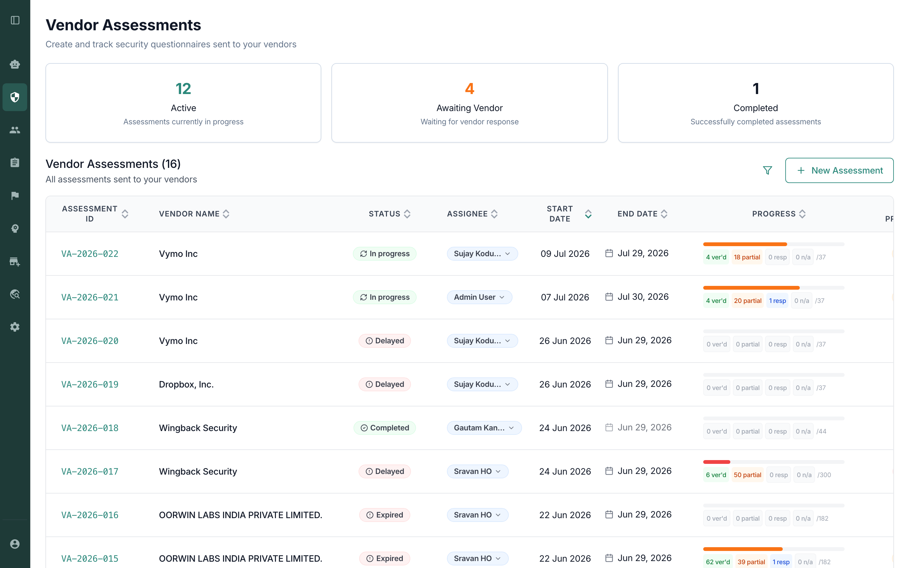
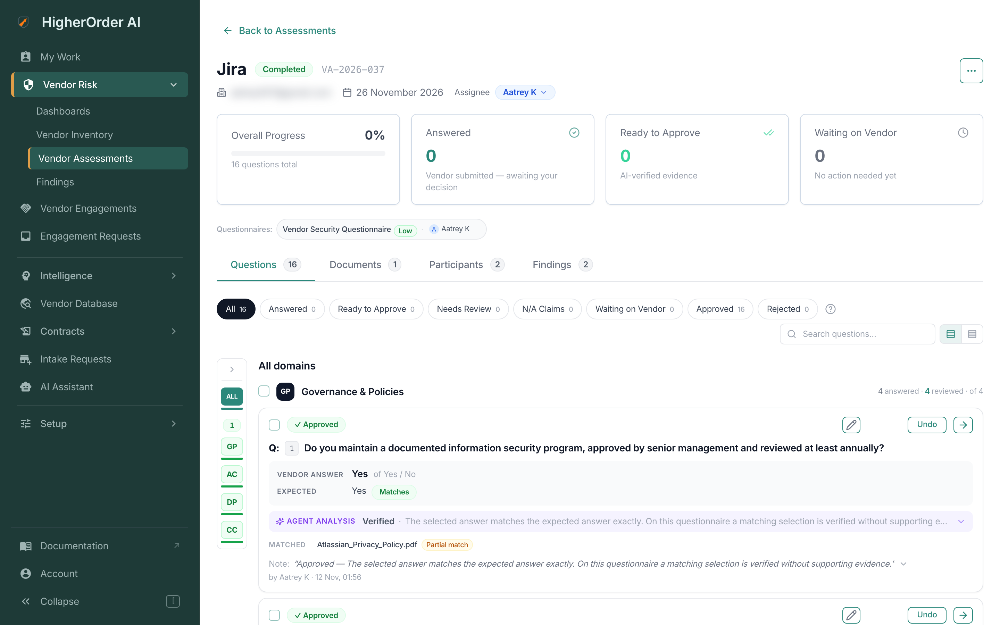
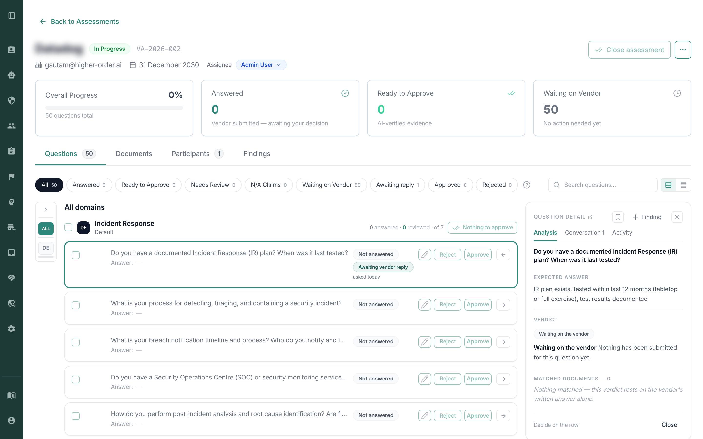
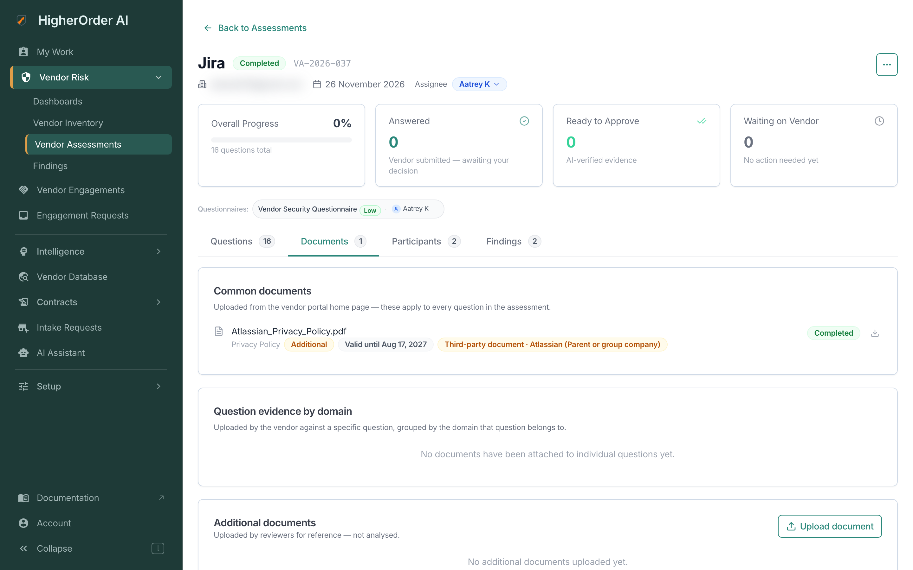

Vendor Assessments is the customer-side workflow for sending a questionnaire to a vendor, reviewing each answer as it comes back, and closing the assessment when every question is decided. Reviews run in a **review workbench** built for volume: a domain rail with live progress, one-click approve/reject with pre-composed notes, bulk approval of AI-verified answers, and a risk score that updates as the vendor answers. A vendor who replies by email instead of the portal is covered too — an uploaded workbook imports into the same assessment machinery.

For the vendor-facing surface, see [Vendor Portal](/vendor-portal). For how assessments launch from an engagement, see [Engagements](/engagements).

<Frame>
  
</Frame>

## What it does

- Create an assessment by picking a vendor, one or more questionnaires, and a deadline; or launch the assessments an engagement's plan calls for after reviewing their scope.
- Review every answer in the workbench — approve or reject in one click, with the note composed before the click and recorded on the question.
- Bulk-approve AI-verified answers — per domain, per selection, or across the current view — behind a review dialog with per-question editable notes.
- Run several assessment tracks in parallel on one engagement, or merge several questionnaires into one assessment.
- Adjust scope after launch: add questionnaires or domains, or withdraw domains with a justification the vendor sees.
- Import a vendor's completed Excel questionnaire; imported answers land in the same statuses and review queues as portal answers.
- Read every document's validity from its own dates, and keep reviewer reference files alongside the vendor's uploads.
- Close the assessment once every asked question is decided — the vendor, the business owner, and TPRM are told the answer review is complete.

## Creating an assessment

**New Vendor Assessment** opens a dialog:

- **Vendor** (required) — from your inventory. Once a vendor is picked, every questionnaire is on offer.
- **Questionnaires** (required) — depends on the tenant's launch mode (below). In **merged** mode, a checklist of every questionnaire, each of which can be narrowed to some of its categories, with one marked **primary**; the primary questionnaire's document checklist and evaluation settings govern the assessment. In **parallel** mode, a single questionnaire.
- **Agent verification** (optional override) — the [evaluation mode](/vendor-risk/questionnaire-templates#evidence-policy-evaluation-mode) for this assessment. Left on *Questionnaire default*, the assessment uses the mode set on the questionnaire.
- **Vendor contact name and email** (required) — the primary contact who will receive the invite. Only the address format is checked, so a vendor without a corporate domain can be invited.
- **Deadline** (optional) — a target date the vendor sees on their portal. Left blank, the vendor gets the due days set on the selected questionnaires, added together.
- **Send to vendor immediately after creating** (checkbox) — if unchecked, the assessment is created in **Draft** and can be sent later.
- **Allow the vendor to invite teammates from other email domains** (checkbox) — by default the vendor can forward the assessment only to colleagues on their own domain. Personal email addresses are never allowed for teammates.

### Launch mode

The **Assessment launch mode** tenant setting (Administration → Tenant Settings) decides how several questionnaires reach one vendor:

- **Merged** (the default) — every questionnaire goes to the vendor as one assessment and one invite. See [Merged questionnaires](#merged-questionnaires).
- **Parallel** — one assessment per questionnaire, each on its own track. A questionnaire that an engagement's plan routes through several rules is still sent once, with the scopes combined. See [Parallel assessment tracks](#parallel-assessment-tracks).

### Launching from an engagement

Assessments launched from an [engagement](/engagements#stage-4-run-the-assessments) skip the dialog above. The engagement's plan selects the questionnaires, and TPRM reviews the planned scope in a launch dialog before anything is sent — nothing launches on its own when the Service Risk Profile is submitted. The launch needs a **justification**, which is recorded in the engagement history; this applies to the pre-onboarding questionnaire and to a post-onboarding assessment alike.

## Assessment states

| State | Meaning |
|---|---|
| **Draft** | Created but not yet sent |
| **Sent** | Invite email dispatched; vendor has not started |
| **In Progress** | Vendor has started answering |
| **Submitted** | Vendor has clicked Submit; awaiting customer review |
| **Under Review** | Customer is actively reviewing questions |
| **Completed** | Customer has closed the assessment; vendor portal is locked |
| **Expired** | Deadline has passed and status is still Sent or In Progress; extending the deadline returns it to In Progress |

## The review workbench

The Questions tab is a three-column layout: a **domain rail**, the **question list**, and a **detail pane**. Both side panels collapse (and start collapsed, so questions get full width); layout preferences persist per reviewer.

### Domain rail

- Domains in template order, each with a two-track progress bar — pale for *vendor answered*, solid for *reviewer decided* — and stacked `answered/total` and `decided/total` counts. A domain turns green when fully decided.
- Sub-domains nest under the selected domain.
- A **Sort by: least answered** toggle turns the rail into a chase list of what's outstanding.
- A live **risk-score chip** shows the current [assessment risk score](/concepts/risk-scoring) — marked as in-flight until the assessment closes, when the score is stamped final.
- Each domain carries its own **score chip**, shown from that domain's first scored answer — before the overall score's coverage threshold is met — so weak domains surface while the vendor is still answering. A domain with no scored answers shows no chip, never a zero.

### The question list

Questions group into domain › sub-domain sections. Each row carries one status chip and three fixed actions: **decide with note**, **Reject**, and **Approve** — the note is composed and visible *before* the click, so approving is genuinely one click. A decided row's primary action becomes **Undo**. On an N/A claim the same buttons record accept-N/A / reject-N/A.

The status chip, the domain path, and the buttons share the row's first line. Everything under it runs the full width of the row, in a fixed order:

- **Vendor answer** and **Expected** — two labelled rows in one block, the same shape for every question type. A choice answer carries a **Matches** or **Differs** badge against the expected answer. Where the template defines no expectation, the Expected row reads *Not set* and says what that means: a choice question always comes to a person, and a text answer is judged on the answer and evidence alone.
- **Agent analysis** — the agent's output, set apart in its own violet zone so generated text is never mistaken for the vendor's. Folded, it is one line with the verdict and the first point not covered; opened, it lists the points **not covered**, other cautions, the reasoning, and the matched documents.
- **Decision note** — the note that will be, or was, recorded with the decision.

The answer, the agent zone, and the decision note open and fold independently.

A follow-up question names its parent in its header ("follow-up to 6.3"). When a filter, a search, or the domain selection has taken the parent out of the list, the follow-up shows a **Parent** block instead — the parent question and the vendor's answer to it — and clicking the block opens the parent in the detail pane.

<Frame caption="A question row in the review workbench: the Vendor answer and Expected block, the Agent analysis zone opened, and the decision note.">
  
</Frame>

The toolbar filters the list with **bucket pills** — All, Answered, Ready to Approve, Needs Review, N/A Claims, Waiting on Vendor, Awaiting reply, Approved, Rejected, Bookmarked (the last two of these appear only when they have something to show) — plus search, a questionnaire filter on merged assessments, and a density switch. A `?` legend defines every bucket in place.

**Awaiting vendor reply.** A question where the risk team wrote to the vendor last and the answer is not yet approved carries a teal *Awaiting vendor reply* chip under its status with the age of the ask ("asked 3 days ago"); the **Awaiting reply** pill filters to them. The same questions are listed per questionnaire on [My Work](/my-work), mailed to the vendor each weekday (09:00 tenant time by default; the schedule is set under [Notifications](/administration/notifications)), and shown to the vendor on the portal's *Customer asked* tab — one rule, so every surface agrees. A vendor who acts on the question — changes the answer, edits the note, marks it not applicable, or attaches evidence — has replied, and the chip clears; setting an ETA does not count.

**Vendor updated.** A question the vendor has touched since the team last looked at it carries a blue chip — **New reply**, **Answer updated**, or **New document** — with its age, in every bucket including Ready to Approve. "Last looked" is team-wide: anyone opening the question, messaging the vendor on it, or deciding it. Opening the question clears the chip for the whole team. A vendor's first answer to a question carries no chip; it arrives through the normal review buckets.

<Frame caption="A question the reviewer has written to the vendor about: the Awaiting vendor reply chip with its age, the Awaiting reply pill in the toolbar, and the detail pane's vendor thread.">
  
</Frame>

### What the reviewer sees — and when

Until the vendor actually submits an answer, an N/A claim, or an ETA on a question, the reviewer sees **nothing AI-generated for it** — no score, no gaps, no suggested answer. Evidence uploads alone don't count as a submission. This keeps the review honest: decisions are made on what the vendor said, not on what the platform guessed they might say.

On a template in **audited-reports-sufficient** mode, a closed-form question (yes/no, single- or multi-select) with a defined expected answer is judged **deterministically** — a matching selection auto-verifies with no model call, and a shortfall is held for the reviewer with the unticked options listed as gaps. A closed-form question with **no** expected answer configured is never auto-verified; it always waits for a human decision. Text questions still go through model evaluation.

A further mode, **answers or audit reports accepted**, does everything audited-reports-sufficient does and also accepts a complete written answer without evidence. A written answer to a question with an authored expected answer is judged on whether it answers the question, and the reviewer reads the verdict as a verdict on the answer: **Answer accepted**, **Answer incomplete** (with the specifics it leaves out), or **Document required** when the expected answer asks for a document and none is attached. A follow-up answer that contradicts its parent's answer is held and says so.

The mode is set on the questionnaire and can be overridden per assessment at creation; an assessment in flight keeps the mode it was launched with. See [evaluation mode](/vendor-risk/questionnaire-templates#evidence-policy-evaluation-mode).

### Attention items — gaps and contradictions

Each answered question carries a consolidated attention list, in severity order: **gaps** — labelled **Not covered** on screen — for what the answer is still missing, **contradictions** (conflicts with another answer, from the post-submission consistency sweep), **expected options left unticked**, **no supporting evidence**, and evidence that has **expired** (see [Documents and validity](#documents-and-validity)). The scope header counts how many questions "need a second look," and any of these marks a question unsafe for bulk approval.

An answer that scores high without actually meeting the defined expectation is held at **partial** — it is excluded from Ready to Approve and from bulk approval, and must be walked one by one.

### Control-mapped questions

A question the template maps to SOC 2 criteria or ISO 27001 controls (see [control crosswalk](/vendor-risk/questionnaire-templates#control-crosswalk)) is judged from the vendor's audit report rather than from its "Yes". Its row and detail pane carry a **Controls checked** pane — one line per mapped criterion: in scope, tested (with the auditor's sample size), and the result — with the auditor's exception text and management response quoted beneath, and the report named in the header. The verdict is **Verified** when every mapped control is in scope and tested with no exceptions; an exception or an untested control holds it at **Partial**; with no accepted report on file the row is capped and says so. An auditor exception is its own attention item — **Exception** — and drops the row out of the *Approve N ready* batch into *Needs a second look*. Where the "nothing matched" line would normally say the verdict rests on the vendor's written answer, a control-mapped question says instead that it rests on the controls check against the named report.

### The detail pane

Opening a question shows three tabs — **Analysis** (the vendor's answer and the expected answer, the agent analysis, matched documents with passages, and what was searched without a match), **Vendor messages**, and **Activity** — plus the question's family (parent and sub-questions), findings raised from it, bookmark, and **Create finding**. A message composer posts to the vendor without changing status. Decisions stay on the row — the pane is for reading, not deciding. The pane's header and close button stay in reach while the page or the pane scrolls.

- **Who wrote what.** Messages and activity entries name their author. A vendor's upload appears in the activity as "Attached *file*".
- **What the vendor changed.** When the vendor has changed a question the team had already looked at, the Analysis tab shows a "Vendor changed this" strip — the answer and note before and after, plus new files — until someone approves, rejects, or replies. When the update is a reply, the pane opens on Vendor messages.
- **Replies after completion.** A completed assessment no longer offers the message box, with one exception: a question that still holds an open finding keeps it, so a reviewer can answer the vendor's finding updates. Nothing else on the question is unlocked by this.

The full question page, linked from the pane, adds two things. The **note recorded with an approval or rejection** can be edited there — or added where none was recorded — without touching the decision. **Internal notes** are team-only notes on the question, each optionally with a file; they never reach the vendor, and an attached file is also listed under the assessment's [Additional documents](#additional-documents).

## Bulk approval

Bulk approve exists in three scopes, all funneling through one review dialog:

- **Approve N ready** on the scope header — everything auto-approvable in the current view
- **Approve N ready** on a domain section — the same, scoped to that section
- **Approve N** on the selection bar — whatever the reviewer ticked

"Ready" means AI-verified **and** bulk-safe: no gap, no contradiction, no unticked expected options, no missing evidence. Ticking rows by hand can include cautioned questions — that's explicit consent, and the selection bar says how many carry a caution. The dialog lists every question with the expected answer, the vendor's answer, and an **editable note** per row; any row can be unticked before submitting. Batches are capped at 200 per submit. When some questions in a batch cannot be approved (already decided, not answered), the dialog ends on an outcome view — "62 approved · 2 couldn't be" — listing each refused question with its reason; the refused questions are unticked, since the reason is final for that question. If the whole submit fails, nothing was recorded and the dialog keeps the batch and its notes for a retry. Every bulk approval writes the same per-question record as a manual one, so **Undo** still works question by question.

There is no bulk reject.

## Documents and validity

The assessment's **Documents** tab has three sections: **Common documents** (uploaded from the vendor portal's home page, applying to every question), **Question evidence by domain** (uploaded against a specific question), and **Additional documents** (the review team's own reference files).

Each vendor document row names the document by its own type — read from the document, not from the checklist slot it was filed under — and carries a validity chip computed from the document's own dates and the tenant's evidence policy:

| Chip | Meaning |
|---|---|
| **Valid until** *date* | Current |
| **Grace until** *date* | Lapsed, but still accepted until the policy's grace period ends |
| **Expired** *date* | Past its validity. An answer resting only on it waits under Needs Review, with the file and its expiry date given as the reason |
| **Undated** | No date could be read from the document |
| **Bridged until** *date* | A SOC report whose audit period has ended, kept current by the vendor's bridge letter. The row shows the real audit period end and links the letter |
| **Date disputed** | The date read from the report contradicts the confirmed one and would make the document expired |

The same Expired and Date disputed chips appear beside matched documents on the question row and in the detail pane. A bridged report is not treated as expired, so answers resting on it are not held.

Where the evidence policy asks the vendor about an expired or undated document rather than refusing it, the vendor's statement is shown under the document. When the vendor supplies a date the document does not show, the reviewer answers in one click: **Confirm the vendor's date**, or **Return to vendor** with a note. Until the date is confirmed the document counts as expired.

For the rules behind the chips — validity months, grace, bridge letters, and what happens to expired or undated uploads — see [Evidence validity](/concepts/evidence-validity).

<Frame caption="The Documents tab of an assessment: validity chips on the vendor's documents, and the Additional documents section.">
  
</Frame>

### Additional documents

Reviewers upload reference files to the assessment under **Additional documents**, each with a required comment saying why it was added. These files are stored only — not analysed, not matched as evidence, and given no type or validity. They can be added after the assessment is completed. The comment stays editable; a file can be edited or deleted by the person who uploaded it, or by an admin or manager.

Evidence and reference uploads accept PDF, Word, Excel (`.xlsx`, `.xlsm`, `.xls`), CSV, and plain-text files, plus PNG and JPEG images; vendor evidence also takes Markdown, JSON, and XML. A macro-enabled workbook (`.xlsm`) is read like `.xlsx` — cell values only; macros are never run.

## Parallel assessment tracks

An engagement can fan out into multiple concurrent assessments — for example a privacy questionnaire and a security questionnaire on separate tracks — each with its own questionnaire, timeline, observation report, risk score, and sign-off:

- The engagement hero shows a **track matrix**: one row per track across a shared eight-step chain (Sent → Received → Reviewed → TPRM Observations → Findings → Business Owner Review → Head Approval → Closed), with each track's next action. **Reviewed** is the moment TPRM presses *Close assessment*, shown with its date. The two approval steps apply only when the vendor asks for more time on a finding; on a track with no extension request they show as skipped.
- Every assessment-scoped tab carries a **track switcher**; the selection follows you across tabs.
- A vendor-level Risk Assessment shared across engagements appears as its own (read-only from sibling engagements) lane.
- The engagement completes only when **every** track is confirmed and every finding is closed.

## Merged questionnaires

Alternatively, one assessment can be assembled from **several questionnaire templates — or category subsets of them**. A scope picker records which template and which categories each block came from, why, and by whom; one questionnaire is **primary** and its document checklist and evidence policy govern the assessment.

On a merged assessment, a chip strip names each questionnaire with its own risk rating (each scores against its own template's bands; the assessment score is their average). With two or more questionnaires, each can carry an **assignee** — a soft assignment that routes the work without locking anyone out. Assignees are set automatically at launch by the tenant's [assignment routing](/administration#assignment) (by questionnaire kind: the engagement owner, a named person, or the least-loaded of several); reassigning by hand from the chip emails the new assignee a link that opens the review workbench pre-filtered to their questionnaire. Clicking a chip filters the question list to that questionnaire. The assessments list marks runs that have something to decide with a **Needs Review** chip.

## Adjusting scope after launch

**Edit scope** on an in-flight assessment adds questionnaires or domains, or withdraws domains and sub-domains — the unit is always the domain, never an individual question. The flow:

- The dialog opens on the live scope; untick domains to withdraw, tick to add, and add whole questionnaires from the catalogue. Plan-mandated questionnaires are locked.
- A pinned diff footer states exactly what will change, and a **justification is mandatory** — it is emailed to the vendor and quoted on their portal.
- Withdrawals get a second confirmation pass listing everything to be removed.

Withdrawn questions are never deleted: answers and decisions are kept but stop counting toward progress, completion, and the risk score. Findings already raised from a withdrawn question keep running. The rail shows a dashed **Withdrawn** section whose contents are read-only, with the recorded reason quoted. Re-adding a withdrawn domain revives the same questions — with their answers — rather than starting over.

## Importing an emailed questionnaire

Some vendors never touch the portal — they email back a filled Excel workbook. **Upload questionnaire** (on the assessment menu, or in the **Assessments** section of the vendor page's Overview tab when no assessment exists yet) imports it into a standard assessment. The import takes `.xlsx`, `.xlsm`, `.xls`, and `.csv` files:

<Steps>
  <Step title="Upload and confirm columns">
    The platform proposes each sheet's question, answer, and comment columns; the reviewer confirms or overrides them. Sample rows show what was detected — including embedded reviewer comments.
  </Step>
  <Step title="Match a questionnaire">
    From the vendor page, the import ranks your templates by how many workbook questions each one covers — up to five candidates, each offering either "adds to the assessment already open" or "opens a new assessment." A workbook that matches nothing is refused, not force-fitted.
  </Step>
  <Step title="Check the dry run">
    Before anything lands, the dialog shows *Questions in file / Answered / Will import*, and a downloadable dry-run workbook lists every row with whether it will import, the matching rule in plain words, and a "Needs attention" sheet you can forward to the vendor. The preview is computed by the same code as the import, so the number on screen is the number that lands.
  </Step>
  <Step title="Import runs in the background">
    Rows that deterministic matching can't place go to a batched model adjudication with a strict confidence floor — anything below it is skipped, not guessed. Comments come in as the vendor's additional context and are read by the evaluation. A progress banner tracks the run; large questionnaires take minutes because every answer is evaluated on arrival.
  </Step>
</Steps>

Imported answers are stored exactly as portal answers and run the same evaluation ladder — auto-verified, partial, or needs-input — so bulk approval and the review queues work on them unchanged. An import never overwrites a vendor's own portal answer or an approved question; re-uploading a corrected workbook is expected and safe.

## Closing, reopening, extending

- **Close assessment** locks the assessment once every asked question is decided. The vendor portal locks with it. Closing is one-way — there is no assessment-level reopen.
- On an assessment that belongs to an engagement, closing sends an **Answer review complete** mail: the vendor is told their answers have been reviewed, and the business owner and TPRM that the observations are being drafted. It is on by default and can be switched off under [Administration → Notifications](/administration/notifications). The track matrix marks the **Reviewed** step with the date.
- **Undo** on any question restores its previous state — the vendor's answer, evidence, and conversation are preserved — and works even after the assessment is closed, for corrections.
- An **expired** assessment can be extended; updating the deadline returns it to In Progress. The vendor is not automatically re-notified — send a message if they need a nudge.

## Participants — who's answering on the vendor side

The **Participants** tab shows everyone the vendor has invited into the assessment (primary contact plus delegates), each participant's email, role, scope (full access or a subset of domains/questions), status, and last activity. Delegation itself is managed by the vendor's primary contact from the [Vendor Portal](/vendor-portal).

## Limitations

- Bulk approval covers approvals only; rejections are per question.
- Scope withdrawal works at the domain/sub-domain level — individual questions cannot be withdrawn, since a half-removed domain would keep full scoring weight while being judged on a fragment.
- Reviewers cannot edit the expected answer or the agent's list of points not covered. Disagreement is handled by messaging the vendor or raising a finding.
- Extending a deadline updates the vendor-facing countdown but does not re-send the invite email.
- Questionnaire import requires the workbook to contain at least one answer; a blank questionnaire is rejected without touching the assessment.
