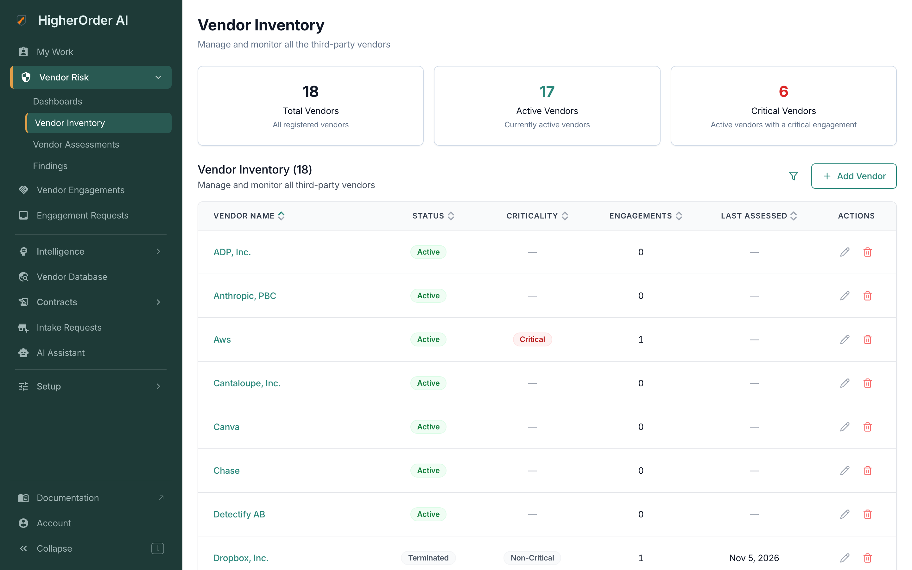
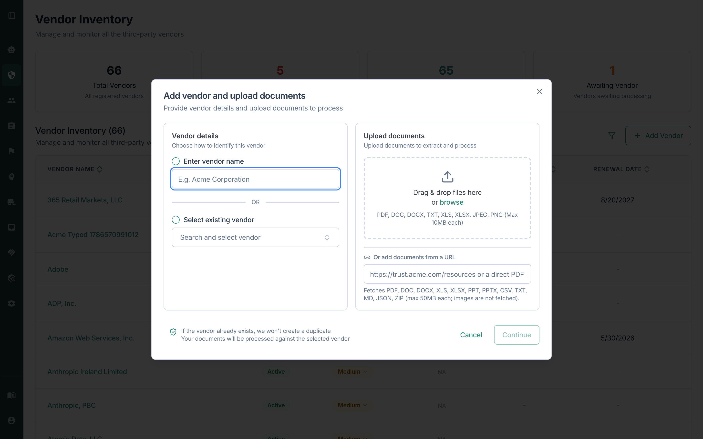
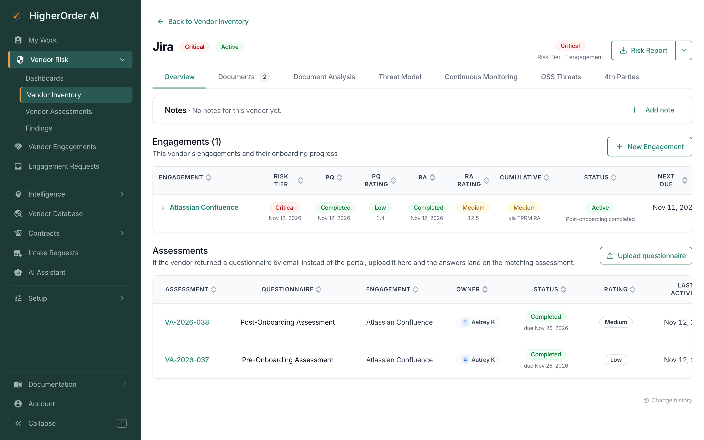
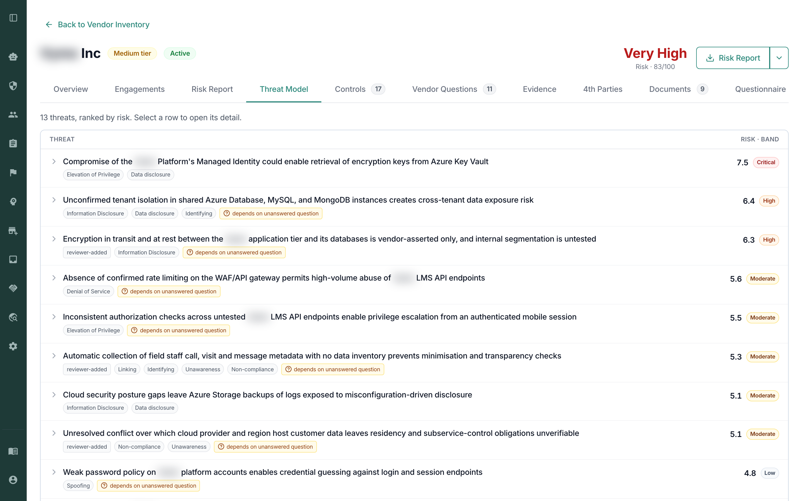
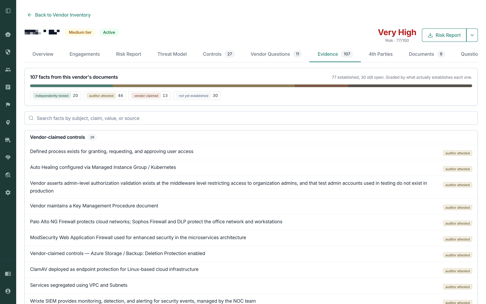

The vendor inventory is the central list of every third-party vendor in your tenant. Each row shows the vendor's status, its criticality, how many engagements it has, and when it was last assessed. Clicking a vendor opens that vendor's profile — its engagements and assessments, its documents, the analysis of those documents, the threat model, and the downloadable risk report.

<Frame>
  
</Frame>

## What it does

- Lists every vendor in the tenant, with free-text search and filters for **Status** and **Criticality** (Critical, Non-Critical, Not classified).
- Shows three summary cards at the top: **Total Vendors**, **Active Vendors**, and **Critical Vendors** — active vendors with at least one critical engagement.
- Derives **criticality** from the vendor's engagements rather than from a label someone maintains by hand. See [Criticality](#criticality).
- Tracks vendor lifecycle status: **Active**, **Pending** (documents uploaded but extraction in progress, displayed as `Processing`), **Prospect**, **Terminated**, **Deleted**.
- Sorts every column ascending or descending. Vendors with no criticality always sort last.
- Lets administrators **rename** a vendor and record the other name it goes by, and **delete** a vendor with a preview of everything the delete will close. See [Rename and delete](#rename-and-delete).

## Inputs

Vendors enter the inventory through the **Add Vendor** action, which opens a dialog with two halves:

<Steps>
  <Step title="Identify the vendor">
    Select an existing vendor from the combobox or enter a new vendor name. Selecting an existing vendor attaches the uploaded documents to that vendor; a new name creates a new vendor record.
  </Step>
  <Step title="Add supporting documents">
    Drag-and-drop one or more files, or browse to attach them. Supported types: PDF, DOCX, TXT, XLSX, XLSM, up to 10 MB per file. Password-protected files are accepted with a password field. Or paste a URL to fetch documents instead — see [Add from a URL](#add-from-a-url).
  </Step>
</Steps>

Typical documents uploaded at intake:

- Vendor contracts and order forms
- SOC 2 Type II reports
- ISO 27001 certificates and Statements of Applicability
- VAPT (penetration test) reports
- Privacy policies
- Completed security questionnaires
- Architecture diagrams (drives threat modeling)

The dialog closes immediately on submit. The new vendor appears in the inventory in the `Processing` state while extraction runs in the background.

### Add from a URL

<Frame caption="Add Vendor: paste a URL instead of uploading — a trust-center page or a direct document link.">
  
</Frame>

Instead of uploading files, paste a **URL** — from the Add Vendor flow, or from an existing vendor's **Documents** tab. The URL can be a direct document link or a page hosting several documents, such as a public trust center or a support-portal attachment page. The platform fetches what it finds — up to 25 documents per run, 50 MB per file — and each fetched file enters the same pipeline as an upload: classification, analysis, threat assessment.

- **The vendor name is optional** on Add Vendor. Left blank, the platform identifies the vendor from the first fetched document and attaches the rest to it.
- **Recognized trust centers hand off.** If the page is a SafeBase or Conveyor trust center, the run saves it as the vendor's Trust Center, pulls its public documents through the standard trust-center machinery, and reports how many documents are NDA-gated (fetch those via **Fetch from Trust Center** once access is granted).
- **Every run produces a per-document report** — what was fetched, what was skipped, and why — visible while the run progresses.

Re-running the same URL re-analyzes nothing: already-ingested documents are recognized and skipped.

A PDF that wraps other files — a cover letter carrying a trust package of embedded reports and spreadsheets — is unpacked automatically: each embedded file is extracted and registered as a document of its own, classified and analyzed independently. One portfolio upload lands as the wrapper plus every attachment on the vendor's Documents tab. This applies on every ingestion path (upload dialogs, vendor portal, trust center, SharePoint, OneDrive, Dropbox).

## Outputs

For each vendor, the inventory shows:

| Column | Meaning |
| --- | --- |
| Vendor Name | Links to the vendor profile |
| Status | Active / Processing / Prospect / Terminated / Deleted |
| Criticality | **Critical** or **Non-Critical**, from the vendor's engagements; a dash when no engagement has been classified |
| Engagements | Number of counted engagements for the vendor |
| Last Assessed | Completion date of the vendor's most recent engagement assessment, of any questionnaire type |
| Actions | Rename and delete — administrators only |

### Criticality

A vendor is as critical as the most critical thing you use it for. The platform reads the vendor's **counted engagements** — those in progress, onboarded, on hold, or offboarding; for a terminated or deleted vendor, all of its engagements — and applies one rule:

- **Critical** — at least one counted engagement is classified critical.
- **Non-Critical** — at least one counted engagement has been classified, and none is critical.
- **Not classified** (shown as a dash) — no counted engagement carries a classification yet.

The same rule feeds the list, the Criticality filter, the **Critical Vendors** card, and the Critical vendors tile on the [Vendors dashboard](/dashboards), so the numbers agree. Classification itself happens on the engagement — see [Engagements](/engagements#stage-3-classification).

<Note>
The manually set vendor **Tier** (Critical / High / Medium / Low) was removed in November 2026, along with the Tier, Category, Annual Value, Renewal Date, and Risk Band columns on this list. Criticality and the engagement risk tier replace it; contract value and renewal dates remain on [Vendor Contracts](/contracts/vendor-contracts).
</Note>

### Vendor profile

Clicking a vendor name opens that vendor's profile.

<Frame caption="Vendor profile — Overview, with the vendor's engagements and assessments">
  
</Frame>

The header carries the vendor name, its criticality chip and status, and a **Risk Tier** rating — the worst service risk tier across the vendor's counted engagements, with the number of engagements behind it. **Risk Report** downloads the vendor risk report.

Tabs:

- **Overview** — three blocks:
  - **Notes** — one shared note per vendor that anyone on the team can edit. If two people edit at once, the second is shown the other version and chooses which to keep.
  - **Engagements** — the vendor's engagements in the same table as the [Engagements](/engagements) list (risk tier, pre-onboarding and Risk Assessment status and rating, cumulative rating, status, next due, owner). **New Engagement** opens the wizard with this vendor already chosen and its domain and contacts filled from the vendor record.
  - **Assessments** — the five most recent assessments for the vendor, including those launched from engagements, with questionnaire, engagement, owner, status, and rating; **View all** loads the rest. **Upload questionnaire** takes a questionnaire the vendor returned by email and lands the answers on the matching assessment.
- **Documents** — every document uploaded or auto-fetched for this vendor. Documents sourced from a public Trust Center carry a shield icon. Failed or rejected documents can be reprocessed or soft-deleted; reuploading a previously deleted document restores its prior analysis. A document whose company name does not match the vendor is held with a [name-conflict question](#name-conflicts-on-upload).
- **Document Analysis** — the per-analyzer results, as sub-tabs: **Overall Risk** (the validated risk band, coverage, and per-analyzer contribution), then a summary per document type present — SOC 2, ISO 27001, Contract Analysis, Privacy, VAPT. A document uploaded as a VAPT report that turns out not to be one — a program summary, a policy, an attestation letter — gets an explanatory verdict card stating what it is and which signals of a real test report are missing, with upload and regenerate actions, rather than an empty analysis.
- **Threat Model** — four sub-tabs:
  - **Threats** — the vendor's threats ranked by computed risk band, each expanding in place to its DREAD dimension detail and provenance. The assessment is built from **all** of the vendor's documents and runs automatically when the vendor is created and as documents arrive.
  - **Controls** — recommended controls in three lists: **buyer-side** controls (each with a "check via" verification pointer and the threats it addresses), **vendor-side** controls, and **SOC 2 complementary user-entity controls**.
  - **Vendor Questions** — the open questions and claims needing evidence that the assessment could not establish, each showing which threat scores currently assume an answer.
  - **Evidence** — the security fact sheet: every fact pulled from the vendor's documents, grouped by subject, each with an evidence-grade chip and its source document. Searchable.
- **Continuous Monitoring** — **Policy Watch**: the vendor's public policy documents under watch, when each was last checked, and changes awaiting review. See [Policy Watch](/vendor-risk/policy-watch).
- **OSS Threats** — open-source vulnerability findings matched to this vendor. See [Threat Intelligence](/threat-intelligence).
- **4th Parties** — sub-processors declared by the vendor.

<Info>
The **Threat Model** tab and **Policy Watch** are modules HigherOrder switches on per tenant. If your tenant does not show them, ask your HigherOrder contact.
</Info>

<Frame caption="Threat Model → Threats: threats ranked by risk, with the STRIDE categories each one maps to and the answers each score depends on.">
  
</Frame>

<Frame caption="The Evidence sub-tab: the vendor's security fact sheet, graded by what actually establishes each fact — independently tested, auditor attested, vendor claimed, or not yet established.">
  
</Frame>
### Rename and delete

Both actions are in the **Actions** column and are available to administrators.

**Rename** (the pencil) edits two fields:

- **Registered name** — the legal name on contracts and certificates. This is the name shown across the app and in the vendor's portal; changing it renames the vendor on every engagement and assessment.
- **Also known as** (optional) — another name the vendor goes by. It is not shown on screens, but documents that use it are still matched to this vendor.

A name already used by another vendor — as its registered name or its other name — is refused, with the conflicting vendor named.

**Delete** (the bin) marks the vendor **Deleted** rather than removing it. The confirmation dialog lists exactly what will change before you commit:

- the vendor goes from its current status to **Deleted**,
- each open engagement moves to **Not Selected**,
- in-progress assessments are stopped, and the vendor's portal access to them ends,
- open findings are closed.

A deleted vendor stays in the list with a red **Deleted** badge and is left out of the summary cards. Its engagements can be found with the **Vendor Deleted** filter on the Engagements list. Starting a new engagement or uploading a matching document for the vendor brings it back to active.

### Name conflicts on upload

When an uploaded document names a company that does not match the vendor it was uploaded for, the document is held and the platform asks one question: *is this the same company?*

- **Yes, same company** — the document is kept, and the name on the document is saved as the vendor's **Also known as**, so later documents under that name match without asking. Editing the registered name at this point renames the vendor everywhere.
- **No, but keep the document** — the document is attached without changing the vendor's names.
- **Reject** — the document is discarded.

Recording a name needs an administrator; other users can keep or reject the document. The same question appears on the vendor's **Documents** tab for any document still held.

## How it works

The inventory loads vendors for the current tenant from the backend. Criticality, the engagement count, and the last-assessed date are computed from the vendor's engagements each time the list loads, so they move as engagements are classified, onboarded, or closed.

The risk band on **Document Analysis → Overall Risk** reflects evidence across all document types uploaded for that vendor — security reports, contracts, questionnaires, VAPT, privacy policies. It updates as new evidence is processed, as documents are reprocessed, and as the platform re-evaluates standards (see [Vendor Contract Standards](/vendor-risk/contract-standards)).

New vendors created via **Add Vendor** are visible immediately in the `Processing` state. Once document extraction finishes, the status transitions to `Active`.

Documents can also enter the inventory automatically via **Trust Center extraction** — for vendors whose public Trust Centers are supported, the platform can pull public evidence directly. Trust Center-sourced documents are marked with a shield icon. See [Trust Center Extraction](/vendor-risk/trust-center).

## Limitations

- Criticality is blank until one of the vendor's engagements has been classified; a vendor added only through **Add Vendor**, with no engagement, shows a dash.
- Last Assessed counts completed engagement assessments. Document analysis alone does not set it.
- The header Risk Tier counts engagements tiered Critical, High, Medium, or Low; an engagement with no tier yet is left out of the rating and its count.
- A full threat assessment takes up to an hour or so after documents land; the Threat Model sub-tabs show an in-progress notice and fill in without a reload. A vendor with no documents gets no assessment.
- URL ingest fetches up to 25 documents per run at 50 MB per file. Pages that require a login or NDA cannot be fetched — for gated trust centers, the run reports the gated count and the documents come through the Trust Center flow once access exists.
- Deleting a vendor closes its open engagements, assessments, and findings. Reactivating the vendor does not reopen them.
