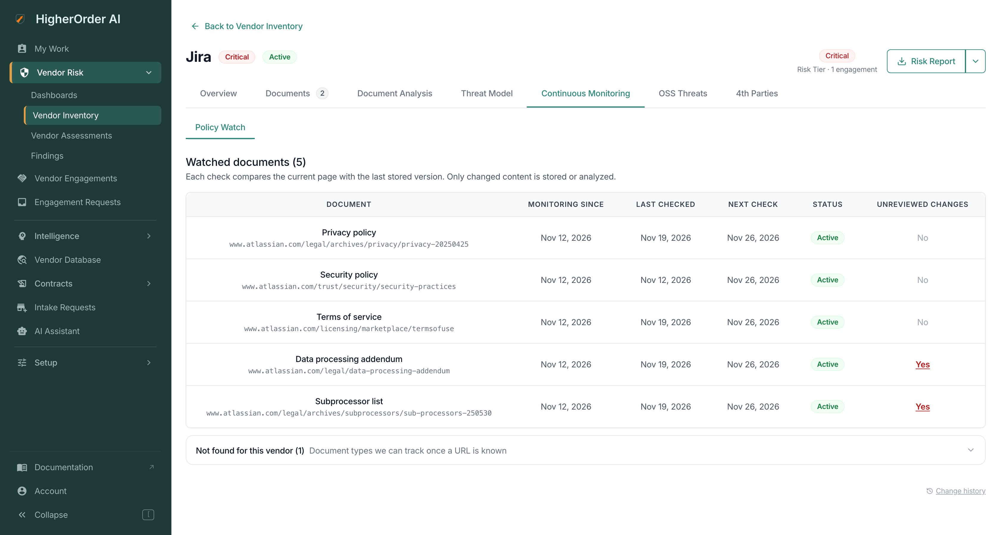

Policy Watch re-checks a vendor's public policy documents on a schedule and, when the wording changes, stores the difference and puts it in front of a reviewer as an unreviewed change on the vendor profile, under **Continuous Monitoring → Policy Watch**.

## What it does

- Lists the public policy documents found for a vendor, with when each was last checked and when it is due next.
- Re-checks each document on its cadence and records a change only when the substance of the text has changed. A new "Last updated" date on its own is not a change.
- Shows each change as the passages removed and the passages added, with an AI summary in which every claim is tied to a passage quoted from the stored text.
- Marks a change **Unreviewed** until someone opens it.
- Lists your engagements with the vendor beside the change, with the data each one shares, and creates a finding on the engagements you select.

Policy Watch is advisory. Nothing it records feeds a risk score, band, or rating.

## Inputs

**Watched document types.** Six kinds of public document are watched:

| Document | Checked every |
|---|---|
| Privacy policy | 7 days |
| Security policy | 14 days |
| Terms of service | 7 days |
| Data processing addendum | 7 days |
| Subprocessor list | 7 days |
| AI & data usage policy | 7 days |

**Where the documents come from.** The platform looks for these documents on the vendor's public site when a vendor intake is submitted or an engagement is created, and stores a baseline copy of each one it finds. The vendor record must carry a website domain; a vendor that was captured recently is not searched again. The data processing addendum, subprocessor list, and AI policy are looked for only while scheduled monitoring is on for the tenant; a vendor first captured while it was off picks them up the next time one of those events occurs for it.

**Tenant configuration.** Two switches, described under [Turning it on](#turning-it-on).

## Outputs

### Watched documents table

One row per document that has a known URL.

| Column | Meaning |
|---|---|
| **Document** | The document type and its URL |
| **Monitoring since** | When the document was first captured |
| **Last checked** | The most recent check, whether or not anything changed |
| **Next check** | When the next scheduled check is due. Shown only while the row is Active |
| **Status** | **Active** — on a schedule. **Blocked by robots.txt** — the vendor's site disallows automated access to the page, so it is not fetched. **Paused** — the document has no next check scheduled |
| **Unreviewed changes** | **Yes** when at least one recorded change has not been opened |

Below the table, a collapsed **Not found for this vendor** section lists the document types that could not be located on the vendor's site.

<Frame caption="Vendor profile → Continuous Monitoring → Policy Watch: the watched documents for a vendor.">
  
</Frame>

### Change list

Clicking a row opens a side panel titled **Changes to** *document*, with the URL, the monitoring start date, and the number of changes. Changes are listed newest first. Each shows a one-line headline, the date the change was found, the "updated" date the document itself states where it prints one, and either **Unreviewed** or **Reviewed** *date*.

A document with no recorded change says that only the baseline copy is stored. **Open current document** opens the live page in a new browser tab.

### A change

Opening a change shows:

- **AI summary** — *What changed* and *Also worth a look*, each a list of claims. Under every claim is the passage it rests on, quoted from the stored text and labelled *previous version* or *current version*. A footer states how many quoted passages were verified against the stored versions.
- **Your engagements with this vendor** — each engagement with its owner and whether company data is shared with the vendor: **Yes** with the data classes, **No**, or **Unknown** when it is not recorded. This is read from the engagement's Service Risk Profile, or from its intake when there is no profile. Engagements that share data are preselected.
- **Full change** — two panes, *Removed (previous version)* and *Added (current version)*, with the passages the summary quotes highlighted.

## How it works

<Steps>
  <Step title="A check comes due">
    The schedule is scanned hourly. Each watched document whose next check has passed is checked, at most once per vendor per day.
  </Step>
  <Step title="The page is fetched">
    The vendor's `robots.txt` is read first; a page it disallows is marked **Blocked by robots.txt** and never fetched. Requests to one host are spaced out, following any crawl delay the site declares. When the site reports the page as unmodified since the last check, the check is recorded and nothing more happens.
  </Step>
  <Step title="The text is compared">
    The page text is normalised — date stamps, tracking parameters, and whitespace differences are removed — and compared with the last stored version. When the normalised text is the same, no new version is stored and no summary is written.
  </Step>
  <Step title="A change is recorded">
    When the text differs, the new version is stored with a line-by-line difference against the previous one, and a summary is drafted. Every claim in the summary must quote a passage that occurs in the stored previous or current text. A claim whose quote cannot be found is dropped, and a summary with no surviving claim is not shown.
  </Step>
</Steps>

### Reviewing a change

1. Open the vendor's **Continuous Monitoring → Policy Watch** tab and click a row that shows **Yes** under Unreviewed changes.
2. Open the change. Opening it is what marks it **Reviewed**, with the date; this clears the Unreviewed marker for everyone in the tenant.
3. Read the summary against the full change.
4. To act on it, tick the engagements the change matters to and select **View suggested action**. The platform drafts an action — a title, steps, an owner role, and a suggested due period — into an editable finding description. Set the **Criticality** (Critical, High, Medium, or Low; High is preselected) and the **Remediation due** date, then select **Create finding**.

One finding is created per selected engagement, with the description you edited. An engagement that already carries a finding for this change is not given a second one; the result says how many were created and how many already existed. The findings appear in [Findings](/findings) with **Policy Watch** as their source.

When no summary could be produced, the panel says why — the summary failed, no claim could be verified, or summaries are not configured — and the full change is still shown. When no action could be drafted, the description starts empty for you to write.

## Turning it on

Two separate switches control Policy Watch. They do different things.

| Switch | What it controls | Who sets it | Default |
|---|---|---|---|
| **Policy Watch module** | Whether the **Continuous Monitoring** tab appears on vendor profiles | HigherOrder. It is not listed in Tenant Settings and a tenant administrator cannot change it | On |
| **Policy Watch scheduled monitoring** | Whether documents are re-checked on their cadence | The tenant, under Administration → Tenant Settings → **Policy Watch**. Requires the tenant-settings permission, which Admins hold by default | Off |

Because the scheduled-monitoring setting is off by default, a tenant that can see the tab still has no recurring checks until an administrator turns the setting on. Each check fetches the vendor's page and, when the content has changed, runs an AI comparison; both carry a per-check cost, which is why the setting is an explicit choice.

While scheduled monitoring is off:

- No scheduled checks run for the tenant.
- Documents are still captured once, when a vendor intake is submitted or an engagement is created.
- The tab shows an amber notice saying that scheduled monitoring is off, and keeps showing any history already recorded.

To hide or restore the tab itself, contact HigherOrder. The module switch only decides whether the tab is shown; it does not start or stop the checks.

See [Administration](/administration#tenant-settings) for Tenant Settings.

## Limitations

- **Public documents only.** Pages behind a login, and documents a vendor shares only on request, are not watched.
- **The watch list cannot be edited.** There is no way to add a URL, correct a wrongly identified one, or remove a document from the tab. A document type listed under *Not found for this vendor* stays there until a later capture locates it.
- **The cadence is fixed.** Seven days, or fourteen for a security policy. It is not configurable per tenant, vendor, or document, and there is no on-demand check.
- **A site that disallows automated access is not checked.** The row shows *Blocked by robots.txt* and no change will be reported for it.
- **No notification is sent.** A detected change does not send email and does not appear in My Work. It is visible only as **Yes** in the Unreviewed changes column on that vendor's tab.
- **Reviewed means opened.** There is no separate approve or dismiss step, and no per-user review state.
- **The summary can be absent.** Every claim shown is tied to a quoted passage, but a change can have no summary at all. The removed and added text is the record; read it for any change that matters.
- **Data shared is display only.** The engagement list does not judge whether a change is material to an engagement. Which engagements get a finding, and at what criticality, is the reviewer's decision.
- **No effect on scores.** Policy Watch changes do not move a vendor's Risk Band, an assessment score, or an engagement rating.
