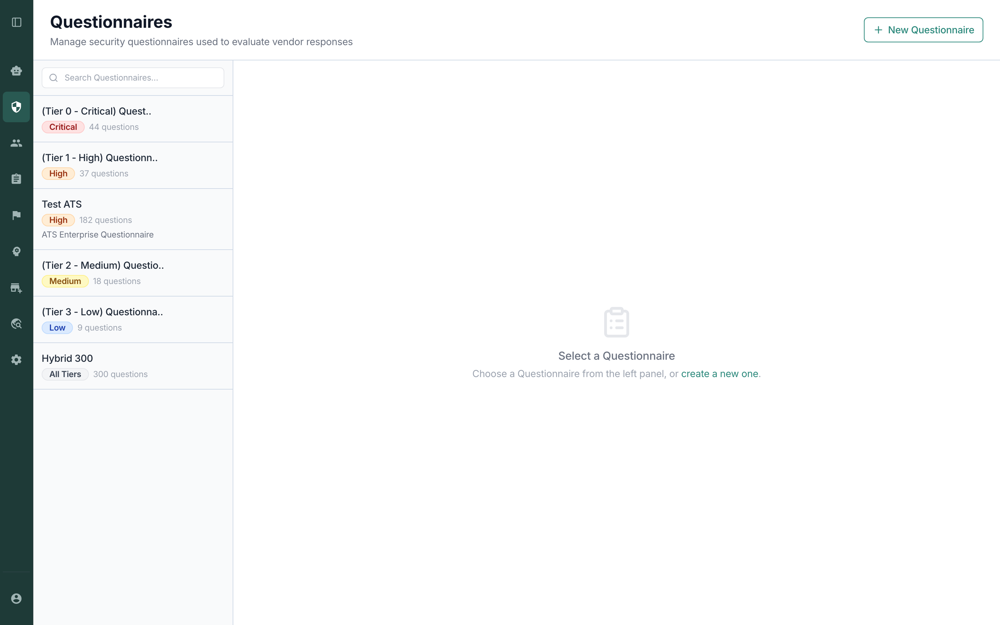

A library of reusable security questionnaires, each carrying a questionnaire type. Templates can be built from scratch, seeded from a built-in security questionnaire, or extracted from an Excel workbook you upload — including 450-plus-question, multi-sheet workbooks. Each template defines its questions' answer types, conditional sub-questions, evidence policy, and the deterministic scoring model used to compute the [assessment risk score](/concepts/risk-scoring).

<Frame>
  
</Frame>

## What it does

- Stores multiple templates per tenant. Each template is named, described, given a **Type** from the tenant's list of questionnaire types, and optionally carries a stable **plan slug** that engagement assessment plans reference.
- Extracts questions from an uploaded Excel file using model-driven extraction — one call per sheet, so large workbooks import reliably and atomically — or seeds from a built-in questionnaire.
- Supports four answer types — **text, yes/no, single-select, multi-select** — with per-option answer choices, customer-authored vendor guidance, and per-option numeric scores.
- Nests **sub-questions** one level under a parent, shown to the vendor only when the parent's answer matches a condition, and evaluated with the parent's question and answer as context.
- Sets the template's **evidence policy**: evidence required (default), answers sufficient (attestation), audited-reports sufficient, or answers or audit reports accepted — plus an optional cross-answer consistency check that runs after vendor submission.
- Carries a **due window** — the number of days (1–100, default 15) a vendor gets to respond to this questionnaire. An assessment launched without an explicit deadline derives its due date from the due windows of the questionnaires in scope, counted once per template.
- Owns the **scoring configuration** — question weights, score ranges and direction, per-option scores, and rating bands — on a dedicated Scoring page with a best-case/worst-case preview.
- **Archives** templates instead of deleting them; archived templates leave the active list and can no longer be chosen for a new assessment, but keep existing assessments working, and can be restored.
- Exports any template to Excel (one worksheet per category) in a format that round-trips back through upload.

## Building a template

### Question sources

- **Spreadsheet upload** (`.xlsx`, `.xlsm`, `.xls`, or `.csv`). A macro-enabled workbook is read like `.xlsx` — cell values only; macros are never run. Extraction runs one model call per sheet with automatic retry and row-splitting for oversized sheets, so large multi-sheet workbooks import without truncation. The import is atomic — if any sheet fails, nothing is imported and the failing sheet is named. Extraction picks up answer types and options, guidance, dotted-number parent/child structure, and show-when conditions.
- **Built-in seed** — a starter security questionnaire.
- **Manual** — one question at a time, with drag-to-nest for sub-questions.

### Type

Each template carries a **Type**, chosen in the template editor and shown as a badge on the template. The type groups the dashboards, drives the engagement filters, and picks the assignment route. The list of types is a tenant setting — Administration → Tenant Settings → **Questionnaire types** — where an administrator renames any type or adds new ones. The types the product behaves on, such as PQ, RA, Data Localization, Outsourcing, Offboarding, and Other, are reserved: they can be relabelled but not removed. A type still given to a template, or routed to named people, cannot be removed until that is changed. An assessment whose questionnaire is of type Offboarding is named as an offboarding assessment and carries an amber chip.

### Per-question fields

- **Question text** and **question number** — numbers are assigned once, at import or when a question is added (sub-questions as `3.1`, `3.2`, …); a question whose text already carries an authored tag (e.g., `A. `, `4.2 `) keeps that tag. Numbers are stable: reordering, re-categorizing, nesting, or deleting questions never renumbers the rest, so a number quoted to a vendor — or matched to your incumbent system's labels — stays put. Gaps after a delete are expected.
- **Answer type** — Text, Yes/No, Single-select, or Multi-select. Select types take 2–12 options.
- **Expected answer** (text questions) or **answer options** (choice questions). On a choice question, the expected answer must be picked from the configured options — a free-text expectation that matches no option cannot be saved, since it would silently fall back to model review instead of deterministic matching.
- **Guidance** — optional customer-authored help shown to the vendor on the portal.
- **Sub-question settings** — the parent to group under and the parent answers that reveal the question. Only yes/no and select parents can gate sub-questions; a hidden sub-question is excluded from the vendor's completion stats and submit gate, and reappears with its state intact if the parent's answer changes. Withdrawing a parent from an assessment's scope withdraws its follow-ups with it, and restoring it brings them back.
- **Control crosswalk** — the SOC 2 criteria and ISO 27001 controls the question maps to, shown read-only on the row (below).

### Control crosswalk

A question can carry a map to audit-framework controls — `SOC 2: CC3.2, CC6.1 · ISO 27001: A.6.3, A.8.2`. Such a question is a **control crosswalk** question: the vendor's audit report, not the vendor's answer, is the evidence. At evaluation time the platform reads a roster of controls from the accepted SOC 2 report (per criterion: the controls, whether they were tested, and any exceptions) and judges the question from it — **Verified** when every mapped criterion is in scope and tested with no exceptions, **Partial** on an exception or an untested criterion, capped when no report is on file. The verdict is deterministic and costs no model call to recompute when an answer changes.

By default a mapped question is verified from the tested controls alone. Where a control being tested is not enough — the question asks for something specific the report must also cover — tick **Report must also cover the question's specifics** on the row; such questions show a *Report coverage required* badge in the list and additionally require the report passage to address the question's substance. The maps are set on the template and snapshotted onto each assessment at launch; the coverage rule is read live, so marking it reaches in-flight assessments at their next evaluation. See the reviewer's side under [Vendor Assessments](/vendor-risk/assessments#control-mapped-questions).

### Evidence policy (evaluation mode)

Set per template and snapshotted onto each assessment at creation, so changing the template later never changes an in-flight assessment:

| Mode | Behavior |
|---|---|
| **Evidence required** (default) | Every answer is evaluated against uploaded evidence |
| **Answers sufficient** | Attestation mode — a matching answer verifies as-is; evidence is requested only where the question explicitly demands a document |
| **Answers or audit reports accepted** | Everything audited-reports-sufficient does, and a written answer to a question with an authored expected answer is judged on whether it answers the question rather than on evidence. A complete answer is verified; one missing a specific the question names is held with exactly those gaps; a bare "N/A", an off-topic answer, or a follow-up that contradicts its parent's answer is held. A question whose expected answer demands a document is never verified without one |
| **Audited reports sufficient** | A specific statement in an accepted document counts as primary evidence for practice questions; questions demanding a deliverable still require it. Which document types are accepted comes from the tenant's [Evidence policy](/administration#evidence-policy) — by default every audit-report type and every policy type, with certificates and attestation letters as ordinary evidence |

The mode can also be set per assessment when a vendor assessment is created; left alone, the questionnaire's default applies. In the fourth mode the reviewer reads the verdict as a verdict on the answer — *Answer accepted*, *Answer incomplete*, *Document required* — and the vendor sees "*What is missing from your answer*".

A separate **consistency check** toggle runs a cross-answer contradiction sweep after the vendor submits.

### Scoring configuration

The **Scoring** page (from the template header) is the single owner of everything the [assessment risk score](/concepts/risk-scoring) reads: per-option scores, each question's score range and direction, question weights, and the rating band ranges for each top-level category. A preview simulator shows the score a best-case and worst-case response set would produce. Weights shown elsewhere in the template are read-only.

A template with no option scores or bands produces an unrated assessment. The security and privacy questionnaires a newly provisioned US tenant starts with arrive scored, with Low 0–10 / Medium 11–15 / High 16–100 bands on every top-level category; scores, weights, and bands stay editable here.

### Expected Documents

The **Expected Documents** tab is one guidance list of the documents the vendor portal suggests uploading (SOC 2 Type II, Privacy Policy, VAPT Report, …). Nothing on it is required — a vendor can skip any of them and add others — and it sets no validity window: how long a document stays current comes only from the tenant's [Evidence policy](/administration#evidence-policy). A new template starts with four entries (SOC 2 Type II, Privacy Policy, VAPT Report, Policy Documents); delete any, or **Remove all**, in which case the vendor is asked for no specific document and can still add their own. Changes apply to new assessments only.

## Plan slugs

A template can carry a short stable **slug** (e.g., `pq-standard`). Engagement assessment plans reference templates by slug, not by name, so renaming a template never breaks a plan. Changing or archiving a slug that a plan or workflow still references is blocked with an "in use" error.

## Archival

Templates are archived, not deleted. Archived templates:

- disappear from the active list and from the questionnaires offered when an assessment is launched,
- keep every existing assessment that references them working,
- sit in a collapsed "Archived" section and can be **restored** at any time.

Archiving — and changing the slug — is blocked while any engagement workflow uses the template, offboarding workflows included; the error names the workflow and step that use it.

## How templates are used at assessment time

- **Launch.** An engagement's classifier selects questionnaires by plan slug; a tenant-level launch mode decides whether multiple questionnaires run as **parallel** assessment tracks or **merge** into one assessment. A merged assessment records which template (and which category subset) each block of questions came from, why it was added, and by whom; one questionnaire is primary and governs the expected documents and evidence policy.
- **Scoring.** Each questionnaire scores against its own template's weights and bands; a merged assessment's score is the average across its questionnaires.
- **Import.** When a vendor returns a filled workbook by email instead of the portal, [questionnaire import](/vendor-risk/assessments) matches it against the template library and lands the answers on a standard assessment.

## Limitations

- No template duplication/clone and no version history.
- Replacing a template's questions via re-upload is destructive and irreversible; the action requires an explicit confirmation. A re-upload or Excel round-trip does not carry control crosswalk maps or their coverage rule.
- The question filter dropdown on the template detail still filters by Text and Yes/No only; select-type questions appear under All.
- Scoring changes never re-score completed assessments.
